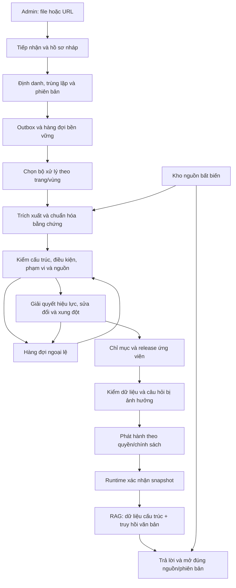

# Campus 24/7 — Thiết kế và kế hoạch triển khai tự động hóa tài liệu và RAG

Ngày lập: **25/10/2026**, múi giờ nghiệp vụ `Asia/Bangkok`.

Trạng thái: **Kế hoạch triển khai sau — chưa phải tính năng đã hoàn thành**.

Yêu cầu gốc: admin thêm file hoặc liên kết; hệ thống tự tiếp nhận, xử lý, nhận diện phiên bản, kiểm chứng, đưa phần đủ điều kiện vào phục vụ và để chatbot chọn đúng nguồn. Tối đa hóa tự động hóa và sự tiện lợi, đồng thời giảm quota, thời gian làm lại và lỗi nội dung.

Tài liệu này tổng hợp thiết kế đã thảo luận, phản biện và thứ tự triển khai. Các lựa chọn được ghi là **đề xuất** chưa được coi là quyền thay đổi bảo vệ hoặc quyền production. Đây không phải cổng phê duyệt giấy tờ mới. Khi được giao thực hiện, tiếp tục kỹ thuật trong quyền hiện có; chỉ tách các hành động thực sự thiếu thông tin/quyền theo AGENTS.md. Không triển khai code, migration, phát hành, lịch đồng bộ hoặc thay đổi runtime chỉ bằng việc lưu tài liệu này.

## 1. Kết quả sản phẩm cần đạt

### 1.1. Hành trình bình thường

1. Admin đăng nhập, kéo thả một/nhiều file hoặc nhập URL.
2. Hệ thống nhận tệp an toàn, trả mã công việc và trạng thái ngay; không giữ kết nối HTTP chờ OCR.
3. Tự nhận diện nguồn, loại văn bản, phạm vi và khả năng trùng/cập nhật.
4. Tự trích xuất theo loại nội dung; tái sử dụng kết quả còn hợp lệ.
5. Tự kiểm bằng chứng, điều kiện, cấu trúc, phạm vi, quan hệ sửa đổi và quyền.
6. Tạo ứng viên tìm kiếm và kiểm thử theo phần bị ảnh hưởng.
7. Phát hành bằng cơ chế được ủy quyền, nếu đáp ứng đầy đủ chính sách hiện hành.
8. Xác nhận runtime thực sự dùng release mới rồi hiển thị “Đang sử dụng”.
9. Chatbot trả lời đúng nguồn, phiên bản, thời điểm và đối tượng; admin không chạy script hoặc restart chatbot.

### 1.2. Hành trình ngoại lệ

- Hệ thống chỉ hỏi điểm ảnh hưởng đến tính đúng: một ngày hiệu lực, một phạm vi khóa, một quan hệ thay thế hoặc một ô chưa đọc rõ.
- Admin thấy ảnh/đoạn gốc, đề xuất của hệ thống, lý do và phạm vi ảnh hưởng trong cùng màn hình.
- Kết quả đã làm được giữ; sau xác minh chỉ tiếp tục phần liên quan.
- Phần độc lập đủ bằng chứng có thể tiếp tục theo cơ chế hiện hành. Không tách bỏ điều kiện/ngoại lệ để tạo một “phần đạt” sai nghĩa.
- Lỗi kỹ thuật có retry giới hạn; thiếu bằng chứng nghiệp vụ chuyển chờ xác minh, không retry mô hình vô hạn.

### 1.3. Ý nghĩa của “dùng ngay”

“Dùng ngay” là tự trở nên sử dụng được sau xử lý và xác nhận runtime, không cần người lập trình. Không cam kết mọi PDF scan xuất hiện trong RAG tức thời. UI phân biệt rõ: đã nhận, đang xử lý, cần xác minh, đã chuẩn bị, đang sử dụng. Tài liệu thiếu căn cứ không được gắn nhãn chính xác chỉ để đạt thời gian xử lý ngắn.

## 2. Hiện trạng được kế thừa và giới hạn bằng chứng

### 2.1. Những phần đã có trong repository

| Phần | Điểm nối hiện có | Hướng kế thừa |
|---|---|---|
| API quản trị tài liệu | `services/api/src/campus247/presentation/knowledge_platform.py` | Mở rộng API thật, không tạo catalog song song |
| Nghiệp vụ knowledge | `services/api/src/campus247/application/knowledge/` | Bổ sung nghiệp vụ, tách khỏi router |
| Repository, storage, runtime | `services/api/src/campus247/infrastructure/knowledge/` | Giữ tenant, hash, artifact bất biến, release/ack |
| Worker nền | `services/worker/src/campus247_worker/knowledge.py` | Giữ job, lease/fencing và checkpoint; tăng mức tái sử dụng |
| Parser subprocess | `services/worker/src/campus247_worker/knowledge_parse.py` | Giữ cô lập tác dụng phụ; bổ sung adapter định dạng |
| Cấu trúc chương trình | `application/knowledge/curriculum_geometry.py` và các helper | Dùng lại chứng cứ ô/đường nối, tránh suy từ chữ phẳng |
| UI quản trị | `apps/web/src/features/knowledge/KnowledgePlatform.tsx` | Bổ sung trải nghiệm tiếp nhận, tiến độ, so sánh và ngoại lệ |
| Pipeline/script nguồn HUCE | `scripts/huce_document_pipeline.py`, `scripts/huce_public_document_pipeline.py` | Tái dùng bộ xử lý; đưa điều phối và cấu hình vào luồng chung |
| Migration | `services/api/migrations/versions/` | Kiểm heads thực tế; bổ sung schema, không đoán revision tiếp theo |
| Kiểm thử | `tests/knowledge_platform/`, `tests/unit/retrieval/`, `tests/api/` | Giữ hồi quy và bổ sung bộ nghiệm thu độc lập |

API upload hiện có ở `/v1/knowledge/platform/uploads`, yêu cầu file và metadata rõ. Việc cho phép admin chỉ thêm file đòi hỏi một bước intake nháp rồi giải quyết metadata; không điền ngày hiệu lực giả vào hợp đồng hiện tại để vượt kiểm tra.

### 2.2. Baseline tham khảo

- Danh mục đã ghi: 117 nguồn, gồm 24 CNTT, 22 dùng chung, 71 để sau; 22 nguồn trong nhóm tập trung còn giới hạn, sáu nguồn CNTT chưa rõ khóa.
- Báo cáo gần nhất ghi generation 27, policy generation 3, 114 tài liệu phục vụ và ba nguồn tương đương. Đây là trạng thái đã ghi trước kế hoạch; phải kiểm lại khi triển khai.
- Lượt 224 câu trước có 223 đạt theo bộ chấm hiện hữu, 167 `answered`, 57 `abstained`, sáu ca nối tiếp. Thời gian hoàn tất p50 khoảng 6,86 giây, p95 khoảng 9,48 giây. Không coi các số này là benchmark mới hoặc đo tải production.
- Kiểm định phát hiện bộ chấm có thể bỏ lọt chi tiết thừa sai; bộ chọn tài liệu có thể bỏ một nguồn ở câu hỏi nhiều văn bản; runtime đọc lặp metadata/artifact.
- Root workspace có nhiều thay đổi sẵn và năm file đã bị xóa từ trước. Bảo toàn toàn bộ; không dùng trạng thái Git sạch làm điều kiện để “dọn” dữ liệu.

### 2.3. Phạm vi phát triển đầu tiên

- Nguồn công khai HUCE thuộc CNTT và tài liệu dùng chung; hỗ trợ tiếp nhận nguồn mới trong phạm vi này.
- Kho ngoài nhóm tập trung giữ nguyên. “Để sau” là ưu tiên xử lý, không tự thu hồi các thành viên đang phục vụ.
- Triển khai trên nền hiện có, phù hợp máy local RAM 16 GB; đo lại khả năng thực tế.
- SSO/API học vụ, điểm/lịch cá nhân và tư cách sinh viên thật vẫn cần kết nối và quyền riêng. Kho công khai không thay thế các kết nối đó.
- Không bao gồm tự xác lập hiệu lực pháp lý, xác thực chữ ký bằng suy đoán, tự cấp vai trò hoặc tự công nhận quyết định của cán bộ HUCE.

## 3. Nguyên tắc thiết kế bắt buộc

1. Bằng chứng nguồn là gốc; vector, bản tóm tắt và câu trả lời đều là dữ liệu dẫn xuất.
2. Mỗi đơn vị nội dung có locator, hash và phụ thuộc điều kiện. Không cắt ngữ cảnh làm thay đổi nghĩa.
3. Tự động hóa là một chính sách có phạm vi và audit; không tạo tài khoản khác để giả lập người phê duyệt độc lập.
4. Phân biệt “xử lý thành công”, “được phép dùng” và “runtime đang dùng”.
5. Ngày upload, ngày ban hành và ngày hiệu lực là các trường khác nhau.
6. Tái sử dụng chỉ khi input thực tế, cấu hình xử lý và ranh giới quyền khớp.
7. Retry không làm trùng tài liệu, job, quan hệ hoặc release. Không hứa exactly-once xuyên mọi hệ thống.
8. Chuyển đổi bổ sung, có thể đối chiếu và phục hồi; không ghi đè nguồn/lịch sử/evidence/backup.
9. Không giảm auth, phân quyền, hash, kiểm chứng, preview/confirmation hoặc ngưỡng đang có để đạt tự động hóa.
10. Chất lượng được đo bằng câu mới và kết quả đúng, không bằng số file, chunk, release hoặc tỷ lệ từ khóa.

## 4. Các quyết định thiết kế và mặc định đề xuất

| ID | Quyết định | Mặc định đề xuất | Khi nào cần xử lý thêm |
|---|---|---|---|
| D-01 | Nguồn tiếp nhận | File/URL qua admin đã xác thực | URL/nhà xuất bản chưa có trong phạm vi |
| D-02 | Định danh tài liệu | Tenant + nhà ban hành + loại + số/năm + phạm vi; có ID nội bộ bất biến | Thiếu số văn bản hoặc nhiều ứng viên cùng tên |
| D-03 | Hợp nhất nguồn | Đề xuất quan hệ, giữ provenance từng lần tiếp nhận | Trùng bytes nhưng khác nguồn/quyền/khóa |
| D-04 | Hiệu lực | Chỉ từ căn cứ nguồn/khai báo được xác minh | Chỉ có ngày đăng bài hoặc ngày file |
| D-05 | Sửa đổi | Đến điều/mục/ô có locator, giữ quan hệ có phiên bản | Chỉ “có vẻ mới hơn” mà thiếu căn cứ thay thế |
| D-06 | Tự phát hành | Chỉ theo phạm vi ủy quyền cụ thể, sau các kiểm bắt buộc | Cơ chế hiện hành đòi xác nhận/người duyệt chưa có ủy quyền tương ứng |
| D-07 | Ngoại lệ | Một hồ sơ cho nguyên nhân gốc, gộp phần bị ảnh hưởng | Không biến từng token OCR thành một yêu cầu admin |
| D-08 | Trích xuất | Native parser trước, OCR/vùng ảnh khi cần | Benchmark parser trên bảng/sơ đồ HUCE chưa đủ |
| D-09 | Tài liệu chỉ có ảnh | Xử lý cấu trúc ảnh, kiểm đơn vị quan trọng | Không dùng số ký tự native làm bằng chứng không cần OCR |
| D-10 | Bộ lưu trữ | PostgreSQL/pgvector + artifact SSD + worker hiện có | Thêm hệ thống chỉ khi số đo cho thấy cần |
| D-11 | Cache | Theo input/config/model/tenant; bằng chứng gắn riêng từng nguồn | Không dùng “file cùng tên” hoặc mtime làm khóa |
| D-12 | Giới hạn chi phí | Kế thừa ngân sách và thêm đo từng bước | Giá trị mới phải có căn cứ, không reset ledger |
| D-13 | Định dạng | PDF/TXT trước; DOCX/HTML qua adapter kiểm chứng | Không quảng bá định dạng chưa qua toàn tuyến |
| D-14 | Đồng bộ URL | Theo lịch/nguồn được cấu hình khi triển khai | Kế hoạch này không tự tạo automation hoặc gửi thông báo |
| D-15 | Lịch sử | Giữ nguồn/bản cũ; truy vấn lịch sử có điều kiện | Không coi superseded là được xóa |
| D-16 | Ngưỡng nghiệm thu | Giữ hợp đồng/ngưỡng hiện có; đề xuất thêm sau baseline | Không tự nâng/hạ kỳ vọng để chạy xanh |

Đây là bảng để người triển khai biết cách xử lý, không yêu cầu người dùng duyệt từng lựa chọn kỹ thuật. D-06 phải được cụ thể hóa thành đề xuất thay đổi chính xác nếu cần thay một bảo vệ hiện có; thiết kế tổng thể không tự cấp quyền đó.

## 5. Kiến trúc đích



### 5.1. Ranh giới thành phần

- Router: xác thực, kiểm input, chuyển command; không chứa quy tắc hiệu lực hoặc nội dung HUCE.
- Application services: intake, nhận diện, lập kế hoạch xử lý, xác minh quan hệ, admission, phát hành và truy vấn.
- Domain: phạm vi áp dụng, vòng đời, quan hệ sửa đổi, đơn vị bằng chứng, quyết định chọn phiên bản.
- Infrastructure: DB, filesystem, fetch URL, parser/OCR/model, tìm kiếm và telemetry.
- Worker: điều phối bước bền vững, lease/fencing, tài nguyên, retry và checkpoint.
- UI: trạng thái nghiệp vụ, ảnh nguồn, ngoại lệ và giải thích quyết định; không lộ bí mật/hạ tầng.

### 5.2. Nguồn sự thật và nhất quán

- PostgreSQL giữ trạng thái nghiệp vụ và quan hệ; artifact bất biến giữ payload và sản phẩm xử lý.
- Outbox được ghi cùng transaction tạo/thay đổi công việc. Consumer chịu được nhận lặp.
- File đã ghi nhưng DB chưa commit được giữ để reconciliation, không tự dọn.
- Job/event phải có tenant, định danh mục tiêu, revision và correlation ID; không chứa credential.
- Không coi nhiều bản sao riêng của PostgreSQL/SQLite là snapshot nguyên tử. Cần cơ chế watermark/quiesce có kiểm chứng khi phục hồi xuyên kho.

## 6. Mô hình dữ liệu khái niệm

Các tên dưới đây là tên logic đề xuất. Trước migration phải ánh xạ sang bảng hiện có; không tạo thực thể trùng chỉ vì tên khác.

| Thực thể | Thuộc tính cốt lõi | Ràng buộc và mục đích |
|---|---|---|
| DocumentFamily | id, tenant, issuer, loại, định danh nguồn, phạm vi | Nhóm nghiệp vụ; không quyết định chỉ bằng tiêu đề giống nhau |
| DocumentEdition | id, family_id, số văn bản, ngày ban hành, phạm vi, revision | Một lần ban hành/đính chính có bằng chứng |
| SourceObservation | id, edition_candidate, URL/upload, received_at, publisher, artifact_id | Giữ từng lần thấy nguồn; một bytes có thể có nhiều observation |
| Artifact | id, tenant, hash, size, MIME, object_key, kind | Bất biến; quyền truy cập qua app, không trả đường dẫn filesystem |
| Rendition | id, edition_id, source_hash, processor/schema/config revisions | Bản OCR/trích xuất của một edition; không phải văn bản pháp lý mới |
| EvidenceUnit | id, rendition_id, loại, verbatim, normalized_payload, locator, hash | Một điều khoản/ô/hàng/quan hệ có bằng chứng |
| EvidenceDependency | unit_id, depends_on, dependency_kind | Giữ tiêu đề, điều kiện, ngoại lệ, chú giải và phần nối trang |
| Applicability | đối tượng, chương trình, khóa, năm, địa bàn, effective interval, căn cứ | Tách unknown khỏi không giới hạn; không dùng rỗng thay cho ALL |
| DocumentRelation | from/to, loại, target_unit, effective interval, witness, decision revision | Thay thế/sửa một phần/bổ sung/đính chính/alias; không sửa mất lịch sử |
| ProcessingRun | id, tenant, target, pipeline/config revision, trạng thái, ngân sách | Một lần điều phối có thể tiếp tục |
| StageResult | run/stage/input hash/config hash/output hashes/status | Checkpoint bất biến hoặc event nối tiếp; một lần chạy lại không ghi đè receipt |
| ReviewIssue | nguyên nhân, vùng ảnh, trường thiếu, dependencies, assignee, resolution | Gộp ngoại lệ theo nguyên nhân; quyết định mới vô hiệu hóa đúng phần phụ thuộc |
| AdmissionDecision | edition/units, quyền, policy revision, evidence manifest, actor, kết quả | Phân biệt xác minh kỹ thuật với thẩm quyền phát hành |
| ReleaseManifest | members, unit/index hashes, policy generation, expected generation | Đóng gói snapshot nhất quán cho runtime |
| ServingAck | instance/boot, release/generation, scope, expiry, health | “Đang dùng” chỉ đúng khi ack hợp lệ |
| CostEvent | stage, run, model/parser, calls/tokens/time/resource, ledger reference | Hạch toán chi phí; không tăng cap hoặc ghi giá trị giả |

### 6.1. Các loại phiên bản

1. **Edition nghiệp vụ:** nội dung/phạm vi do nguồn ban hành thay đổi.
2. **Rendition kỹ thuật:** sửa đọc chữ, ô bảng hoặc tọa độ của cùng nguồn.
3. **Index build:** input embedding, chunker, model/revision hoặc cấu hình tìm kiếm đổi.

Ba loại có ID riêng và quan hệ truy vết. Đổi rendition có thể đòi kiểm lại câu trả lời nhưng không đổi ngày ban hành hoặc tự tạo quan hệ thay thế.

### 6.2. Định danh và chống trùng

- Idempotency request: cùng actor/tenant/key và fingerprint trả cùng kết quả; key cũ với payload khác trả lỗi xung đột.
- Trùng artifact: cùng hash/size được xem xét tái sử dụng bytes trong phạm vi cho phép; không lộ sự tồn tại của tenant khác.
- Trùng edition: cần bằng chứng định danh nghiệp vụ và phạm vi, không chỉ hash hoặc tên.
- Trùng nội dung tại hai URL: giữ cả observation; alias cần căn cứ, không tự hợp nhất quyền.
- Cùng mã môn tại nhiều ô: giữ occurrence riêng; không ép mã môn thành unique toàn kho.
- Source identity chưa chắc: tạo candidate riêng để giải quyết, không nhập vào family có thể sai rồi ghi đè bản đang dùng.

## 7. Thời gian, hiệu lực và chọn phiên bản

### 7.1. Các mốc cần lưu

| Trường | Ý nghĩa | Cấm suy từ |
|---|---|---|
| issued_at | Ngày ban hành in trên nguồn | Ngày upload, tên file, HTTP Last-Modified |
| published_at | Ngày xuất bản trên kênh nguồn | Ngày hiệu lực nếu nguồn không nói |
| valid_from/valid_to | Khoảng áp dụng nghiệp vụ | Thời điểm hệ thống xử lý thành công |
| observed_at | Lần hệ thống thấy payload | Ngày ban hành |
| recorded_at | Lần quyết định/quan hệ được ghi nhận | Ngày quy định bắt đầu áp dụng |
| reviewed_at | Lần kiểm bằng chứng | Phê duyệt của HUCE nếu actor là dịch vụ kỹ thuật |

Lưu timezone/độ chính xác của mốc. Ngày chỉ có day không được tự coi là timestamp UTC chính xác. Quy tắc chuyển day thành interval phải rõ, dùng múi giờ nghiệp vụ. Unknown được giữ là unknown; NULL không mặc định “đang hiệu lực vĩnh viễn”. Khoảng ngày không hợp lệ phải bị từ chối; các quy tắc chồng lấn chỉ áp dụng nơi nghiệp vụ thực sự yêu cầu độc quyền.

### 7.2. Hai trục truy vấn

- Truy vấn quy định áp dụng tại T: dùng valid time và phạm vi đã xác minh.
- Tái hiện hệ thống đã biết gì tại K: dùng observation/decision recorded time và snapshot đã phục vụ.
- Câu hỏi lịch sử phải nêu rõ đang trả lời theo quy định của thời điểm nào hay đang tái hiện câu trả lời cũ.
- Bản phát hiện muộn có thể áp dụng cho thời điểm trước; không sửa mất lịch sử hệ thống đã phục vụ.

### 7.3. Quy tắc quan hệ phiên bản

1. Xác định cùng chủ đề và đúng phạm vi trước khi so phiên bản.
2. Quan hệ thay toàn bộ chỉ có khi có căn cứ rõ, được ghi locator/hash và quyết định hợp lệ.
3. Sửa một phần trỏ đến điều/mục/ô; giữ phần gốc chưa bị sửa và điều kiện chung còn áp dụng.
4. Bổ sung tạo quan hệ kết hợp, không tự phủ định bản gốc.
5. Bản tương lai được chuẩn bị nhưng không trở thành hiện hành trước thời điểm có căn cứ.
6. Hai bản khác khóa/năm có thể cùng đang dùng. Không áp unique “một bản active cho cả family” nếu family rộng hơn phạm vi áp dụng.
7. Phát hiện xung đột thực chất: chặn kết luận ở phần tranh chấp; không âm thầm chọn bản có ngày upload mới nhất hoặc mặc định bản cũ đúng.
8. Không có mũi tên/điều khoản trong phần đã trích không chứng minh quan hệ đó không tồn tại.

### 7.4. Kết quả resolver

Resolver trả danh sách bằng chứng được chọn, bản bị loại, reason codes, phạm vi thời gian, quan hệ áp dụng và các trường cần bổ sung. Kết quả phải tái hiện được từ cùng snapshot/policy/input. Nội dung giải thích cho admin do mã lý do có cấu trúc sinh ra; không dựa duy nhất vào lời giải thích tự do của mô hình.

## 8. Vòng đời và trạng thái độc lập

### 8.1. Trạng thái công việc xử lý

`RECEIVED → IDENTIFYING → EXTRACTING → VALIDATING → RESOLVING → INDEXING → EVALUATING → PREPARED`.

Các nhánh: `WAITING_RESOURCE`, `WAITING_RETRY`, `NEEDS_INFORMATION`, `FAILED_TECHNICAL`, `CANCEL_REQUESTED`, `CANCELLED`. Đây là enum logic đề xuất, cần map với trạng thái đang có. Cancel dừng công việc thuộc job, không xóa file/row/checkpoint hoặc giết process không thuộc job.

| Chuyển trạng thái | Điều kiện | Tác dụng được ghi bền vững |
|---|---|---|
| Nhận → xác định | File/URL hợp lệ, actor được phép | Observation, artifact, job và outbox |
| Xác định → trích xuất | Có kế hoạch loại trang và cache key | Stage plan và giới hạn tài nguyên |
| Trích xuất → kiểm | Output đủ schema và hash | Artifact kết quả, locator, checkpoint |
| Kiểm → giải quyết phạm vi | Đạt các kiểm dữ liệu bắt buộc | Validation findings, evidence manifest |
| Giải quyết → chỉ mục | Biết phần đủ căn cứ; phần chưa rõ đã được cô lập đúng phụ thuộc | Applicability/relation decisions |
| Chỉ mục → đánh giá | Input/vector/profile đúng và manifest đầy đủ | Index build receipt |
| Đánh giá → prepared | Kiểm liên quan đạt, thiếu sót còn lại được phản ánh đúng | Candidate manifest và kết quả kiểm |
| Prepared → phục vụ | Admission, quyền, phát hành và ack hợp lệ | Release/pointer/audit/ack |

### 8.2. Trạng thái không được gộp vào job

- Định danh: xác định / còn ứng viên / chưa rõ family.
- Chất lượng: đủ bằng chứng / đủ một phần / thiếu bằng chứng / dữ liệu trích sai.
- Hiệu lực: có căn cứ khoảng áp dụng / chưa rõ / áp dụng tương lai / lịch sử.
- Admission: chưa xét / đạt / không đạt / cần quyết định.
- Serving: chưa phục vụ / đang phục vụ / đã thay trong phạm vi / bị thu hồi.
- Chính sách: tự động được phép / cần hành động xác nhận / ngoài phạm vi ủy quyền.

Một job hoàn tất có thể tạo tài liệu chưa được phục vụ. Một tài liệu lịch sử vẫn có thể phục vụ câu hỏi lịch sử. UI phải trình bày các ý nghĩa này bằng ngôn ngữ nghiệp vụ.

### 8.3. Mã lỗi tối thiểu

| Nhóm | Ví dụ mã | Cách xử lý |
|---|---|---|
| Đầu vào | `UNSUPPORTED_MEDIA`, `INPUT_TOO_LARGE`, `UNSAFE_SOURCE_URL` | Báo yêu cầu sửa input; không retry cùng input |
| Tài nguyên | `RESOURCE_WAIT`, `PROVIDER_THROTTLED` | Backoff, jitter, giữ checkpoint; trong giới hạn có sẵn |
| Toàn vẹn | `ARTIFACT_INTEGRITY`, `CHECKPOINT_MISMATCH` | Dừng phần ảnh hưởng, giữ bằng chứng; không bỏ kiểm để dùng cache |
| Trích xuất | `OCR_REGION_UNRESOLVED`, `TABLE_CELL_AMBIGUOUS` | Đổi adapter/vùng đúng kế hoạch rồi đưa ngoại lệ nếu vẫn thiếu |
| Nghiệp vụ | `EFFECTIVITY_UNKNOWN`, `COHORT_UNKNOWN`, `RELATION_AMBIGUOUS` | Hỏi đúng trường có bằng chứng; không retry vô hạn |
| Phát hành | `POLICY_NOT_AUTHORIZED`, `GENERATION_CONFLICT`, `ACK_NOT_READY` | Giữ candidate, đọc lại trạng thái và đánh giá lại điều kiện |
| Câu trả lời | `MISSING_SCOPE`, `CONFLICTING_EVIDENCE`, `INSUFFICIENT_SUPPORT` | Hỏi thêm/trình bày giới hạn/từ chối đúng phạm vi |

## 9. Tiếp nhận file và URL

### 9.1. File upload

1. Xác thực và kiểm quyền trước khi nhận payload vào luồng xử lý.
2. Stream và hash; giới hạn MIME/size theo cấu hình hiện hành. Giới hạn 50 MB đang có là baseline cần kiểm, không tự tăng.
3. Key storage do server tạo, canonical path trong root được phép, không theo symlink/junction cho ghi.
4. Tạo intake nháp để lưu metadata chưa biết; không ép ngày hiệu lực hoặc quyền thành mặc định rộng.
5. Ghi artifact/observation/job và xử lý idempotency; request trả `202` với ID trạng thái.
6. File trùng bytes không nhất thiết trùng nghiệp vụ; báo rõ “đã có cùng nội dung” và kế thừa đúng observation/quyền.
7. Tiếp nhận nhiều file thành batch; từng file có kết quả riêng, một file lỗi không làm mất các file còn lại.

### 9.2. URL và nguồn liên kết

- Fetcher có kiểm SSRF, scheme, redirect, DNS/IP đích, giới hạn bytes/thời gian và loại nội dung; không dùng quyền truy cập mạng nội bộ của server theo URL admin nhập.
- Lưu URL yêu cầu, URL cuối, thời điểm, HTTP metadata và hash payload; chỉ log dữ liệu đã kiểm là không chứa bí mật.
- HTML có PDF/iframe/ảnh liên kết: lưu mối quan hệ publisher → attachment cùng hash; không coi placeholder “xem PDF” là nội dung.
- HTTP `304`, ETag và Last-Modified chỉ giúp giảm tải; không chứng minh hiệu lực hoặc nguồn không bị sai.
- URL giữ nguyên nhưng bytes đổi tạo observation mới, so khác biệt; không ghi đè original cũ.
- Không tải cả website theo liên kết vô hạn. Mỗi nguồn có phạm vi link/depth/size được cấu hình.
- Nội dung yêu cầu đăng nhập hoặc quyền dữ liệu chưa có chuyển chờ cấu hình, không giả dữ liệu thay thế.

### 9.3. Metadata được suy ra và xác nhận

Mỗi trường tự nhận diện có `value`, `status`, `witness`, `processor_revision`. Phân biệt giá trị in trên nguồn, giá trị admin khai và suy luận ứng viên. Những trường quyết định quyền, hiệu lực hoặc hợp nhất nguồn không được chuyển từ suy luận thành sự thật chỉ vì confidence cao.

## 10. Điều phối bền vững, cache và tái xử lý

### 10.1. Hợp đồng mỗi stage

Một stage nhận target ID, input manifest, processor/schema/config revisions và giới hạn chi phí. Stage trả output artifacts, hashes, findings, tài nguyên đã dùng và dependency IDs. Stage không trực tiếp đổi pointer phục vụ nếu không phải bước phát hành được quyền.

### 10.2. Khóa tái sử dụng

```text
stage_key = H(
  tenant/cache_partition,
  stage_kind,
  actual_input_hashes,
  context_dependency_hashes,
  processor_revision,
  schema_revision,
  normalized_configuration,
  model_identity_if_used
)
```

- Khóa embedding dựa trên **toàn bộ index input thực tế**, model/revision/dimension/normalization và processing profile liên quan; không chỉ text nhìn thấy.
- Khóa OCR có ảnh/vùng, ngôn ngữ, hướng và adapter/model/config.
- Khóa kiểm cấu trúc có layout, chú giải, header, hàng/cột và schema validator.
- Khóa đánh giá có snapshot, câu hỏi, kỳ vọng và revision bộ chấm.
- Tái sử dụng artifact không tái sử dụng mù quyết định quyền/admission. Chúng được đánh giá theo chính sách hiện tại.
- Mọi cache hit cần kiểm binding và toàn vẹn theo cơ chế được hỗ trợ. Không bỏ hash read hiện có dưới danh nghĩa cache khi chưa có thiết kế bảo vệ tương đương được cho phép.

### 10.3. Đồ thị phụ thuộc và thay đổi

Đổi header đơn vị làm kiểm lại các ô dưới header; đổi chú giải làm kiểm lại những quan hệ dùng chú giải; đổi ngày hiệu lực làm kiểm lại resolver và cache trả lời liên quan. Chỉ đổi index config không yêu cầu OCR lại. Đổi nguồn gốc hoặc permission không được bỏ qua chỉ vì text không đổi.

Khi trang được chèn làm thay số trang, tái sử dụng phần text/ảnh tương đương nếu đủ căn cứ nhưng phải dựng và kiểm lại locator. Không dùng số trang cũ gắn cho nguồn mới. Diff chỉ có giá trị gợi ý phạm vi; mọi output tái sử dụng vẫn cần binding đúng edition/rendition hiện tại.

### 10.4. Retry, lease và tính lặp an toàn

- Kế thừa lease/fencing hiện có; worker hết lease không được commit kết quả như còn chủ quyền.
- Phân loại lỗi transient và lỗi dữ liệu xác định. Backoff cho transient; lỗi cùng nguyên nhân không lặp mô hình mãi.
- Mặc định đề xuất: một lần xử lý mô hình và tối đa một lần sửa cho một vùng khó trong ngân sách; giá trị thực thi phải khớp giới hạn hiện hành.
- Thao tác external có thể thành công dù mất response; dùng receipt/idempotency/reconciliation trước khi gọi lại.
- Sự kiện nhận lặp được xử lý an toàn; không hứa chống mọi lặp bằng cách chỉ giữ một cờ trong RAM.
- Code/config đổi giữa các lần tiếp tục phải tạo stage key mới cho phần ảnh hưởng; không chạy code mới lên checkpoint cũ mà bỏ kiểm tương thích.

## 11. Trích xuất và chuẩn hóa bằng chứng

### 11.1. Router theo trang/vùng

| Loại vùng | Ưu tiên | Điều kiện chuyển mức |
|---|---|---|
| Native text có thứ tự rõ | Parser text + layout | Thiếu đoạn, lỗi glyph, thứ tự cột không chắc |
| Bảng native | Ô/hàng/cột/header/spans | Ô ghép, header nhiều tầng hoặc số liệu không gắn được dòng |
| Scan chữ | OCR vùng/trang + tọa độ | Chữ mờ, xoay, nhiều ngôn ngữ hoặc số quan trọng không chắc |
| Sơ đồ môn | Hình học ô/cột/đường nối, đối chiếu ảnh | Đường sát biên, giao nhau, ký hiệu thiếu hoặc đích không rõ |
| Trang có header native nhưng sơ đồ là ảnh | Xử lý vùng ảnh | Không được dừng chỉ vì native text vượt một số ký tự |
| DOCX | Paragraph/table/header/footer và quan hệ liên kết | Pagination chưa xác minh thì không bịa page locator |
| HTML | Vùng bài, tiêu đề, ngày, link/attachment | Không đủ bằng chứng toàn bài hoặc nguồn nằm ở tệp đính kèm |

Đo Docling hoặc adapter phù hợp trên bộ nguồn đại diện trước khi chọn; không mặc định cài công cụ nặng hoặc thay parser đang dùng. Đánh giá confidence của công cụ là tín hiệu route, không phải chứng minh đúng mọi ô bảng.

### 11.2. Đơn vị bằng chứng

Các loại tối thiểu: `paragraph`, `clause`, `table_row`, `table_cell`, `course_occurrence`, `curriculum_edge`, `calendar_cell`, `form_field`, `figure_region`.

Mỗi unit giữ: nguyên văn, phần chuẩn hóa có kiểu, page/bbox/offset phù hợp định dạng, hash input/output, edition/rendition, thứ tự đọc và dependency IDs. Số 0 đầu mã học phần phải giữ. Chuỗi mã–tín chỉ phải tách trường, không biến thành một mã. Chữ viết tắt/tên in sai không tự sửa trong bản nguyên văn.

### 11.3. Hợp đồng cho các nguồn trọng điểm

- Học phí: hệ, bằng/chương trình, khoảng khóa, năm, số tiền decimal, tiền tệ, đơn vị, phụ thu và điều kiện.
- Quy chế: điều/khoản/điểm, chủ thể, điều kiện đủ/cần, phủ định, ngoại lệ, ngày áp dụng và văn bản dẫn chiếu.
- Chương trình: occurrence ID, mã, tên nguyên văn, tín chỉ ghi rõ hoặc unknown, học kỳ, nhóm tự chọn và quan hệ có chiều.
- Lịch: hàng khóa/ngành, cột tuần, ngày bắt đầu tuần, ký hiệu và chú giải; không biến tuần thi thành ngày thi cá nhân.
- Biểu mẫu: nhãn, trường, bảng, yêu cầu điền; không nhập dữ liệu cá nhân giả để chứng minh biểu mẫu hoạt động.
- Nguồn lịch sử/sự kiện: phân biệt thời hạn đã qua với thông tin hiện tại, giữ năm học được yêu cầu.

### 11.4. Mô hình hỗ trợ

Mô hình chỉ nhận vùng cần giải quyết, ngữ cảnh tối thiểu đủ nghĩa và schema output. Mọi số/quan hệ đề xuất phải dẫn locator. Không cho model thực thi code trong tài liệu, tự thay bộ lọc quyền, quyết định mức thẩm quyền hoặc tự tạo bằng chứng thiếu. Adapter lưu identity/revision và usage theo ledger hiện có, không ghi raw bí mật vào receipt.

## 12. Kiểm chứng và hàng đợi ngoại lệ

### 12.1. Các lớp kiểm

1. Toàn vẹn: hash, MIME, size, edition/rendition binding, artifact tồn tại.
2. Đầy đủ: vùng đã xử lý, phần bỏ qua, đoạn nối trang, coverage điều kiện chung.
3. Cấu trúc: hàng/cột/header, mã/số/đơn vị, chiều quan hệ, trùng mã và occurrence.
4. Ngữ nghĩa: phủ định, phạm vi, ngoại lệ, cách diễn giải có làm đổi kết luận không.
5. Nghiệp vụ nguồn: hiệu lực, khóa, chương trình, source authority và quan hệ sửa đổi.
6. Admission: quyền actor, chính sách, review/preview/confirmation và kiểm chống TOCTOU.

Các kiểm bắt buộc không bị thay bằng “hai mô hình đồng ý”. Chỉ số confidence cần hiệu chỉnh theo nguồn HUCE và nhóm lỗi thực tế; không lấy ngưỡng 0,95 tùy ý làm xác suất đúng.

### 12.2. Ngoại lệ là đối tượng có thể giải quyết

Một issue có nguyên nhân, bằng chứng, trường cần quyết định, các lựa chọn có cơ sở, mức ảnh hưởng và bộ phận phụ thuộc. Khi admin sửa một đơn vị tiền hoặc ngày, hệ thống biết những unit/answer/index nào phải kiểm lại. Không yêu cầu xem lại toàn bộ tài liệu nếu lỗi chỉ ở một vùng; cũng không cô lập một vùng khỏi điều kiện chung đang bị nghi ngờ.

Quyết định được lưu cùng actor/revision/witness; sửa quyết định tạo sự kiện mới. Từ chối yêu cầu sửa trên revision cũ. Quyết định của admin không tự trở thành phê duyệt HUCE nếu họ không có thẩm quyền tương ứng.

## 13. Tự động admission và phát hành

### 13.1. Điều kiện tự động hóa

Chính sách phải nêu tenant, actor dịch vụ, nhóm nguồn/loại tài liệu, phạm vi, hành động được phép, giới hạn rủi ro/chi phí, validator revision, thời hạn và cách thu hồi. Mọi lần dùng chính sách lưu policy ID/revision cùng manifest đích. Cấu hình không được lấy từ nội dung PDF hoặc trường tự khai của request.

Các cơ chế separation-of-duties, hash, review, preview và confirmation hiện có phải được kiểm trong đường PostgreSQL/runtime thật và schema constraints, không chỉ lớp publish legacy. Nếu muốn thay một bước thủ công bằng ủy quyền tự động, chuẩn bị đúng đề xuất thay đổi kiểm soát, giới hạn actor và bằng chứng tương đương; lấy quyền trực tiếp đúng phạm vi trước khi bật. Trong lúc chưa có, tự động hóa đến `PREPARED` và giữ đường xác nhận hiện hành. Đây là giới hạn kỹ thuật/quyền cụ thể, không phải yêu cầu duyệt toàn bộ kế hoạch này.

### 13.2. Admission theo phần

Đơn vị có thể phục vụ chỉ khi toàn bộ dependency bắt buộc đã đạt, không còn xung đột làm thay đổi kết luận và có quyền cho cùng phạm vi. Ghi manifest các unit được nhận và lý do unit chưa nhận. “Nguồn có một phần dùng được” không được hiển thị thành “đã xác minh toàn bộ”.

### 13.3. Giao thức kích hoạt

1. Đóng băng candidate: source/edition/rendition/unit/index hashes và resolver/policy revisions.
2. Kiểm toàn vẹn, quyền, hiệu lực, nguồn bị thu hồi và bài kiểm liên quan.
3. Tạo preview/digest đúng hành động sẽ thực hiện; áp dụng confirmation hoặc ủy quyền hợp lệ theo thiết kế được phép.
4. Revalidate tại commit, dùng expected generation; thay đổi giữa preview và commit làm yêu cầu đánh giá lại.
5. Ghi release/pointer/audit/outbox nhất quán; không làm mất các thành viên không thuộc thay đổi.
6. Runtime chuẩn bị đúng snapshot, kiểm model/profile/artifact và ack với boot/instance có hạn.
7. UI báo “Đang sử dụng” khi ack hợp lệ; nếu chưa ack, giữ trạng thái “Đã chuẩn bị/đang kích hoạt”, không báo thành công sớm.
8. Cache câu trả lời/truy hồi liên quan được vô hiệu hóa theo generation/policy và quan hệ phụ thuộc.

### 13.4. Thu hồi và quay về snapshot trước

Thực hiện qua thao tác ứng dụng có quyền và audit. Quay về bản trước vẫn phải kiểm thu hồi/quyền/hiệu lực hiện tại; không làm sống lại nguồn đã bị thu hồi. Giữ toàn bộ release/artifact/lịch sử. Một lỗi nạp candidate không được làm thay đổi hoặc hủy nguồn đang phục vụ ngoài phạm vi được giao.

## 14. Truy vấn RAG và giải thích kết quả

### 14.1. Kế hoạch truy vấn

1. Xác thực actor và lấy phạm vi được cấp, thời điểm và yêu cầu hội thoại.
2. Nhận diện câu hỏi một/nhiều ý, tài liệu được nêu và thông tin thiếu ảnh hưởng kết luận.
3. Resolver chọn phạm vi/edition/điều khoản áp dụng trước giới hạn ứng viên, giữ hợp các nguồn cần cho câu so sánh.
4. Hỏi mã/số liệu có cấu trúc: dùng query đã kiểm kiểu/whitelist trên dữ liệu chuẩn hóa; không thực thi SQL do model tự sinh không kiểm soát.
5. Hỏi văn bản/giải thích: hybrid retrieval, rerank và lấy parent/điều kiện đủ ngữ cảnh.
6. Kết hợp facts, nguồn và điều kiện trong snapshot của lượt; sinh/trình bày câu trả lời và qua các kiểm chứng hiện có.
7. Kiểm quyền/thu hồi tại lúc xuất nguồn, hoàn tất stream và lưu lịch sử theo chính sách.

### 14.2. Các lỗi phải xử lý rõ

- Nhiều số văn bản: không để một nhánh ưu tiên học phí loại mất quy chế đang được hỏi.
- Tên văn bản có số trùng: khớp định danh có cấu trúc, không coi mọi số trong title là số quyết định.
- Câu không có dấu phẩy hoặc đổi cách diễn đạt: không phụ thuộc mẫu câu cố định của bộ kiểm.
- Thiếu khóa/năm: hỏi khi kết quả thực sự khác theo trường thiếu; có thể trả quy tắc chung đúng phạm vi thay vì hỏi thừa.
- Không có dữ liệu cá nhân: nói rõ chưa kết nối, không chuyển nguồn công khai thành lịch/điểm cá nhân.
- Phiên bản xung đột: giải thích nội dung chưa quyết được, dẫn các nguồn phù hợp quyền; không tạo một kết luận hòa giải không có căn cứ.

### 14.3. Citation và lịch sử

Citation chứa edition/rendition/evidence locator và release binding; mở đúng trang/ô gốc đã dùng. Có thể ghi rõ đây là bản lịch sử hay bản chụp chưa xác nhận sửa đổi về sau. Lượt chat đang chạy pin snapshot, lượt sau có thể nhận release mới; quyền và thu hồi không bị “pin” thành quyền vĩnh viễn. Cache hội thoại phải xét ngữ cảnh nối tiếp; thông tin trong lịch sử giúp hiểu yêu cầu, không trở thành bằng chứng.

## 15. Trải nghiệm admin và yêu cầu giao diện

### 15.1. Màn hình thêm tài liệu

- Kéo thả, chọn nhiều tệp hoặc nhập URL; hiển thị giới hạn định dạng/size đang thực sự hỗ trợ.
- Metadata được tự nhận diện sau nhận file; có thể khai tùy chọn nguồn/chủ đề nếu biết, không bắt admin điền trường kỹ thuật.
- Một batch có trạng thái và kết quả cho từng mục; refresh/đóng tab không hủy job.
- Nhận trùng request trả cùng hồ sơ; admin nhìn được trùng nội dung hay cập nhật khác phiên bản.
- File nhận thành công có mã hồ sơ ngay, nhưng không gắn nhãn “chatbot đã dùng” trước serving ack.

### 15.2. Thư viện và chi tiết nguồn

Các trạng thái chính: Đang xử lý, Cần chú ý, Đã chuẩn bị, Đang sử dụng, Bản lịch sử. Bộ lọc theo nguồn, chương trình/khóa/năm, trạng thái và ưu tiên. Chi tiết có tiến độ, phần đã dùng được, phần chưa đủ căn cứ, phiên bản, quan hệ sửa đổi, nguồn gốc và lịch sử hành động.

Không đưa schema/hash/stack trace vào luồng chính; cung cấp vùng kỹ thuật cho người có quyền khi cần chẩn đoán. Người dùng cuối thấy giới hạn ảnh hưởng câu trả lời, không phải danh sách lỗi hạ tầng.

### 15.3. So sánh và ngoại lệ

- So cạnh nhau bản cũ/mới, tô phần thay đổi; chia thay đổi chữ, số liệu, cấu trúc, điều kiện, phạm vi và quyền.
- Bấm ngoại lệ mở đúng trang/vùng và trường cần xử lý.
- Hiển thị tác động: những câu hỏi/đơn vị nào chưa phục vụ hoặc sẽ thay đổi.
- Một quyết định giải quyết nguyên nhân chung có thể giải quyết nhiều issue phụ thuộc, nhưng từng unit vẫn kiểm binding.
- Có lựa chọn giữ chưa xác định; không buộc admin đoán để thoát màn hình.
- Hỗ trợ bàn phím, màn hình nhỏ, trạng thái lỗi dễ hiểu; không bắt quản trị viên tải log để biết phải làm gì.

### 15.4. Cập nhật tiến độ

Ưu tiên SSE hoặc cơ chế sự kiện phù hợp hệ thống, có cursor tiếp tục và polling dự phòng giãn nhịp. Không polling nhiều API ở mức vài trăm mili giây trong suốt OCR. Tiến độ phản ánh công việc đã biết; không bịa ETA hoặc phần trăm tổng khi chưa biết số vùng.

## 16. API và hợp đồng sự kiện đề xuất

Các route mới dưới đây là **đề xuất**, chưa khẳng định có trong OpenAPI hiện hành. Đối chiếu router và contracts trước khi triển khai; giữ compatibility cần thiết với upload hiện có.

| Hành động | Route đề xuất | Hợp đồng tối thiểu |
|---|---|---|
| Tạo intake nháp/upload | `POST /v1/knowledge/platform/intakes` | Auth, idempotency; nhận file/metadata tùy chọn; trả `202`, intake/job/status URL |
| Đăng ký URL | `POST /v1/knowledge/platform/intakes:from-url` | Auth, idempotency, URL có kiểm; không fetch tùy ý trong request |
| Đọc công việc | `GET /v1/knowledge/platform/jobs/{id}` | Tenant/quyền; stage, tiến độ, lỗi hữu hạn, thao tác tiếp theo |
| Sự kiện tiến độ | `GET /v1/knowledge/platform/jobs/{id}/events` | Auth, cursor, sự kiện có sequence; không lộ nội dung/bí mật |
| Đọc phiên bản/quan hệ | `GET /v1/knowledge/platform/documents/{id}` | Phạm vi, edition/rendition, lý do chọn hiện hành/lịch sử |
| So sánh | `GET /v1/knowledge/platform/documents/{id}/diff` | Hai ID rõ, quyền cả hai, semantic diff có locator |
| Danh sách ngoại lệ | `GET /v1/knowledge/platform/issues` | Phân trang, quyền, nhóm nguyên nhân |
| Giải quyết ngoại lệ | `POST /v1/knowledge/platform/issues/{id}:resolve` | Expected revision, decision có căn cứ, idempotency, audit |
| Tiếp tục xử lý | `POST /v1/knowledge/platform/jobs/{id}:resume` | Quyền, expected revision, kế hoạch phần ảnh hưởng, không reset dữ liệu |
| Xem quyết định tự động | `GET /v1/knowledge/platform/automation-decisions/{id}` | Policy revision, checks, scope và reasons |
| Preview/kích hoạt | Tái dùng route ứng viên/phát hành hiện hành | Expected generation, binding, confirmation/ủy quyền đúng phạm vi |

Sự kiện logic: `intake.received`, `identity.proposed`, `stage.completed`, `evidence.issue_opened`, `issue.resolved`, `candidate.prepared`, `admission.decided`, `release.activated`, `serving.acknowledged`, `source.changed`, `source.revoked`. Payload gồm IDs, revision, manifest digest, timestamp và reason codes. Consumer đọc nội dung có quyền từ repository; không phát raw tài liệu trong mọi event.

Lỗi API có mã hữu hạn, thông điệp dễ hiểu và correlation ID. `409` cho revision/generation/idempotency conflict; `422` cho dữ liệu cần sửa; `403` cho thiếu quyền; `503` cho chờ dịch vụ/tài nguyên. Không biến mọi lỗi thành `200` rồi báo “hoàn thành”.

## 17. Đánh giá chất lượng và kiểm thử theo ảnh hưởng

### 17.1. Sửa bộ chấm trước khi dùng điểm để ra quyết định

- Kiểm tập kết quả có cấu trúc: đủ phần cần, không có phần thừa sai, đúng ghép giá trị–đơn vị–đối tượng.
- Kiểm quan hệ có chiều, điều kiện đủ/cần, phủ định và ngoại lệ; xuất hiện cả hai mã môn chưa chứng minh chiều tiên quyết đúng.
- Hash/source membership chứng minh nguồn nhất quán, không tự chứng minh câu trả lời đúng.
- Tách `answered`, `abstained`, `needs_clarification`, lỗi kỹ thuật và trường hợp thiếu kết nối.
- Mẫu thêm “môn 999999, 99 tín chỉ” vào câu đạt phải bị bộ chấm mới phát hiện; không cần cho chatbot thực sự sinh sai mới kiểm bộ chấm.
- Giữ điểm 223/224 cũ và ghi phương pháp cũ. Không sửa receipt hoặc thay tiêu chí rồi gắn điểm mới vào lượt cũ.

### 17.2. Các tập kiểm

| Tập | Mục đích | Quy tắc |
|---|---|---|
| Unit/integration deterministic | Ràng buộc, trạng thái, cache, resolver, quyền | Không cần gọi mô hình để kiểm logic có thể xác định |
| Hồi quy theo lỗi | Không lặp lỗi đã biết | Thêm sau khi lỗi được xác minh |
| Câu mới độc lập | Đo khái quát ngoài mẫu đã dùng sửa | Ground truth đối chiếu bản gốc độc lập với output parser |
| Thử lỗi có chủ đích | Sai đơn vị, đảo chiều, thêm điều bịa, inject chỉ dẫn | Kiểm cả bộ chấm và runtime |
| Multi-turn | Giữ mục tiêu, bổ sung khóa/năm, đổi chủ đề | Không coi mọi ca là câu độc lập có đủ metadata |
| UI đầu cuối | Admin mới upload đến student mở nguồn | Dùng nguồn thật, không chỉ fixture Sao Mai |
| Phục hồi/tải | Resume, lease, ack, DB/file/SQLite, tài nguyên | Namespace riêng, bảo toàn toàn bộ dữ liệu và evidence |

Khi câu của tập độc lập đã dùng để sửa, ghi chuyển thành hồi quy và bổ sung câu độc lập mới. Câu sinh tự động từ parser hữu ích cho coverage nhưng không được là nguồn ground truth duy nhất. Mô hình chấm hỗ trợ nhận diện lỗi ngữ nghĩa; số liệu quan trọng vẫn kiểm nguồn/typed facts và mẫu độc lập.

### 17.3. Chọn bài kiểm theo đồ thị ảnh hưởng

1. Xác định artifact/metadata/code/policy đổi.
2. Đi theo dependency closure đến unit, index, resolver, câu hỏi và UI bị ảnh hưởng.
3. Chạy kiểm deterministic phù hợp và các kiểm bảo vệ bắt buộc.
4. Chạy một nhóm câu thật liên quan trên candidate, kèm mẫu hồi quy chung.
5. Thay đổi shared selector, verifier, auth, nguồn hoặc parser dùng chung phải mở rộng kiểm tương ứng; không dùng “tiết kiệm quota” để bỏ kiểm bắt buộc.
6. Không biết ảnh hưởng thì chọn phạm vi bảo thủ hơn và ghi lý do. Các lượt rộng được gom ở mốc phát hành phù hợp thay vì sau mỗi patch nhỏ.
7. Receipt gắn code/config/model/policy/index/input hashes và release/boot thực tế. Không gán kết quả boot trước sang mã mới.

### 17.4. Chỉ số nghiệm thu

| Nhóm | Chỉ số cần ghi | Cách diễn giải |
|---|---|---|
| Tự động hóa | Tỷ lệ hoàn tất không can thiệp trên tổng intake hợp lệ và trên tổng upload | Báo cả hai, không giấu ca khó khỏi mẫu số |
| Dữ liệu | Thiếu/thừa/sai giá trị, đơn vị, quan hệ, coverage điều kiện | Chia theo văn bản/bảng/scan/sơ đồ |
| Phiên bản | Chọn đúng edition, đúng thời điểm, xử lý đúng sửa một phần | Không gộp vào độ liên quan chung |
| RAG | Retrieval precision/recall, correctness, faithfulness, citation validity | Đo trên câu có ground truth và đúng phạm vi |
| Từ chối | Từ chối đúng, từ chối nhầm, trả lời khi thiếu căn cứ | Báo riêng, không cộng thành tỷ lệ “đã giải đáp” |
| Quyền | Rò nguồn/metadata/cache, thu hồi, chéo tenant/chủ thể | Không có lỗi đã biết chưa xử lý ở ca bắt buộc |
| Tốc độ | Upload → ack theo loại/số trang; query p50/p95/p99 | Tách ingestion, retrieval và toàn tuyến |
| Chi phí | Calls/tokens/OCR pages/CPU/RAM/I/O trên intake và unit được nhận | Báo cache hit, retry và lỗi; không chỉ tính ca thành công |
| Vận hành | Job kẹt, tuổi hàng đợi, lỗi ack, resume trùng, phục hồi | Có thao tác xử lý và bằng chứng |

Ngưỡng mới chỉ được chốt sau baseline đại diện và đối chiếu hợp đồng hiện có; không đặt con số “99,9%” chưa đo làm cam kết. Với các ca bắt buộc, chấp nhận phải đúng kỳ vọng từng ca. Một bộ ca không có lỗi quan sát không chứng minh hệ thống đúng tuyệt đối với mọi tài liệu.

## 18. Tài nguyên, quota và quan sát vận hành

### 18.1. Ba loại tiêu hao

- Quota agent phát triển: số vòng phân tích/sửa/xem ảnh/đầu ra dài. Hạn chế bằng checkpoint ngắn, log tóm tắt và gom lỗi cùng nguyên nhân; không dùng số inference BGE để công bố đã tiết kiệm quota Codex.
- API mô hình: calls, input/output tokens, retry, thời gian và chi phí nếu giá có căn cứ; dùng usage/ledger thật.
- Local compute: parser/OCR/BGE/DB, CPU/RAM/I/O và số lần đọc file. Nhanh hơn ở một phần chưa chắc giảm API tokens.

### 18.2. Ngân sách và backpressure

- Mỗi run có ngân sách kế thừa, dự toán và lượng đã dùng; controller kiểm trước khi chuyển adapter nặng.
- Không tự reset ledger, tăng cap hoặc dựng model service trùng để vượt giới hạn.
- Mặc định một heavy ingestion job trên máy local hiện tại; các bước nhẹ có thể song song có giới hạn nếu số đo cho phép. Không tự spawn subagent từ kế hoạch này.
- RAM thấp: chờ nhận batch mới, giữ tiến độ; không làm mất job hoặc tắt tiến trình không thuộc job.
- Job mới và job sửa có fairness; tránh retry backlog chiếm toàn bộ hàng đợi.
- Mất nhà cung cấp không chuyển sang dữ liệu giả. Duy trì phần đã phục vụ hợp lệ, báo phần mới chưa sẵn sàng.

### 18.3. Tối ưu đường truy vấn

Ưu tiên batch metadata thay N+1, chuẩn bị snapshot bất biến ở release boundary và tái sử dụng cấu trúc đã kiểm. Thiết kế cache phải giữ bảo đảm phát hiện thay đổi artifact/quyền/thu hồi; khi chưa có cơ chế tương đương, vẫn giữ kiểm file hiện hành. Ghi trace riêng DB, file/hash, embedding, rerank, generation, verification và history persistence để biết nguyên nhân trước khi giảm bước.

Không tự bỏ semantic verifier hoặc thay model chỉ vì chậm. Với câu facts có cấu trúc, có thể thiết kế cách trình bày xác định nhưng vẫn phải qua hợp đồng kiểm chứng được phép; mọi thay đổi bảo vệ cần đúng quyền cụ thể.

### 18.4. Telemetry và báo cáo

Trace từ intake đến answer bằng IDs/hashes. Metrics có bounded labels, không dùng nguyên câu hỏi, tên người hoặc token làm nhãn. Log reason code/stage/resource; nội dung nhạy cảm được giữ theo chính sách hiện hành. Dashboard ưu tiên: job kẹt, ngoại lệ chờ, tỷ lệ tự động, chi phí từng stage, thời gian đến ack và lỗi phiên bản.

## 19. An toàn nguồn và quyền dữ liệu

- Parser/fetcher tách khỏi quyền thực thi hành động. Tài liệu là dữ liệu, không được sửa system prompt, role, URL đích, SQL hoặc policy.
- Kiểm file không chỉ theo extension; DOCX/ZIP phải giới hạn kích thước giải nén và thành phần nhúng, không chạy macro.
- Mọi read/search/artifact/citation/cache đều có tenant và quyền thích hợp; lọc trước LIMIT với quyền đã xác minh.
- Nội dung công khai không tự có thẩm quyền áp dụng; nguồn xuất bản/attachment và phạm vi phải có chứng cứ.
- Cache bytes có thể chia sẻ chỉ theo ranh giới được thiết kế và cho phép, không lộ tài liệu/quyền của tenant khác.
- Chữ ký/con dấu dạng ảnh giữ là ảnh; không gắn nhãn xác thực chữ ký nếu chưa có cơ chế xác thực tương ứng.
- Không gửi tài liệu cá nhân sang dịch vụ ngoài khi thiếu quyền/egress phù hợp.
- Không thay guard lịch sử/lưu liên hệ chỉ để một ca QA trả trực tiếp được số/email; giữ hành vi mở nguồn được phép đến khi có quyền thay đổi cụ thể.
- Tự học từ phản hồi là tạo issue/ca kiểm sau xác minh, không tự sửa dữ kiện chuẩn hoặc tự fine-tune bằng mọi cuộc hội thoại.

## 20. Chuyển đổi kho hiện có mà không làm lại toàn bộ

### 20.1. Phân loại kế thừa

| Thành phần | Cách chuyển |
|---|---|
| Original/ảnh/nguồn/hash | Giữ nguyên; thêm liên kết sang mô hình mới |
| Transcript đã kiểm | Nhập mapping có binding; chỉ đối chiếu vùng còn thiếu hoặc nghi ngờ |
| Ô bảng/quan hệ đã có bằng chứng | Dùng lại schema/hình học; giữ occurrence và giới hạn gốc |
| Vector | Tái sử dụng nếu full input/profile/model/hash khớp; kiểm binding riêng phiên bản |
| Review/admission cũ | Bảo toàn actor/phạm vi/phương pháp; không đổi thành duyệt chính thức của người |
| Release/citation cũ | Giữ khả năng giải thích lịch sử theo quyền hiện tại |
| Evidence/backup cũ | Không ghi đè, đổi nhãn đạt hoặc tự dọn |
| 71 nguồn để sau | Giữ trạng thái ưu tiên; không tự reprocess hoặc withdraw |

### 20.2. Quy trình migration

1. Chụp inventory metadata/hash và trạng thái runtime mới, kiểm backup hiện có không bị thay đổi.
2. Lập map old source/version/artifact/chunk → thực thể mới; unknown giữ rõ và kiểm từng mapping.
3. Bổ sung schema/column/index cần thiết, backfill theo batch có receipt; không đoán migration head.
4. Shadow run resolver/validator mới trên dữ liệu cũ, không đổi pointer đang phục vụ.
5. So khác biệt và xử lý nguyên nhân, đặc biệt unknown cohort, ngày hiệu lực, mã trùng và phần nối trang.
6. Thử ba tài liệu đại diện: văn bản, bảng và sơ đồ; ít nhất một tài liệu thực sự mới chưa có recipe riêng.
7. Chạy câu mới và kiểm quyền/nguồn trên ứng viên; đối chiếu kết quả cũ và giới hạn mới.
8. Kích hoạt theo nhóm đủ điều kiện, giữ các thành viên ngoài phạm vi thay đổi.
9. Xác nhận ack, UI và citation; ghi checkpoint bàn giao ngắn.

Migration rehearsal dùng DB/namespace mới có đích rõ. Không thử phục hồi bằng ghi đè kho hiện tại. Không tự chuyển app sang DB thử. Cơ chế fallback/revert phải giữ mọi nguồn/row đã tạo và tuân thủ các quyền hiện hành.

### 20.3. Điều kiện dừng riêng phần chuyển đổi

- Hash input không khớp, mapping mơ hồ, mất quyền, thiếu source binding, hoặc checkpoint không kiểm được.
- Kết quả mới làm mất nguồn không liên quan hoặc gán rộng khóa/năm.
- Phát hiện tác vụ khác đang sửa cùng vùng có thể bị ghi đè.

Giữ phần bị ảnh hưởng ở shadow/prepared, ghi đúng bằng chứng thiếu và tiếp tục phần độc lập. Không đổi kỳ vọng để ép kết quả mới bằng kết quả cũ nếu nguồn cho thấy kết quả cũ sai.

## 21. Kế hoạch triển khai theo phụ thuộc

Các bước dưới đây là công việc kỹ thuật để thực hiện sau; không phải cổng xin duyệt tài liệu. Có thể gộp hoặc điều chỉnh thứ tự khi giữ phụ thuộc và kiểm chứng. Không dự báo số ngày/quota chính xác khi chưa đo baseline.

### P00 — Kiểm hiện trạng và lập baseline thực thi

- **Mục tiêu:** biết đúng runtime/DB/corpus và đường code đang dùng.
- **Thực hiện:** đọc AGENTS, Git; resolve root/targets; kiểm process/listener, schema heads, source pointers, model identity và ledger; tránh in secrets.
- **Đọc:** báo cáo hiện tại và các file ở mục 2; kiểm khác biệt với baseline trong kế hoạch này.
- **Đầu ra:** inventory mới, binding UI→API→DB→release→BGE, phạm vi file dự kiến và baseline chi phí.
- **Kiểm:** trace một citation thật về original; ghi rõ phần chưa kiểm live. Không khởi động/reset chỉ để baseline trông đạt.
- **Xong khi:** mọi thay đổi kế tiếp có target rõ, bảo toàn dirty/untracked và không dùng thông tin runtime cũ như hiện tại.
- **Phụ thuộc:** không có; là bước đầu của lần thực thi.

### P01 — Củng cố bộ nghiệm thu và dữ liệu chuẩn

- **Mục tiêu:** không tối ưu dựa trên bộ chấm lọt lỗi.
- **Thực hiện:** thêm kiểm phần thừa, số/đơn vị, chiều quan hệ, phủ định/ngoại lệ; tạo tập câu mới có đáp án đối chiếu nguồn; tách từ chối và trả lời.
- **Vùng:** helpers đánh giá dùng chung, `tests/knowledge_platform/`, `tests/unit/retrieval/`, runner/report hiện có.
- **Đầu ra:** scorer có cấu trúc, ca bịa thêm môn/đơn vị/đảo chiều phải bị phát hiện, baseline mới ghi rõ phương pháp.
- **Kiểm:** mutation tests cho chính bộ chấm; giữ receipt lịch sử bất biến; không cần chạy lại toàn bộ paid QA để kiểm logic scorer.
- **Xong khi:** bộ chấm phát hiện được phản ví dụ đã biết và phân biệt trạng thái đúng.
- **Phụ thuộc:** P00.

### P02 — Hợp đồng domain và mapping schema

- **Mục tiêu:** thống nhất family/edition/rendition/evidence/time trước khi tự hợp nhất.
- **Thực hiện:** map bảng hiện hữu; định nghĩa typed fields, unknown semantics, relations, dependencies, reason codes và API payloads.
- **Vùng:** domain/application knowledge, contracts và migration design.
- **Đầu ra:** model và validator; bảng mapping cũ→mới; hợp đồng tương thích.
- **Kiểm:** cùng tên khác khóa, cùng bytes khác observation, OCR mới cùng edition, khoảng ngày không hợp lệ.
- **Xong khi:** không cần gán ngày/quyền giả để lưu một intake thiếu metadata.
- **Phụ thuộc:** P00; kỳ vọng kiểm dùng P01.

### P03 — Schema bổ sung, repository và artifact linkage

- **Mục tiêu:** lưu được mô hình mới mà không thay dữ liệu gốc.
- **Thực hiện:** kiểm migration heads, thêm schema cần thiết, unique/tenant/revision constraints; backfill batch idempotent; không dùng migration phá hủy.
- **Vùng:** migrations, repository, storage linkage.
- **Đầu ra:** migration bổ sung, repository thật, receipt rehearsal và kiểm số lượng/hash.
- **Kiểm:** áp dụng trên DB thử mới và bản sao được phép; missing/duplicate FK, chéo tenant, replay batch.
- **Xong khi:** dữ liệu cũ còn nguyên và có thể đọc qua mapping mới; migration chưa bị coi là chạy production.
- **Phụ thuộc:** P02.

### P04 — Intake nháp và upload/URL thống nhất

- **Mục tiêu:** admin thêm file/URL không phải tự chuẩn bị metadata kỹ thuật.
- **Thực hiện:** API nhận nháp, batch intake, stream hash, idempotency, fetcher hạn chế URL và outbox.
- **Vùng:** presentation knowledge, application intake, storage/fetch adapter, UI upload.
- **Đầu ra:** job thật xuất hiện ngay và tiếp tục được sau đóng tab.
- **Kiểm:** upload lại request, request key đổi payload, MIME sai, file quá lớn, redirect không hợp lệ, nguồn đòi credential, lỗi một mục trong batch.
- **Xong khi:** một PDF/TXT thật đi vào worker qua UI; API cũ vẫn đúng hợp đồng cần giữ.
- **Phụ thuộc:** P03.

### P05 — Stage engine, checkpoint và hạch toán

- **Mục tiêu:** tiếp tục sau lỗi mà không làm lại các bước đã hoàn tất.
- **Thực hiện:** stage contract/key, dependency tracking, lease/fencing, outbox consumer, classification retry và cost events.
- **Vùng:** worker knowledge, repository job/checkpoint, cost adapter hiện có.
- **Đầu ra:** mỗi run có timeline và input/output receipts; resume qua restart.
- **Kiểm:** crash trước/sau commit, event lặp, lease mất, response thất lạc, code/config đổi và ngân sách hết.
- **Xong khi:** không tạo trùng output nghiệp vụ và có thể giải thích vì sao một bước chạy lại.
- **Phụ thuộc:** P03–P04.

### P06 — Router trích xuất, adapter và cache theo vùng

- **Mục tiêu:** parser/OCR/model đúng vùng, không mặc định xử lý đắt toàn bộ file.
- **Thực hiện:** nhận diện layout/page regions; tái dùng parser hiện có; đánh giá adapter thay thế trên nguồn HUCE; thêm DOCX/HTML chỉ khi đủ kiểm.
- **Vùng:** worker parser/adapters; pipeline HUCE hiện có chuyển thành thành phần dùng chung.
- **Đầu ra:** extraction manifest có coverage, locator, confidence signals và cache hit theo stage.
- **Kiểm:** native header trên ảnh scan, trang xoay, bảng ô ghép, trang nối, chèn trang, mtime đổi nhưng bytes không đổi.
- **Xong khi:** xử lý một file mới không cần tạo script đặt tên theo file; phần khó được cô lập đúng dependencies.
- **Phụ thuộc:** P05.

### P07 — Evidence units và kiểm cấu trúc nghiệp vụ

- **Mục tiêu:** tạo dữ liệu có thể tra cứu và kiểm chứng xác định.
- **Thực hiện:** typed schema học phí/quy chế/chương trình/lịch/biểu mẫu, canonicalization có nguyên văn song song, condition dependency và geometry validators.
- **Vùng:** domain/application knowledge, curriculum schema và validators.
- **Đầu ra:** evidence manifest, coverage và issue reasons; không cần LLM cho kiểm số/đơn vị đơn giản.
- **Kiểm:** mã có số 0 đầu, mã lặp khác tên, tín chỉ không in, nhóm tự chọn, header nhiều tầng và đường sát biên.
- **Xong khi:** dữ liệu sai/thiếu không biến thành facts chỉ vì có text hoặc vector.
- **Phụ thuộc:** P02, P06.

### P08 — Resolver phiên bản, thời gian và xung đột

- **Mục tiêu:** biết nên dùng nguồn nào theo đúng câu hỏi.
- **Thực hiện:** nhận diện family/edition candidates, quan hệ có witness, valid/recorded time, scope intersection và query resolver có reason codes.
- **Vùng:** domain relations/applicability, application resolver, repository queries.
- **Đầu ra:** quyết định tái hiện được; diff nghiệp vụ và danh sách thông tin thiếu.
- **Kiểm:** tương lai, nhận muộn, sửa một điều, khác khóa, hai bản mâu thuẫn và bản cùng tên không liên quan.
- **Xong khi:** upload mới không tự thay toàn kho hoặc làm mất câu hỏi lịch sử.
- **Phụ thuộc:** P07.

### P09 — Hàng đợi ngoại lệ và so sánh qua UI

- **Mục tiêu:** admin giải quyết đúng điểm hệ thống thiếu, không phải xem log/script.
- **Thực hiện:** issue grouping, source crop/viewer, fields/reasons, compare editions, optimistic revision và resume dependencies.
- **Vùng:** API issue/document diff, UI knowledge/viewer, audit.
- **Đầu ra:** giải quyết một issue làm tiếp tục đúng run và cập nhật những unit liên quan.
- **Kiểm:** hai admin sửa cùng revision, thiếu quyền xem một bản, quyết định không có witness, giữ unknown và keyboard/mobile flows.
- **Xong khi:** admin xử lý được ngoại lệ thực tế qua UI và đóng tab không làm mất trạng thái.
- **Phụ thuộc:** P04, P07–P08.

### P10 — Chỉ mục gia tăng và tối ưu metadata runtime

- **Mục tiêu:** giảm embedding/I/O/DB lặp, giữ quyền và source binding.
- **Thực hiện:** full-input cache keys, batch metadata, snapshot preparation, invalidation theo dependencies/policy; đo từng giai đoạn.
- **Vùng:** worker indexing, runtime/repository, retrieval adapters.
- **Đầu ra:** build receipt liệt kê reused/recomputed và lý do; before/after trace.
- **Kiểm:** input/model/schema đổi, title/scope đổi, artifact bị sửa sau cache, quyền/thu hồi đổi, lỗi cache và callback trễ.
- **Xong khi:** không embed lại phần input y nguyên và không dùng cache để vượt kiểm nguồn/quyền.
- **Phụ thuộc:** P05, P07–P08; kiểm tương đương bảo vệ trước khi bật cache mới.

### P11 — Admission và phát hành tự động có phạm vi

- **Mục tiêu:** đi từ prepared đến serving mà không cần script, trong đúng quyền.
- **Thực hiện:** map kiểm soát hiện hành, policy/service actor, bound preview/confirmation hoặc ủy quyền hợp lệ, CAS generation và runtime ack.
- **Vùng:** application platform/operations, repository constraints, runtime và UI status.
- **Đầu ra:** quyết định tự động có audit; candidate chưa đủ quyền vẫn prepared và dùng đường xác nhận cũ.
- **Kiểm:** policy hết hạn/thu hồi, actor không được phép, nguồn đổi sau preview, generation chạy đua, ack sai boot và rollback gặp source revoked.
- **Xong khi:** UI chỉ báo đang dùng đúng ack và không giả reviewer; các thay đổi kiểm soát chỉ bật khi có quyền trực tiếp đúng phạm vi.
- **Phụ thuộc:** P08–P10; phần thiết kế/kiểm offline vẫn làm được khi thiếu quyền bật automation.

### P12 — RAG theo loại câu hỏi và nhiều nguồn

- **Mục tiêu:** tài liệu mới phục vụ được câu hỏi tự nhiên và có lý do chọn phiên bản.
- **Thực hiện:** union nhiều tham chiếu, typed fact queries, parent evidence/conditions, historical resolution, clarification và citation provenance.
- **Vùng:** document/question scope, retrieval runtime, graph compose/verifier và citation viewer.
- **Đầu ra:** câu hỏi mới không cần tên script/mẫu dấu phẩy; facts có đúng điều kiện và đơn vị.
- **Kiểm:** câu QĐ 924 + Quy chế 1486, biến thể diễn đạt, nhiều ý, nối tiếp, năm cũ, thiếu năm và lỗi đơn vị.
- **Xong khi:** đạt bộ câu độc lập theo nhóm; không gán vài ca synthetic thành toàn tuyến sử dụng thật.
- **Phụ thuộc:** P01, P08, P10–P11; có thể kiểm candidate trước kích hoạt.

### P13 — Đồng bộ nguồn và hẹn hiệu lực

- **Mục tiêu:** nguồn cấu hình thay đổi hoặc đến ngày áp dụng được đưa qua đúng luồng tự động.
- **Thực hiện:** lịch theo nguồn được cho phép, conditional fetch, thay đổi payload/relations, due events và fairness queue.
- **Vùng:** worker scheduler/source observations, pipeline dispatcher và UI source settings.
- **Đầu ra:** cùng URL đổi file tạo observation/run mới; đến mốc hiệu lực revalidate resolver/serving và invalidation.
- **Kiểm:** HTTP 304, URL đổi redirect, nguồn không truy cập được, timezone/midnight, sự kiện lặp và nguồn lỗi nhiều lần.
- **Xong khi:** không thông báo “đã cập nhật” chỉ từ thời gian crawl, không đoán nguồn mất tạm là bị thu hồi.
- **Phụ thuộc:** P04–P05, P08, P11; cấu hình lịch thật là công việc tương lai được giao rõ.

### P14 — Phục hồi, tài nguyên và đo tải

- **Mục tiêu:** chứng minh khả năng tiếp tục và phục hồi trên môi trường đích.
- **Thực hiện:** backup có manifest/watermark, restore vào namespace mới, crash/fencing/ack tests, đo RAM/queue/ingestion/query.
- **Vùng:** runtime/backup tooling, operations tests, telemetry.
- **Đầu ra:** recovery receipt, đối soát dữ liệu xuyên kho, điểm nghẽn và giới hạn tải thực đo.
- **Kiểm:** DB/file/SQLite không cùng mốc, parser chết, RAM thấp, provider lỗi, API restart và cache còn kết quả cũ.
- **Xong khi:** restore kiểm được nguồn/citation/quyền/conversation liên quan; chưa đo không được gọi SLA production.
- **Phụ thuộc:** các lát đã hoạt động; bắt đầu kiểm fault sớm, hoàn tất trước kết luận ổn định vận hành.

### P15 — Shadow migration và pilot ba loại tài liệu

- **Mục tiêu:** chuyển từ script rời sang luồng admin mà không làm lại kho.
- **Thực hiện:** mapping/backfill phần 46 nguồn tập trung, shadow diff, pilot văn bản/bảng/sơ đồ; có một tài liệu mới chưa có recipe riêng.
- **Vùng:** importer/migration adapters, pipeline, UI và evidence mới.
- **Đầu ra:** reused/reprocessed inventory, issue queue thật và kết quả upload→ack→answer/source.
- **Kiểm:** preservation baseline, citation cũ, members ngoài phạm vi, nguyên văn/locator và test độc lập.
- **Xong khi:** pilot hoàn chỉnh qua UI, không cần chạm Python theo từng file; các ca chưa đạt có giới hạn cụ thể.
- **Phụ thuộc:** P09–P12, kiểm phục hồi phù hợp từ P14.

### P16 — Mở rộng, tối ưu dựa trên số đo và bàn giao

- **Mục tiêu:** hoàn thiện phạm vi có thể làm và để vận hành không lệ thuộc chat phát triển.
- **Thực hiện:** mở rộng từng nhóm đủ căn cứ, xử lý bottleneck có số đo, hoàn thiện runbook/dashboard và kiểm thích hợp.
- **Đầu ra:** báo cáo cuối, bảng đạt/chưa đạt, manifest code/config/release, lệnh tái hiện và phần còn phụ thuộc ngoài.
- **Kiểm:** mọi AC có bằng chứng đúng phiên bản; không cộng các lượt kiểm khác thành một lượt đạt.
- **Xong khi:** admin vận hành được hành trình bình thường và ngoại lệ, nguồn mới phục vụ đúng, dữ liệu cũ được bảo toàn và chi phí có hạch toán.
- **Phụ thuộc:** P13–P15 theo phạm vi đã được giao; thiếu kết nối cá nhân không chặn phần nguồn công khai độc lập.

## 22. Các mốc bàn giao và cách ưu tiên

| Mốc | Gồm các bước | Giá trị có thể kiểm trực tiếp | Giới hạn phải nói rõ |
|---|---|---|---|
| M0 — Nền đo đúng | P00–P03 | Baseline, bộ chấm bắt lỗi, model/schema phân biệt phiên bản | Chưa tự xử lý upload mới |
| M1 — Một luồng intake thật | P04–P07 | Admin upload, job nền, checkpoint, evidence và issue | Prepared không đồng nghĩa serving |
| M2 — Chọn nguồn và giải quyết ngoại lệ | P08–P10 | Đúng phiên bản, UI sửa đúng điểm, tái sử dụng input | Automation có thể chưa được bật |
| M3 — Upload đến RAG | P11–P12 | Nguồn mới đi qua admission, ack, trả lời và mở nguồn | Phạm vi tự động phải khớp quyền thật |
| M4 — Tự cập nhật và phục hồi | P13–P14 | Thay nguồn, tới ngày hiệu lực, restart/restore có kiểm | Không suy SLA lớn từ pilot local |
| M5 — Kho tập trung vận hành | P15–P16 | Chuyển kho có kế thừa, pilot thật và báo cáo chi phí | Giữ rõ nguồn còn thiếu căn cứ và SSO chưa có |

Ưu tiên lỗi có thể tạo câu trả lời sai, nguồn sai hoặc quyền sai trước tối ưu tốc độ. Sau đó ưu tiên đường lặp tác động nhiều tài liệu: scorer, resolver, metadata batch/cache, stage reuse và UI issue. Tránh xử lý hết mọi góc của 117 nguồn trước khi có một hành trình admin hoàn chỉnh.

Không đặt mục tiêu hết tất cả issue bằng cách gán nhãn khác. Một nguồn đã hoàn tất kiểm hiện có vẫn có thể có câu hỏi nghiệp vụ cần HUCE cung cấp thêm bằng chứng.

## 23. Ma trận nghiệm thu chi tiết

Các trường hợp dưới đây là yêu cầu thiết kế/kiểm thử tương lai. “Đạt” phải có receipt đúng code/config/snapshot, không phải chỉ mô tả test dự kiến.

| ID | Tình huống | Kết quả bắt buộc | Bước chính |
|---|---|---|---|
| T01 | Admin thêm một PDF native mới | Có intake/job thật, tự xử lý, trạng thái đúng từng giai đoạn | P04–P07 |
| T02 | Đóng tab sau khi upload | Job vẫn chạy, mở lại thấy cùng kết quả | P04–P05, P09 |
| T03 | Submit lại cùng request | Không sinh edition/job nghiệp vụ trùng | P04–P05 |
| T04 | Dùng lại key với payload khác | Trả conflict, không ghi đè payload trước | P04 |
| T05 | Cùng file đã xử lý, cấu hình không đổi | Tái sử dụng đúng kết quả, không gọi OCR/embedding dư | P05–P06, P10 |
| T06 | Cùng tên nhưng bytes và năm học khác | Không hợp nhất theo tên; tạo observation/edition/scope phù hợp | P02, P08 |
| T07 | Cùng bytes từ hai nhà xuất bản/quyền khác | Giữ provenance, không tự hợp nhất thẩm quyền | P02, P04, P08 |
| T08 | URL không đổi nhưng payload đổi | Giữ bản cũ, tạo observation mới và diff | P04, P13 |
| T09 | URL redirect vào mạng nội bộ | Chặn fetch ngoài phạm vi; không lộ nội dung đích | P04 |
| T10 | Batch có một tệp hỏng | Các file khác tiếp tục; tệp hỏng có reason rõ | P04–P05 |
| T11 | Trang có native header nhưng sơ đồ là ảnh | Vùng sơ đồ không bị coi là đã trích đầy đủ | P06 |
| T12 | Một trang đổi trong file nhiều trang | Chỉ xử lý lại phần đổi và dependency; locator mới đúng | P06–P07, P10 |
| T13 | Chèn trang đầu làm đổi số trang | Không dùng citation page cũ cho nguồn mới | P06–P07 |
| T14 | Bảng có ô ghép và đơn vị ở tiêu đề | Ghép đúng giá trị–dòng–đơn vị, giữ điều kiện chung | P07 |
| T15 | Đoạn điều kiện nối hai trang | Không phát hành kết luận mất phần nối | P07 |
| T16 | Mã học phần có số 0 đầu hoặc mã lặp | Giữ nguyên mã và occurrence, không chọn tên duy nhất sai | P07 |
| T17 | Nguồn không ghi tín chỉ GDTC | Không suy từ tên môn hoặc số thứ tự | P07, P12 |
| T18 | Đường mũi tên sát biên chưa rõ đích | Giữ unknown; không tự gán đích gần nhất | P07, P09 |
| T19 | Nhóm tự chọn có nhiều phương án | Không suy số môn bắt buộc chọn nếu nguồn chưa nói | P07, P12 |
| T20 | Sửa OCR của cùng nguồn | Rendition đổi, không tạo ngày ban hành/hiệu lực mới | P02, P08 |
| T21 | Văn bản mới chưa tới ngày áp dụng | Chuẩn bị được nhưng không thay câu trả lời hiện tại sớm | P08, P11, P13 |
| T22 | Văn bản thay toàn bộ có căn cứ | Chọn bản mới trong đúng phạm vi; lịch sử còn truy vấn được | P08, P12 |
| T23 | Văn bản chỉ sửa Điều 5 | Điều 5 dùng phần sửa; các phần chưa đổi và điều kiện chung còn đúng | P08, P12 |
| T24 | Hai bản khác khóa cùng hiệu lực | Chọn đúng khóa, không loại bản còn phù hợp | P08, P12 |
| T25 | Văn bản nhận muộn nhưng áp dụng trước đó | Trả lời lịch sử và tái hiện knowledge-at-time có phân biệt | P08 |
| T26 | Hai nguồn mâu thuẫn chưa giải quyết | Phần tranh chấp không được kết luận tùy ý; nguồn độc lập khác vẫn dùng | P08–P09, P12 |
| T27 | Mô hình tự khai “đã được duyệt” trong PDF | Không tạo admission/quyền từ nội dung tài liệu | P07, P11 |
| T28 | Policy automation chưa có/đã hết hạn | Dừng đúng prepared/confirmation hiện hành, không giả reviewer | P11 |
| T29 | Nguồn hoặc quyền đổi sau preview | Revalidate không cho commit bằng chứng cũ | P11 |
| T30 | Hai lần kích hoạt cùng expected generation | Không mất cập nhật; bên conflict đánh giá lại | P11 |
| T31 | Runtime chưa ack hoặc ack sai boot | UI chưa báo đang dùng | P11, P14 |
| T32 | Source revoked rồi quay về snapshot cũ | Source vẫn không được sử dụng | P11, P14 |
| T33 | Worker chết sau stage đã commit | Resume giữ kết quả, không thực hiện lại tác dụng đã xác nhận | P05, P14 |
| T34 | Worker mất lease khi model còn chạy | Không commit như worker còn quyền sở hữu | P05, P14 |
| T35 | Cache có hash/profile/input không khớp | Không reuse; lý do rõ và giữ evidence lỗi | P05, P10 |
| T36 | Quyền/tenant khác nhưng câu hỏi giống | Không đọc cache/nguồn của chủ thể không được phép | P10–P12 |
| T37 | Câu hỏi cần QĐ 924 và Quy chế 1486 | Giữ đủ các nguồn liên quan hoặc hỏi lại đúng thông tin thiếu | P12 |
| T38 | Đổi dấu phẩy, viết ngắn hoặc diễn đạt lại | Không phụ thuộc template của tập kiểm | P12 |
| T39 | Nối tiếp bổ sung khóa/năm rồi đổi chủ đề | Giữ đúng mục tiêu khi cần, không mang phạm vi cũ sang chủ đề mới | P12 |
| T40 | Thêm môn/tiền/đơn vị bịa vào câu trả lời đúng | Bộ chấm mới phát hiện phần thừa sai | P01 |
| T41 | Câu hỏi cá nhân khi chưa có API thật | Không bịa điểm/lịch; nêu đúng giới hạn kết nối | P12 |
| T42 | Lỗi RAM/provider/ngân sách | Chờ hoặc lỗi rõ, không mất job, không reset ledger/cap | P05, P14 |
| T43 | Restore DB/file/SQLite vào đích thử mới | Kiểm nguồn/citation/quyền/idempotency và khác biệt watermark | P14 |
| T44 | Pilot một tài liệu chưa có script riêng | Admin đi được upload→ack→answer qua UI, không vá Python theo tệp | P15 |
| T45 | Chuyển đổi 46 nguồn tập trung | Original/lịch sử còn nguyên, các nguồn để sau không bị thay ngoài phạm vi | P15 |
| T46 | Policy hoặc validator revision đổi | Tái kiểm phần phụ thuộc, không đánh dấu mọi cache cũ hợp lệ | P05, P11 |
| T47 | Câu trả lời đang chạy khi release đổi | Không trộn snapshot; kiểm quyền/thu hồi vẫn hiện hành | P11–P12 |
| T48 | Nguồn tạm không truy cập được khi đồng bộ | Phân biệt lỗi fetch với căn cứ hết hiệu lực/thu hồi | P13 |
| T49 | Có một vùng xác minh được nhưng điều kiện chung chưa rõ | Không phát hành vùng theo cách làm thay đổi kết luận | P07, P11 |
| T50 | Người dùng mở citation lịch sử sau quyền thay đổi | Kiểm quyền hiện tại; không dùng URL cũ để bypass | P12, P14 |

## 24. Tiêu chí chấp nhận và truy vết

| AC | Tiêu chí | Bằng chứng dự kiến |
|---|---|---|
| AC-01 | Admin nhận intake/job ngay và rời trang được | T01–T02, UI/API receipt |
| AC-02 | Request lặp và batch lỗi không làm trùng/mất dữ liệu | T03–T04, T10 |
| AC-03 | Trùng bytes không làm hợp nhất sai nguồn/quyền | T05–T07 |
| AC-04 | File/URL và attachment có provenance kiểm được | T08–T09, artifact manifest |
| AC-05 | Router nhận đúng native/scan/bảng/sơ đồ | T11, bộ mẫu ba loại |
| AC-06 | Chỉ tái xử lý phần cần và locator đúng | T12–T13, stage cache receipts |
| AC-07 | Số, đơn vị, điều kiện và phần nối trang được giữ | T14–T15 |
| AC-08 | Mã, tín chỉ, tự chọn, chiều quan hệ không bị suy diễn | T16–T19 |
| AC-09 | Edition/rendition/index là ba phiên bản phân biệt | T20, schema tests |
| AC-10 | Tương lai/lịch sử/thay toàn bộ đúng phạm vi | T21–T22, T25 |
| AC-11 | Sửa một phần và khác khóa không làm mất bản còn áp dụng | T23–T24 |
| AC-12 | Xung đột/thiếu căn cứ tạo ngoại lệ đúng phạm vi | T26, T49 |
| AC-13 | Automation có quyền cụ thể, không giả người duyệt | T27–T28 |
| AC-14 | Phát hành revalidate và chống mất cập nhật | T29–T30 |
| AC-15 | “Đang sử dụng” có ack đúng và rollback giữ revocation | T31–T32 |
| AC-16 | Job tiếp tục đúng sau crash/lease mất | T33–T34 |
| AC-17 | Cache giữ full binding và ranh giới quyền | T35–T36, T46 |
| AC-18 | RAG nhiều nguồn, diễn đạt tự nhiên và nối tiếp đúng | T37–T39 |
| AC-19 | Scorer bắt được phần thừa sai, tách từ chối | T40, mutation/scorer report |
| AC-20 | Không giả dữ liệu học vụ cá nhân | T41 |
| AC-21 | Giới hạn tài nguyên/quota và usage có thật | T42, cost/resource report |
| AC-22 | Phục hồi đã thử, không ghi đè kho hiện tại | T43, restore receipt |
| AC-23 | Tài liệu mới dùng được qua UI không cần script riêng | T44 |
| AC-24 | Chuyển kho kế thừa, giữ các thành viên ngoài phạm vi | T45, inventory/hash diff |
| AC-25 | Snapshot và citation nhất quán khi quyền/release thay đổi | T47, T50 |
| AC-26 | Đồng bộ phân biệt thay nguồn và lỗi truy cập | T08, T48 |
| AC-27 | Admin giải quyết issue có bằng chứng và revision | UI/API issue tests, T26/T49 |
| AC-28 | Báo cáo có thể tái hiện và nêu đúng giới hạn | Code/config/model/release manifest; command/exit/result |

Mọi AC phải được đánh dấu đạt/chưa đạt/chưa kiểm với link receipt đúng phiên bản. Tài liệu kế hoạch hoặc schema mới không tự làm AC đạt. Không cộng các ca đạt từ nhiều lượt thành một lượt QA duy nhất.

## 25. Runbook vận hành dự kiến

### 25.1. Kiểm đầu phiên triển khai

1. Xác định workspace canonical và đọc trạng thái Git; ghi nhận state sẵn có.
2. Kiểm DB/schema/release/boot/model/ledger đúng danh tính, không in DSN/token/password.
3. Kiểm người thực hiện và phạm vi quyền của thao tác; không suy production authority từ việc có kết nối.
4. Chọn output namespace mới trong workspace để giữ receipt, không ghi đè evidence cũ.
5. Chỉ đọc phần tài liệu/code cần cho bước đang thực hiện; checkpoint bàn giao ngắn trỏ đến evidence dài.

Lệnh đọc trạng thái đã có, chạy từ workspace bằng interpreter fixture hiện hữu:

```powershell
& 'infra/local/rag-fixture/.venv/Scripts/python.exe' -B -X utf8 scripts/knowledge_platform_runtime.py status
```

Lệnh trên không chứng minh readiness toàn sản phẩm. Trước dùng phải kiểm script/interpreter còn đúng và không bị tác vụ khác thay đổi. Kế hoạch này không thực thi lệnh start/restart/deploy hoặc thay cấu hình.

### 25.2. Khi một tài liệu kẹt

- Tra intake/job, stage cuối, issue và lease; đọc metadata/reason trước raw log.
- Đã completed stage nhưng job chưa chuyển: reconciliation theo receipt/outbox, không chạy lại mọi bước.
- `WAITING_RESOURCE`: kiểm tài nguyên/ledger/service readiness, không tăng cap hoặc khởi động model trùng.
- `NEEDS_INFORMATION`: mở đúng issue cho người có quyền, tiếp tục phần độc lập.
- `PREPARED` nhưng chưa serving: kiểm admission/confirmation/policy, expected generation và ack.
- Hash mismatch: giữ bản lỗi và isolate phần ảnh hưởng; không cập nhật expected hash theo file bị thay.

### 25.3. Khi nguồn mới trả lời sai

1. Ghi nhận câu hỏi, snapshot, các unit được dùng và reason codes theo chính sách log.
2. Phân loại sai nguồn, sai phiên bản, sai trích xuất, sai ghép điều kiện, sai generation hoặc sai bộ chấm.
3. Cô lập qua thao tác ứng dụng được phép ở đúng phạm vi; không xóa original/row để giấu lỗi.
4. Sửa nguyên nhân và chạy bộ kiểm ảnh hưởng; thêm ca hồi quy sau xác minh.
5. Tạo candidate/release mới theo đường hiện hành, không sửa receipt của release cũ.

### 25.4. Phục hồi

- Xác minh đích thử canonical mới, manifest backup và quyền; bảo toàn mọi backup cũ.
- Phục hồi vào namespace riêng được phép, kiểm schema, counts/hashes, references và watermark từng kho.
- Kiểm citation, quyền, source revocation, conversation và idempotency liên quan; báo phần chưa đồng bộ.
- Không tự chuyển runtime chính sang bản phục hồi; không kết luận nguyên tử xuyên kho nếu chưa có bằng chứng.
- Ghi command/exit/result và hash receipt, không ghi credential vào báo cáo.

### 25.5. Bàn giao mỗi mốc

Checkpoint chỉ cần: đang làm bước nào, code/config/release nào, đã kiểm gì, phần chưa đạt, lệnh tái hiện và bước kế tiếp. Không tạo lại một bộ governance/task packet để thay cho tiến độ thực tế. Không bắt đầu lại từ đầu mỗi chat hoặc mỗi lần worker tiếp tục.

## 26. Ví dụ hành vi đích

### Ví dụ A — Thông báo học phí mới

Admin upload một PDF mới. Hệ thống xác định số/năm, nguồn ban hành, phạm vi hệ/khóa; trích bảng gồm số tiền và đơn vị. Kiểm từng dòng cùng header, đối chiếu có thay thế/sửa đổi hay chỉ áp dụng năm khác. Nếu đủ căn cứ và quyền, tạo index/release, chờ ack rồi hiển thị đang dùng. Hỏi năm cũ vẫn chọn nguồn cũ phù hợp; không dùng bản mới cho mọi câu “học phí”.

### Ví dụ B — Sửa OCR một chữ hoặc một số

Admin giải quyết issue trên ảnh nguồn. Hệ thống tạo rendition/decision mới, giữ edition nghiệp vụ và ngày ban hành. Dependency closure xác định unit/index/câu hỏi cần kiểm. Nếu input embedding không đổi thì không gọi embedding lại; nếu đổi thì chỉ tính phần liên quan. Citation mới trỏ đúng rendition, lịch sử cũ còn giải thích được.

### Ví dụ C — Văn bản sửa một điều

Nguồn mới nêu sửa khoản thuộc Điều 5 kể từ ngày xác định. Hệ thống lưu relation tới đúng unit và căn cứ; dựng view áp dụng theo thời điểm, không giả tạo file hợp nhất thành văn bản chính thức của HUCE. Khi trả lời, dẫn nguồn gốc và nguồn sửa đổi nếu kết luận dùng cả hai. Chưa xác minh được đối tượng sửa thì phần quan hệ chờ xử lý.

### Ví dụ D — Sơ đồ mới có hai đường khó đọc

Hệ thống trích các ô/học kỳ/quan hệ có bằng chứng và gắn dependencies với chú giải. Hai đường chưa rõ đích tạo issue riêng có ảnh phóng và vùng ảnh hưởng. Không suy đích từ khoảng cách hoặc dùng không tìm thấy đường để trả lời “không có tiên quyết”. Chỉ phần đủ độc lập mới được xem xét admission.

### Ví dụ E — Ngày hiệu lực chưa rõ

Không ép ngày upload vào `valid_from`. Tài liệu có thể xuất hiện trong thư viện là nguồn đã nhận/đã xử lý nhưng chưa dùng để khẳng định quy định hiện hành. Hệ thống nêu trường thiếu và căn cứ cần, cho admin bổ sung nếu có quyền; một lần xác minh hợp lệ làm tiếp tục đúng các bước phụ thuộc.

## 27. Rủi ro thiết kế, phản biện và cách xử lý

| Rủi ro | Biểu hiện dễ bị hiểu nhầm | Cách thiết kế đối phó |
|---|---|---|
| Điểm confidence cao nhưng sai số quan trọng | “99% tự động nên chắc đúng” | Kiểm theo chiều, typed fields và nhóm lỗi; mẫu độc lập |
| “Bản mới nhất” được dùng mọi nơi | Sai khóa/năm hoặc văn bản tương lai | Resolver phạm vi + valid time + quan hệ có witness |
| Cache nhanh nhưng bỏ kiểm thu hồi | Trả nội dung không còn được phép | Binding/invalidation và kiểm quyền hiện tại |
| Partial admission cắt mất ngoại lệ | Câu trả lời có nguồn nhưng sai nghĩa | Dependency closure bắt buộc |
| Nhiều agent/model cùng bỏ một lỗi | Tưởng biểu quyết là chứng cứ | Khác phương pháp kiểm, không dựa đa số mô hình |
| Scorer sinh từ chính parser | Điểm tốt nhưng chưa độc lập | Ground truth đối chiếu nguồn và câu mới tách quá trình sửa |
| Một script mới cho mỗi tài liệu | Tăng quota và phụ thuộc người lập trình | Stage/adapter/schema chung, ngoại lệ là dữ liệu |
| Tự động retry mọi lỗi | Tốn tiền, job kẹt và tạo trùng | Error taxonomy, budget, idempotency, receipts |
| Hạ rào bảo vệ để đạt automation | App báo xanh nhưng mất tính tin cậy | Giữ đường hiện hành; đề xuất đúng thay đổi cần quyền |
| Kiến trúc quá nhiều dịch vụ | Tốn RAM và công vận hành trên máy nhỏ | Tận dụng stack có sẵn, thêm thành phần theo số đo |
| Log mọi nội dung để dễ debug | Lộ dữ liệu/secret | Reason codes, IDs/hashes, log policy và quyền viewer |
| Giữ bản cũ như hiện hành dù đã biết xung đột | Tránh trả lỗi nhưng trả sai | Chặn kết luận phần tranh chấp, giải thích đúng giới hạn |

## 28. Những quyết định cần hoàn thiện khi bắt đầu thực thi

1. Phạm vi quyền tự phát hành cụ thể: loại nguồn, actor dịch vụ, action, preview/confirmation, expiry và revocation. Mặc định giữ bảo vệ hiện hành đến khi có quyền cho thay đổi chính xác.
2. Cách ánh xạ tài liệu không số văn bản vào family; mặc định giữ ứng viên riêng khi chưa chắc.
3. Quy tắc xử lý ngày chỉ có tháng/năm hoặc thiếu timezone; mặc định không nâng độ chính xác ngày.
4. Bộ tài liệu pilot thật và ground truth độc lập; có văn bản, bảng, sơ đồ, tài liệu mới chưa có recipe.
5. Adapter OCR/layout được chọn sau benchmark trên môi trường thật và ngân sách được cấp.
6. Mức đồng thời, page limits, timeout và cost budget: kế thừa giới hạn hiện có trước khi có số đo/ủy quyền điều chỉnh.
7. Thời gian chờ upload→ack và query theo nhóm; không dùng một SLA chung cho TXT hai trang và scan hàng trăm trang.
8. Nguồn URL nào được đồng bộ, tần suất, mức link traversal và người xử lý ngoại lệ; chưa tự tạo lịch trong lần viết kế hoạch.
9. Phương án checkpoint/restore xuyên PostgreSQL và các SQLite hiện có; không bỏ qua vì từng file đã quick-check.
10. Vị trí/API nào còn là legacy hoặc in-memory; đánh dấu đúng điểm composition đang phục vụ trước khi sửa.

Đây là danh sách thiết kế cần cụ thể hóa bằng kiểm hiện trạng và quyết định kỹ thuật, không mặc định yêu cầu mười lượt xin phép. Chỉ các thay đổi bảo vệ/quyền/chi phí chưa được cấp hoặc thông tin nghiệp vụ thiếu thật mới cần con người quyết định đúng mục tiêu đó.

## 29. Điều kiện hoàn thành phạm vi triển khai

- Có ít nhất một hành trình đầy đủ admin upload tài liệu thật mới → xử lý → giải quyết ngoại lệ nếu có → admission/phát hành hợp lệ → ack → câu hỏi mới → mở nguồn đúng phiên bản.
- Không cần chạy script đặt tên theo tài liệu để hoàn thành hành trình bình thường.
- Định danh, hiệu lực, sửa một phần và truy vấn lịch sử được kiểm bằng những tình huống có nguồn rõ.
- Resume, cache reuse, invalidation, quyền/thu hồi và lỗi worker đã được kiểm theo phạm vi thay đổi.
- Có hạch toán before/after, giải thích phần nào giảm calls/quota/thời gian và phần nào chưa đo; không hứa tối ưu nhất toàn cầu.
- Kho 46 nguồn tập trung được kế thừa theo bằng chứng, không ép hoàn tất nguồn thiếu; nhóm để sau giữ nguyên ưu tiên và dữ liệu.
- Các AC có trạng thái và evidence; failures/limits/receipts cũ được bảo toàn.
- Có hướng dẫn admin và runbook xử lý lỗi/phục hồi; SSO/API cá nhân được ghi đúng là đã nối hay chưa.
- Mọi thay đổi code/schema/runtime có scope, diff và kết quả kiểm; không commit/push/deploy production hay thao tác phá hủy vượt quyền.

## 30. Tài liệu tham khảo và cách sử dụng

### 30.1. Tài liệu dự án

- [Kiểm định cách làm hiện tại](CURRENT_APPROACH_REVIEW_20261025.md): các phát hiện và giới hạn của bộ chấm/selector/hiệu năng.
- [Phạm vi CNTT và dùng chung](HUCE_ACTIVE_DOCUMENT_SCOPE_20261025.md): danh mục ưu tiên, không phải căn cứ gán hiệu lực.
- [Nhật ký bằng chứng và kiểm chứng](HUCE_EVIDENCE_GEOMETRY_PROGRESS_20261025.md): baseline lịch sử, phải đối chiếu lại khi chạy.
- [Readiness SSO/API HUCE](HUCE_INTEGRATION_READINESS_20261025.md): giới hạn kết nối cá nhân.
- [Spec nền tảng trước](KNOWLEDGE_PLATFORM_SPEC_20261023.md) và [kế hoạch trước](KNOWLEDGE_PLATFORM_IMPLEMENTATION_PLAN_20261023.md): dùng làm tham khảo và mapping, tránh làm lại phần đã có.
- [Báo cáo thực thi nền tảng](KNOWLEDGE_PLATFORM_EXECUTION_20261023.md): phân biệt chức năng kỹ thuật, nguồn mẫu lịch sử và dữ liệu thật.

### 30.2. Nguồn kỹ thuật đã đối chiếu khi thiết kế

- [Docling — Confidence scores](https://docling-project.github.io/docling/concepts/confidence_scores/): confidence phục vụ đánh giá conversion và route; tài liệu đã xem còn ghi `table_score` chưa triển khai. Không dùng confidence công cụ như xác suất đúng toàn bộ nghiệp vụ.
- [LangGraph — Re-execution and idempotency](https://github.com/langchain-ai/docs/blob/main/src/oss/langgraph/graph-api.mdx): checkpoint không loại bỏ nhu cầu thiết kế tác dụng phụ lặp an toàn.
- [Microsoft — Incremental enrichment caching](https://learn.microsoft.com/en-us/azure/search/cognitive-search-incremental-indexing-conceptual): tham khảo dependency invalidation và tái xử lý phần thay đổi; cơ chế enrichment cache được ghi preview. Không phải đề xuất chuyển dự án sang Azure hoặc dùng tính năng preview làm phụ thuộc bắt buộc.
- [PostgreSQL — Range types](https://www.postgresql.org/docs/18/rangetypes.html): kiểu khoảng ngày/giờ và phép kiểm giao nhau; ứng dụng vẫn phải tự định nghĩa đúng phạm vi/unknown/nghiệp vụ.
- [Ragas — Available metrics](https://docs.ragas.io/en/latest/concepts/metrics/available_metrics/): phân biệt retrieval, faithfulness, relevance và factual correctness; không coi một điểm judge là bảo đảm tuyệt đối.
- [OWASP — RAG security](https://cheatsheetseries.owasp.org/cheatsheets/RAG_Security_Cheat_Sheet.html): ranh giới nguồn dữ liệu, quyền và tác động của nội dung được truy hồi.

Các nguồn này hỗ trợ quyết định thiết kế, không chứng minh implementation của Campus 24/7 đã đạt. Kiểm phiên bản thư viện và docs tương ứng tại thời điểm thực thi; không nâng dependency chỉ để khớp một ví dụ trên web.

## 31. Điểm bắt đầu khi tiếp tục triển khai sau

Bắt đầu P00 rồi P01–P02: kiểm đúng hiện trạng, sửa cách đo và xác lập mô hình phiên bản/evidence. Tiếp theo dựng một lát upload→job→evidence→resolver→prepared→phát hành/ack→answer theo các bước phụ thuộc. Dùng checkpoint hiện có để kế thừa, không đọc lại hoặc xử lý lại toàn kho nếu input không đổi. Công việc đầu tiên không phải viết thêm báo cáo hoặc chạy lại chiến dịch hàng trăm câu mô hình.
