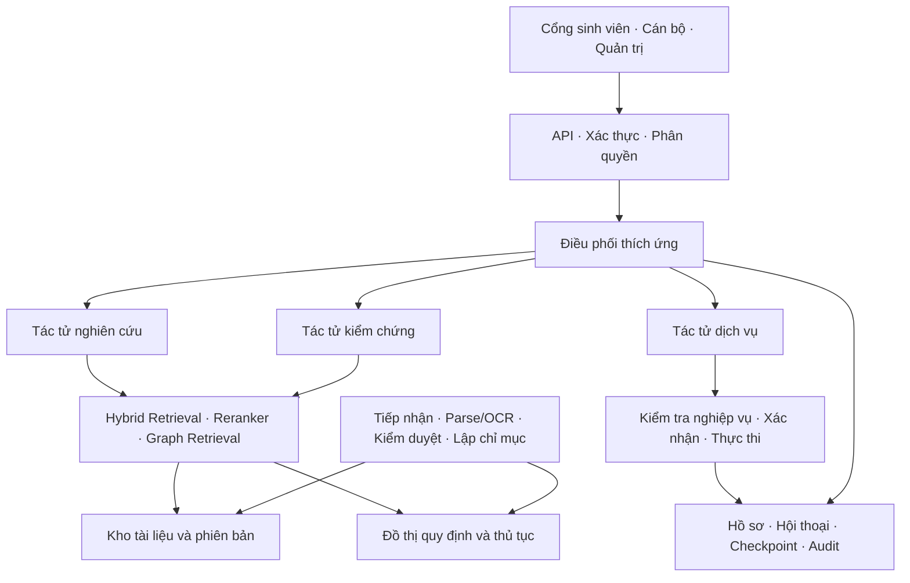

# Kế hoạch đồ án tốt nghiệp — Campus 24/7

> **Định hướng:** Nền tảng tri thức và điều phối dịch vụ đại học sử dụng RAG thích ứng, truy hồi trên đồ thị và hệ thống đa tác tử có kiểm chứng bằng chứng.
>
> **Ngày lập:** 13/10/2026. **Nhân lực:** 01 người. **Bối cảnh học kỳ:** 06 tháng. **Đơn vị lập lịch implementation hiện tại:** giờ Codex hoạt động, theo cập nhật trực tiếp của người dùng cùng ngày.
>
> **Trạng thái:** Kế hoạch đề xuất được ghi lại theo yêu cầu của người dùng. Các năng lực, chỉ tiêu và đầu ra dưới đây là mục tiêu triển khai, chưa phải kết quả đã đạt. Lịch bắt đầu, phần cứng, ngân sách mô hình và đơn vị phối hợp chưa được chốt. Bộ thiết kế các chặng tiếp theo và ước lượng giờ Codex nằm tại [docs/graduation-design](graduation-design/README.md).

> **Cập nhật phạm vi 13/10/2026:** Người dùng yêu cầu dùng multi-agent ngay, bỏ so sánh kiến trúc và gộp chặng 2–3–4. Chặng hiện tại là [Multi-agent tích hợp](graduation-design/02_MULTI_AGENT_INTEGRATED.md), tiếp tục từ code đang làm dở. Giữ số chặng 5–7 để các tham chiếu còn ổn định. Kiểm chứng chất lượng, quyền, lỗi và tài nguyên vẫn thuộc phạm vi; không yêu cầu xây single-agent riêng, benchmark so sánh hoặc ablation.

## 1. Tên đề tài và định vị

**Tên đề tài học thuật:**

> Nghiên cứu và xây dựng nền tảng trợ lý dịch vụ đại học sử dụng truy xuất tri thức thích ứng và hệ thống đa tác tử có kiểm chứng bằng chứng.

**Tên sản phẩm:** Campus 24/7 — Nền tảng tri thức và điều phối dịch vụ đại học bằng AI.

Đồ án tập trung vào kiến trúc AI, độ tin cậy của câu trả lời, khả năng phối hợp tác tử và tích hợp quy trình nghiệp vụ. Tính chuyên nghiệp được chứng minh bằng hệ thống hoạt động, khả năng xử lý lỗi, dữ liệu đánh giá độc lập và thực nghiệm có thể tái lập.

## 2. Bài toán, mục tiêu và người dùng

### 2.1. Bài toán thực tế

Sinh viên phải tìm thông tin trong nhiều quy chế, thông báo và biểu mẫu, tự xác định điều kiện áp dụng rồi liên hệ phòng ban để thực hiện thủ tục. Cán bộ tiếp nhận câu hỏi lặp lại, hồ sơ thiếu thông tin và yêu cầu khó phân loại. Khi tài liệu thay đổi, việc dùng sai phiên bản hoặc bỏ sót ngoại lệ dễ dẫn đến hướng dẫn không chính xác.

Campus 24/7 hỗ trợ hành trình:

**Hỏi thông tin → xác định điều kiện → nhận hướng dẫn có nguồn → chuẩn bị hồ sơ → xem trước và xác nhận → cán bộ xử lý → theo dõi và nhận kết quả.**

### 2.2. Mục tiêu

1. Xây dựng kho tri thức có cấu trúc, phiên bản, hiệu lực và nguồn gốc kiểm tra được.
2. Trả lời câu hỏi tiếng Việt, câu nối tiếp và câu nhiều vấn đề bằng bằng chứng phù hợp.
3. Điều phối truy hồi và tác tử theo độ phức tạp, độ bao phủ bằng chứng và ngân sách.
4. Phát hiện thông tin còn thiếu, mâu thuẫn và kết luận chưa đủ căn cứ.
5. Tích hợp AI với quy trình hồ sơ, xác nhận thao tác và xử lý của cán bộ.
6. Đánh giá chất lượng, độ tin cậy, khả năng hoàn thành tác vụ và tài nguyên của hệ thống multi-agent bằng bằng chứng tái lập.

### 2.3. Người dùng

| Nhóm | Khả năng chính | Giá trị nhận được |
|---|---|---|
| Sinh viên | Hỏi đáp, mở nguồn, chuẩn bị và gửi hồ sơ, theo dõi yêu cầu | Hướng dẫn thống nhất, giảm thời gian tìm kiếm và bổ sung hồ sơ |
| Cán bộ | Nhận, phân công, yêu cầu bổ sung, xử lý và phản hồi | Hồ sơ có cấu trúc, căn cứ hỗ trợ và lịch sử rõ ràng |
| Quản trị viên | Quản lý tri thức, kiểm duyệt quan hệ, phân quyền, theo dõi chất lượng | Kiểm soát nguồn và quan sát hoạt động hệ thống |

### 2.4. Tình huống chủ đạo

> “Em đang nhận học bổng, muốn nghỉ học tạm thời một học kỳ. Điều này ảnh hưởng thế nào đến học bổng, cần chuẩn bị hồ sơ gì và liên hệ đơn vị nào?”

Hệ thống phải nhận ra các vấn đề về nghỉ học, học bổng và thủ tục; hỏi loại học bổng hoặc thời điểm nếu cần; tìm nhiều nguồn; xét điều kiện và hiệu lực; phân biệt kết luận đã được hỗ trợ với phần chưa xác định; chuẩn bị hồ sơ khi được yêu cầu; chuyển cán bộ nếu cần quyết định nghiệp vụ.

Tình huống này dùng để minh họa khả năng tư vấn nhiều nguồn. Trong phạm vi cam kết, quy trình nộp hồ sơ hoàn chỉnh được triển khai cho hai nghiệp vụ tại mục 3; luồng nghỉ học có thể chuyển thành yêu cầu hỗ trợ chung.

## 3. Phạm vi triển khai

### 3.1. Phạm vi cam kết trong sáu tháng

- Một trường đại học; ưu tiên bối cảnh HUCE để tận dụng kho tài liệu công khai hiện có.
- Ba nhóm người dùng: sinh viên, cán bộ và quản trị viên.
- Hai nghiệp vụ chuyên biệt, một luồng hỗ trợ chung.
- Web sử dụng được trên máy tính và điện thoại.
- Kho tri thức từ tài liệu công khai; dữ liệu cá nhân và vận hành mô phỏng.
- Multi-agent dùng nền Advanced RAG, đồ thị có phạm vi chọn lọc và bộ đánh giá độc lập về chất lượng hệ thống.
- Lưu dữ liệu tại backend, checkpoint bền vững, quan sát hệ thống và hướng dẫn triển khai môi trường demo.

| Nghiệp vụ | Luồng cần hoàn thiện |
|---|---|
| Xin giấy xác nhận sinh viên | Hướng dẫn → chuẩn bị hồ sơ → xem trước → xác nhận gửi → bổ sung → cán bộ duyệt hoặc từ chối → trả tài liệu mẫu |
| Đề nghị phúc khảo | Tra cứu hướng dẫn → chọn học phần từ dữ liệu mô phỏng → chuẩn bị đề nghị → gửi → tiếp nhận → cập nhật và trả kết quả |
| Hỗ trợ chung | Gửi vấn đề hoặc chuyển từ chat → phân loại → phân công → trao đổi → phản hồi → đóng yêu cầu |

Điều kiện và thành phần hồ sơ phải được đối chiếu với tài liệu của trường. Theo yêu cầu trình bày trực tiếp đã thực hiện ở chặng 1, giao diện và bản giấy xác nhận không mang nhãn demo/mô phỏng. Phạm vi dữ liệu, provenance, cấu hình môi trường và các phần chưa xác minh được ghi trung thực trong record/evidence kỹ thuật; quyền và xác nhận nghiệp vụ được giữ.

### 3.2. Phần mở rộng

- Pilot với đơn vị trong trường và tích hợp hệ thống đào tạo thật khi có điều kiện hợp tác.
- Microsoft GraphRAG toàn kho với community summaries và global search.
- Fine-tuning lớn hoặc huấn luyện Self-RAG theo nghiên cứu gốc.
- Xử lý đa phương thức toàn diện, ứng dụng di động riêng, thanh toán và chữ ký số.
- Hỗ trợ nhiều trường, nhiều tenant và hạ tầng phục vụ tải lớn.

Các chức năng thời khóa biểu hoặc đặt phòng đã có có thể được giữ và tái sử dụng, nhưng không trở thành trọng tâm phát triển mới của đồ án này.

## 4. Hiện trạng và chiến lược tận dụng dự án

Kho mã đã có nền tảng Next.js, FastAPI, PostgreSQL/pgvector, LangGraph, mã RAG và các luồng công cụ, xác nhận, chuyển cán bộ. Một số phần vẫn dùng dữ liệu mock hoặc lưu trạng thái trong bộ nhớ. Hiện trạng tích hợp cần được kiểm kê trước khi ước lượng công việc chi tiết.

Các điểm tham chiếu đã đọc khi lập đề xuất:

- `apps/web/src/lib/data/config.ts`: chế độ dữ liệu giao diện mặc định là mock nếu không có cấu hình khác.
- `services/api/src/campus247/agent/graph.py`: graph có các nhánh truy hồi, công cụ, xác nhận và chuyển cán bộ.
- `services/api/src/campus247/agent/state.py`: trạng thái có cấu trúc cho hội thoại, công cụ và kết quả.
- `services/api/src/campus247/application/ticket/confirm.py`: dịch vụ đã đọc có cơ chế xác nhận và chống trùng nhưng lưu ticket trong bộ nhớ.
- `services/api/src/campus247/application/knowledge/publish.py`: dịch vụ đã đọc lưu phiên bản trong bộ nhớ.
- `docs/RAG_ADVANCED_IMPLEMENTATION_20261013.md`: báo cáo pilot RAG hiện có và giới hạn đánh giá.

Những quan sát này không thay thế một lần kiểm thử toàn hệ thống. Số lượng node trong graph hoặc số lượng test đã chạy không tự chứng minh năng lực multi-agent hay chất lượng trên dữ liệu thực tế.

Chiến lược triển khai là tái sử dụng các module phù hợp, hoàn thiện persistence và tích hợp, bổ sung lớp điều phối thích ứng, đồ thị quy định và thực nghiệm. Giữ nguyên tài liệu, dữ liệu, thay đổi và bằng chứng đã có.

Theo chỉ dẫn trực tiếp cập nhật ngày 13/10/2026, Codex được linh hoạt refactor, tái thiết kế hoặc xây implementation thay thế để đạt mục tiêu; không bắt buộc giữ cấu trúc code hiện tại. Thực hiện bằng thay đổi có thể review và chuyển tiếp có thể phục hồi, bảo toàn dữ liệu, công việc có sẵn và cơ chế bảo vệ. Quyền linh hoạt kỹ thuật không thay xác nhận đích phá hủy, không cấp quyền reset/xóa dữ liệu hoặc paid/production mới. Chi tiết tại [bộ thiết kế](graduation-design/README.md).

## 5. Kiến trúc tổng thể



### 5.1. Các lớp trách nhiệm

| Lớp | Trách nhiệm |
|---|---|
| Presentation | Giao diện, API và truyền sự kiện; không chứa quy tắc nghiệp vụ cốt lõi |
| Application | Điều phối use case, retrieval, kiểm chứng và tương tác giữa tác tử |
| Domain | Điều kiện nghiệp vụ, vòng đời hồ sơ và kiểm tra trạng thái |
| Infrastructure | Database, model gateway, parser, search adapter, queue và telemetry |

Backend chia module rõ ràng, kết hợp worker xử lý tài liệu. Chưa cần tách thành nhiều microservice để thực hiện phạm vi đồ án.

### 5.2. Stack đề xuất

| Thành phần | Lựa chọn định hướng |
|---|---|
| Web | Next.js, React, TypeScript; tái sử dụng giao diện hiện có |
| API | FastAPI, Pydantic và hợp đồng API có cấu trúc |
| Điều phối | LangGraph, subgraph, checkpoint và human-in-the-loop |
| Dữ liệu | PostgreSQL cho nghiệp vụ và metadata; pgvector cho dense retrieval |
| Tìm kiếm | BM25, embedding đa ngôn ngữ, RRF và cross-encoder reranker |
| Đồ thị | Bảng node/edge trong PostgreSQL cho phạm vi chọn lọc |
| Cache và giới hạn | Redis khi cần; cache có phạm vi và phiên bản |
| Model | Gateway tách provider, theo dõi token, thời gian và chi phí |
| Quan sát | Structured logs, trace, metrics; tái sử dụng công cụ hiện có |
| Triển khai | Môi trường local/demo có cấu hình và hướng dẫn tái lập |

Chốt cấu hình embedding, reranker, mô hình sinh và mức đồng thời sau khi đo trên phần cứng thực tế. Việc bổ sung dịch vụ trả phí hoặc triển khai ngoài môi trường demo là công việc riêng, phụ thuộc ngân sách và thẩm quyền phù hợp.

## 6. Thiết kế nền tảng RAG nâng cao

### 6.1. Pipeline nhập và quản lý tài liệu

**Tiếp nhận → giữ bản nguồn → parse/OCR → kiểm tra cấu trúc → chia đoạn → tạo metadata → lập chỉ mục → kiểm duyệt → xuất bản phiên bản.**

- Giữ URL, thời điểm thu nhận, hash, phiên bản và vị trí trích dẫn.
- Parse theo tiêu đề, điều, khoản và bảng. OCR cho phạm vi tài liệu quét chọn lọc; kiểm tra thủ công những đoạn có số, ngưỡng hoặc ngoại lệ quan trọng.
- Giữ liên kết document → section → parent → child.
- Đánh dấu nội dung chưa được xác minh; không dùng như quy định đã được duyệt.
- Build chỉ mục trong namespace/phiên bản mới, xác minh trước khi chuyển phiên bản phục vụ.
- Giữ snapshot và bằng chứng cũ để tái lập thực nghiệm; không lập chỉ mục đè hoặc xóa dữ liệu chỉ để làm sạch môi trường.

### 6.2. Các kỹ thuật cốt lõi

| Kỹ thuật | Thiết kế | Mục đích |
|---|---|---|
| Structure-aware parsing | Nhận diện tiêu đề, điều khoản, bảng và locator | Giữ cấu trúc và nguồn |
| Parent–child retrieval | Tìm bằng child, lấy parent phù hợp làm context | Không bỏ mất ngoại lệ |
| Contextual retrieval | Bổ sung ngữ cảnh cho văn bản lập chỉ mục | Tìm đúng đoạn thiếu chủ ngữ hoặc tên văn bản |
| Hybrid retrieval | BM25 + dense embedding, hợp nhất bằng RRF | Khớp chính xác và hiểu ngữ nghĩa |
| Reranking | Cross-encoder đánh giá query–passage | Nâng chất lượng các ứng viên đưa vào context |
| Conversational rewriting | Giải tham chiếu, giữ điều kiện, nhận diện chuyển chủ đề | Xử lý câu nối tiếp |
| Adaptive retrieval | Chọn đường xử lý theo độ khó và độ thiếu bằng chứng | Kiểm soát chất lượng và chi phí |
| Multi-hop retrieval | Dùng kết quả trước để lập truy vấn tiếp theo | Trả lời yêu cầu nhiều nguồn |
| Corrective retrieval | Đánh giá bằng chứng và điều chỉnh tìm kiếm | Khắc phục kết quả ban đầu chưa đủ |
| Temporal retrieval | Xét hiệu lực, đối tượng và quan hệ thay thế | Tránh dùng sai phiên bản |
| Claim verification | Đối chiếu từng phát biểu với đoạn nguồn | Kiểm tra diễn giải và trích dẫn |

Metadata hoặc phần tóm tắt do AI tạo chỉ phục vụ tìm kiếm. Văn bản nguồn đã được kiểm tra mới là bằng chứng để trả lời.

### 6.3. Điều phối truy hồi thích ứng

| Loại yêu cầu | Đường xử lý đề xuất |
|---|---|
| Giới thiệu, điều hướng giao diện | Phản hồi hệ thống có cấu trúc, không cần tìm quy định |
| Câu hỏi quy định đơn giản | Truy hồi một bước và kiểm chứng |
| Câu nhiều vấn đề | Phân tách nhiệm vụ, truy hồi theo từng vấn đề và tổng hợp |
| Câu có quan hệ thủ tục/điều kiện | Kết hợp đồ thị với điều khoản gốc |
| Thiếu dữ kiện người dùng | Hỏi làm rõ trước khi kết luận |
| Thiếu nguồn hoặc nguồn mâu thuẫn | Tìm bổ sung có giới hạn; sau đó nêu giới hạn hoặc chuyển cán bộ |

Các kết luận về quy định phải có nguồn. Việc chọn mô hình hoặc đường xử lý không thay thế yêu cầu này. Ngưỡng phân loại, top-k và số vòng tìm lại được chọn trên bộ phát triển, ghi lại cấu hình trước đánh giá cuối.

### 6.4. Kiểm chứng và xử lý hiệu lực

- Kiểm tra nguồn có hỗ trợ trực tiếp phát biểu, đúng đối tượng và thời điểm không.
- Kiểm số, đơn vị, khoảng giá trị, quan hệ so sánh, phủ định và điều kiện đi kèm.
- Phân biệt nguồn không đủ với lỗi dịch vụ hoặc lỗi mô hình.
- Không chọn văn bản chỉ vì ngày ban hành mới hơn; xét quan hệ thay thế và phạm vi áp dụng.
- Cho phép trả lời phần đã đủ căn cứ và chỉ rõ phần còn thiếu.
- Bộ kiểm chứng bằng mô hình có thể sai; kết hợp kiểm tra xác định và đánh giá của người trong thực nghiệm.

Nếu chỉ dùng prompt cho phản tư/kiểm chứng, mô tả là cơ chế evaluator–optimizer hoặc lấy cảm hứng từ Self-RAG. Không tuyên bố tái hiện Self-RAG gốc nếu chưa triển khai huấn luyện và reflection tokens theo nghiên cứu.

## 7. Đồ thị quy định có bằng chứng

### 7.1. Mô hình

| Loại thực thể | Ví dụ |
|---|---|
| Văn bản/điều khoản | Quy chế, thông báo, điều quy định |
| Thủ tục/biểu mẫu | Xin xác nhận, phúc khảo, biểu mẫu tương ứng |
| Đơn vị | Đơn vị tiếp nhận và xử lý |
| Đối tượng | Nhóm sinh viên, chương trình, khóa học |
| Điều kiện/ngoại lệ | Yêu cầu áp dụng, trường hợp đặc biệt |
| Hiệu lực | Khoảng thời gian và quan hệ thay thế |

```text
Thủ tục → yêu cầu → Hồ sơ
Thủ tục → tiếp nhận bởi → Đơn vị
Thủ tục → áp dụng cho → Đối tượng
Điều kiện → có ngoại lệ → Ngoại lệ
Thủ tục/điều kiện → được quy định tại → Điều khoản
Phiên bản → thay thế trong phạm vi xác định → Phiên bản trước
```

Mỗi cạnh có nguồn, phiên bản, locator, phạm vi hiệu lực và trạng thái kiểm duyệt. Quan hệ do mô hình trích xuất chưa kiểm tra không tự trở thành căn cứ nghiệp vụ.

### 7.2. Cách sử dụng

Đồ thị xác định quan hệ và điều khoản ứng viên; hệ thống truy hồi văn bản gốc để kiểm chứng và trả lời. Bắt đầu với hai nghiệp vụ chính và một tập điều kiện liên quan. Kiểm chứng độ đúng trên nhóm câu hỏi quan hệ, ngoại lệ và nhiều nguồn.

Phần cam kết là graph-assisted retrieval có nguồn. Community summaries/global search của Microsoft GraphRAG là nhánh mở rộng riêng.

## 8. Thiết kế hệ thống đa tác tử

### 8.1. Vai trò

| Tác tử | Trách nhiệm | Đầu ra |
|---|---|---|
| Coordinator | Hiểu mục tiêu, lập kế hoạch, phân công, quản lý ngân sách, dừng | Kế hoạch, phụ thuộc, quyết định bước tiếp theo |
| Research | Chọn công cụ, viết lại truy vấn, tìm nhiều bước | Bằng chứng có nguồn, độ bao phủ và khoảng trống |
| Verifier | Kiểm tra kết luận, nguồn, mâu thuẫn và điều kiện | Verdict từng phát biểu và yêu cầu sửa/tìm bổ sung |
| Service | Thu thập trường dữ liệu, chuẩn bị hồ sơ, đề xuất thao tác | Bản nháp, trường còn thiếu và action proposal |

Các vai trò có thể dùng chung mô hình nền. Mỗi vai trò có mục tiêu, tập công cụ và hợp đồng đầu ra riêng. Coordinator có thể tạo nhiều nhiệm vụ Research độc lập; không cần tạo tác tử cố định cho từng phòng ban.

### 8.2. Hợp đồng phối hợp

Định nghĩa schema cho các nhóm dữ liệu:

- Nhiệm vụ: ID, mục tiêu, phụ thuộc, công cụ được phép và trạng thái.
- Bằng chứng: nguồn, phiên bản, locator, nội dung gốc và phạm vi áp dụng.
- Kết luận đề xuất: phát biểu, nguồn hỗ trợ và giới hạn.
- Kiểm chứng: được hỗ trợ, chưa đủ, mâu thuẫn hoặc không hợp lệ.
- Ngân sách: lượt gọi, token, thời hạn và mức đồng thời còn lại.
- Hành động: loại thao tác, dữ liệu đề xuất và thông tin cần xác nhận.

Backend tạo ngữ cảnh quyền đáng tin cậy và kiểm tra ở mỗi công cụ. Tác tử không tự cấp hoặc mở rộng quyền. Kết luận của tác tử khác chưa phải sự thật nếu chưa đối chiếu nguồn.

### 8.3. Ma trận độ bao phủ bằng chứng

| Vấn đề | Bằng chứng | Trạng thái minh họa |
|---|---|---|
| Điều kiện nghỉ học | Điều khoản đã xác minh | Đủ |
| Ảnh hưởng đến học bổng | Chưa biết loại học bổng | Cần hỏi |
| Thành phần hồ sơ | Hướng dẫn hiện hành | Đủ |
| Đơn vị tiếp nhận | Hai nguồn không thống nhất | Cần cán bộ xác nhận |

Coordinator sử dụng ma trận để quyết định tìm thêm, hỏi người dùng, tổng hợp hoặc chuyển cán bộ. Đây là trọng tâm điều phối và một đóng góp ứng dụng của đồ án.

### 8.4. Giới hạn và kết thúc

- Giới hạn nhiệm vụ song song, số vòng sửa, số lần gọi công cụ và ngân sách.
- Phát hiện nhiệm vụ trùng lặp, vòng lặp và kết quả không bổ sung bằng chứng.
- Nhiệm vụ có phụ thuộc chạy theo thứ tự; chỉ song song hóa phần độc lập.
- Hủy phần việc không còn cần thiết, không hủy hồ sơ đã thực thi.
- Hết ngân sách hoặc thời hạn phải trả trạng thái và giới hạn rõ ràng.

## 9. Nghiệp vụ, bộ nhớ và vận hành

### 9.1. Thực thi có kiểm soát

AI hỗ trợ hiểu yêu cầu và chuẩn bị dữ liệu. Backend kiểm tra quyền, schema, điều kiện và trạng thái; người dùng xác nhận bản xem trước; cán bộ quyết định kết quả nghiệp vụ cần phê duyệt.

Khi xác nhận hoặc tiếp tục tác vụ, kiểm tra lại actor, nội dung, thời hạn và điều kiện áp dụng. Thay đổi nội dung quan trọng phải tạo bản xem trước mới. Dùng transaction, khóa chống trùng và kiểm tra phiên bản trạng thái để tránh tạo hồ sơ lặp.

Checkpoint không tự bảo đảm thao tác nghiệp vụ xảy ra đúng một lần. Các hiệu ứng bên ngoài cần cơ chế chống trùng và đối soát kết quả; không tự báo thành công khi kết quả chưa rõ.

### 9.2. Các loại bộ nhớ

| Loại | Nội dung | Giới hạn |
|---|---|---|
| Hội thoại | Mục tiêu, điều kiện và thông tin người dùng đã cung cấp | Không tự trở thành quy định hoặc quyền truy cập |
| Nghiệp vụ | Hồ sơ và trạng thái từ backend | Đọc theo quyền của người dùng |
| Tri thức | Tài liệu, phiên bản và đồ thị có nguồn | Chỉ dùng nguồn đủ điều kiện làm căn cứ |

### 9.3. Khả năng vận hành

- Lưu hội thoại, hồ sơ, checkpoint và audit trong storage bền vững.
- Tạm dừng để chờ xác nhận hoặc xử lý của cán bộ; tiếp tục đúng phiên và hồ sơ.
- Trace theo request → tác tử → retrieval/model/tool, có thời gian và ngân sách.
- Ghi phiên bản corpus, model, prompt và cấu hình để tái lập.
- Cache theo phạm vi truy cập, câu hỏi và phiên bản nguồn; không dùng chung câu trả lời cá nhân giữa người dùng.
- Kiểm tra quyền truy cập đối tượng, giới hạn tốc độ, nội dung đính kèm và dữ liệu gửi tới mô hình.
- Xem nội dung tài liệu truy hồi là dữ liệu, không phải lệnh thay đổi quyền hoặc gọi công cụ.
- Lỗi mô hình/reranker có trạng thái rõ; cổng hồ sơ và nội dung đã được xuất bản vẫn truy cập được.
- Có hướng dẫn sao lưu và kiểm tra phục hồi trong môi trường demo, giữ nguyên bằng chứng và dữ liệu cũ.

Chỉ tiêu độ trễ và mức đồng thời được chốt sau baseline trên phần cứng xác định. Báo cáo p50/p95 cùng cấu hình và tải; không suy ra SLA production từ một lượt demo.

## 10. Giao diện và kịch bản demo

| Giao diện | Phần cần có |
|---|---|
| Sinh viên | Chat, trích dẫn mở được, thông tin còn thiếu, bản nháp, xác nhận, danh sách hồ sơ và thông báo |
| Cán bộ | Hàng đợi, phân công, chi tiết hồ sơ, yêu cầu bổ sung, căn cứ và lịch sử xử lý |
| Quản trị | Nhập/duyệt tài liệu, phiên bản, kiểm duyệt đồ thị, dashboard chất lượng |
| Quan sát kỹ thuật | Kế hoạch tác vụ, nguồn đã tìm, verdict, lỗi, thời gian và chi phí |

Màn hình quan sát trình bày kế hoạch có cấu trúc và kết quả công cụ; không hiển thị suy luận nội bộ hoặc dữ liệu nhạy cảm.

Kịch bản bảo vệ:

1. Câu hỏi nhiều vấn đề, tìm nhiều nguồn và hỏi làm rõ.
2. Nộp và xử lý hồ sơ hoàn chỉnh từ sinh viên đến cán bộ.
3. Quy định thay đổi, nguồn mâu thuẫn hoặc thiếu bằng chứng.
4. Dừng/chạy lại tác vụ, kiểm tra hồ sơ không bị tạo trùng.
5. Quan sát Coordinator phân công, Research tìm bổ sung và Verifier kiểm nguồn; kiểm tra dừng đúng khi thiếu bằng chứng hoặc tài nguyên.

## 11. Đóng góp nghiên cứu và thực nghiệm

### 11.1. Đóng góp ứng dụng dự kiến

1. Điều phối truy hồi theo độ bao phủ bằng chứng, quyết định tìm tiếp, hỏi thêm hoặc trả lời.
2. Truy hồi quy định theo quan hệ và hiệu lực, kết hợp đồ thị có nguồn với tìm kiếm đoạn văn.
3. Phối hợp đa tác tử theo ngân sách, chỉ huy động đường xử lý phức tạp khi cần.

Không tuyên bố thuật toán mới hoặc ưu thế so với kiến trúc khác khi chưa có phép đo tương ứng. Báo cáo hành vi và chất lượng đã quan sát của implementation được chọn.

### 11.2. Câu hỏi nghiên cứu

- Hệ thống multi-agent đạt độ đúng, độ đầy đủ và coverage nguồn thế nào ở từng nhóm câu hỏi?
- Coordinator/Research/Verifier giữ điều kiện, phát hiện thiếu bằng chứng và phục hồi sau lỗi ra sao?
- Đồ thị có bằng chứng hỗ trợ truy ngược câu hỏi quan hệ, ngoại lệ và nhiều nguồn đúng đến mức nào?
- Điều phối tác vụ sử dụng calls/tokens, chi phí và thời gian ra sao trong giới hạn hiện hành?
- Hệ thống xử lý thiếu bằng chứng và từ chối quá mức như thế nào?

### 11.3. Cấu hình kiểm chứng

| Cấu hình | Mục đích |
|---|---|
| Multi-agent tích hợp | Kiểm chức năng, phân công, tìm bổ sung, kiểm chứng và phục hồi |
| Multi-agent có graph ở chặng 5 | Kiểm quan hệ, điều kiện, hiệu lực và nguồn của graph-assisted retrieval |

Ghi corpus/model/prompt/config fingerprint, bộ câu hỏi, rubric và usage thật cho mỗi lượt kiểm chứng. Giữ kết quả RAG trước đây làm evidence lịch sử và regression khi phù hợp; không bắt buộc chạy lại làm đối chứng.

Không yêu cầu benchmark giữa các kiến trúc hoặc ablation. Kiểm tra lỗi bằng doubles/namespace riêng không làm giảm cổng bảo vệ của ứng dụng đang phục vụ.

### 11.4. Bộ đánh giá

Quy mô đề xuất:

- Khoảng 300 câu hỏi có đáp án và nguồn kiểm tra được.
- Khoảng 40 kịch bản hội thoại nhiều lượt.
- Khoảng 60 tình huống công cụ, phân quyền và lỗi nghiệp vụ.

Bao gồm câu đơn nguồn, nhiều nguồn, câu nối tiếp, diễn đạt khác, thiếu dấu, ngoại lệ, sai phiên bản, mâu thuẫn, thiếu thông tin và không có đáp án. Phân tách tập phát triển và tập đánh giá cuối; không dùng đáp án đánh giá cuối để xây FAQ, contextual metadata hoặc điều chỉnh hệ thống.

### 11.5. Chỉ số

| Nhóm | Chỉ số |
|---|---|
| Retrieval | Recall@k, MRR/nDCG khi có nhãn phù hợp, coverage nguồn cần thiết |
| Câu trả lời | Độ đúng, độ đầy đủ, hỗ trợ từng phát biểu và độ chính xác trích dẫn |
| Từ chối | Từ chối đúng, từ chối quá mức, trả lời sai khi thiếu nguồn |
| Agent | Hoàn thành tác vụ, bước thừa, tìm lại có ích, vòng lặp và lỗi phối hợp |
| Nghiệp vụ | Hoàn thành luồng, chuyển trạng thái đúng, chống trùng và truy cập đúng quyền |
| Vận hành | p50/p95, token, số lượt gọi, chi phí, timeout và tỷ lệ lỗi |
| Sử dụng | Khả năng hoàn thành tác vụ và phản hồi của người dùng thử |

Chấm theo rubric rõ ràng, đối chiếu với nguồn. Điểm do LLM chấm phải được kiểm tra trên một tập do người đánh giá. Báo cáo theo nhóm câu hỏi, mẫu số và khoảng tin cậy khi phù hợp; giữ cả kết quả lỗi và kết quả không cải thiện.

### 11.6. Tiêu chí hoàn thành

- Hai quy trình chuyên biệt và luồng hỗ trợ chung chạy từ giao diện tới backend, lưu được sau khởi động lại.
- Trích dẫn mở được và truy ngược về đúng nguồn/phiên bản.
- Có xử lý rõ cho thiếu dữ kiện, thiếu bằng chứng, mâu thuẫn và lỗi dịch vụ.
- Có kiểm chứng phân quyền, xác nhận, chống trùng và tiếp tục tác vụ.
- Hoàn thành kiểm chứng chức năng/chất lượng của multi-agent và graph trong phạm vi đã chọn, tái lập được bằng dữ liệu/cấu hình đã ghi.
- Có báo cáo chất lượng, độ trễ, chi phí và giới hạn; không suy ra ưu thế kiến trúc từ các phép đo này.
- Chỉ tiêu định lượng mục tiêu được chốt sau baseline trên tập phát triển, trước đánh giá cuối; không thay đổi để hợp thức hóa kết quả.

## 12. Lộ trình theo thời gian Codex

### 12.1. Cách tính và độ tin cậy

Giờ Codex hoạt động gồm đọc/phân tích, code, chạy công cụ/build/test, kiểm UI và sửa lỗi khi Codex đang thực hiện công việc. Tách thời gian chờ người dùng/reviewer/quyền truy cập/nguồn lực bên ngoài; không quy đổi trực tiếp tháng công của người sang giờ Codex. Các khoảng dưới đây là ước lượng ban đầu chưa hiệu chỉnh, độ tin cậy thấp, không phải SLA. Sau 2–3 công việc đầu, cập nhật bằng thời gian thực tế quan sát được.

### 12.2. Các chặng thực hiện

| Chặng | Đầu ra | Giờ Codex dự kiến |
|---|---|---:|
| 1, phần nền nếu còn thiếu | Xin xác nhận end-to-end, persistence và baseline | 12–24 |
| 2–3–4, gộp | Multi-agent, coverage/tìm lại, DAG/verifier/resume, budget admission, cache và vận hành | 36–70 |
| 5 | Đồ thị quy định có nguồn và hiệu lực | 12–24 |
| 6 | Service Agent, phúc khảo, hỗ trợ và quản trị tri thức | 16–30 |
| 7 | Thực nghiệm độc lập, kiểm tải/lỗi và bàn giao | 16–32 |

Các chặng 2–7: **80–156 giờ**, hoặc **100–195 giờ** với dự phòng 25%. Nếu tính toàn bộ phần nền chặng 1: **92–180 giờ**, hoặc **115–225 giờ** gồm dự phòng. Thời gian chờ bên ngoài được báo riêng. Giả định stack/runtime sử dụng được, không huấn luyện lớn và đồ thị có phạm vi chọn lọc; thay đổi phần nền lớn cần cập nhật estimate.

Khoảng 36–70 giờ của chặng gộp giữ envelope ước lượng từ ba chặng cũ, chưa trừ phần tái sử dụng hoặc phần so sánh đã bỏ. Hiệu chỉnh phần việc còn lại sau kiểm kê; không coi gộp chặng là bằng chứng tự động giảm thời gian.

Thiết kế kỹ thuật, work packages, phụ thuộc, acceptance và cách ghi thời gian: [bộ tài liệu các chặng](graduation-design/README.md). Đầu vào kỹ thuật phải được kiểm chứng thực tế; tài liệu này không tự tuyên bố chặng 1 hoặc các chặng sau đã hoàn thành.

### 12.3. Phân bổ học kỳ trước đây — tham khảo

Bảng tháng/tuần sau được giữ nguyên như lịch sử để tham khảo việc tổ chức học kỳ của người thực hiện. Các dòng single-agent, so sánh và ablation trong bảng không còn là phạm vi phải thực hiện. Lịch implementation hiện tại dùng giờ Codex và chặng gộp ở mục 12.2.

| Thời gian | Công việc | Đầu ra kiểm tra được |
|---|---|---|
| Tháng 1, tuần 1–4 | Kiểm kê mã; chốt nghiệp vụ; thiết kế dữ liệu; chuẩn hóa nguồn; xây bộ đánh giá; đo baseline | Danh sách hiện trạng, luồng nghiệp vụ, schema, rubric, baseline và giới hạn tài nguyên |
| Tháng 2, tuần 5–8 | Hoàn thiện ingestion, phiên bản, nguồn trích dẫn, Advanced RAG và persistence nền | Pipeline nhập tài liệu, source readback, cấu hình Advanced RAG và đo so sánh ban đầu |
| Tháng 3, tuần 9–12 | Single-agent; ma trận bằng chứng; adaptive/corrective retrieval; checkpoint | Agent có tìm lại và điều kiện dừng; trace và kiểm tra restart |
| Tháng 4, tuần 13–16 | Coordinator, Research, Verifier; giao tiếp có schema; đồ thị chọn lọc | Multi-agent hoạt động; quan hệ có nguồn; so sánh single/multi-agent ban đầu |
| Tháng 5, tuần 17–20 | Service Agent; hai quy trình hồ sơ; giao diện cán bộ; dashboard; kiểm thử tích hợp | Các luồng end-to-end, xác nhận, phân quyền, chống trùng và quan sát |
| Tháng 6, tuần 21–24 | Đánh giá cuối; ablation; dùng thử; kiểm tải/lỗi; sửa lỗi; viết báo cáo và luyện demo | Bằng chứng tái lập, hệ thống đóng gói, báo cáo, slide và kịch bản bảo vệ |

Làm một lát cắt end-to-end của quy trình xin xác nhận sớm để phát hiện vấn đề tích hợp, rồi mở rộng song song với các bước AI theo thứ tự phụ thuộc. Đây là lịch ước lượng, không phải ngày bắt đầu đã được xác nhận.

## 13. Rủi ro và điều chỉnh phạm vi

| Rủi ro | Cách xử lý |
|---|---|
| Nhiều kỹ thuật vượt thời gian | Hoàn thiện lát cắt multi-agent tích hợp trước; giới hạn đồ thị vào nhóm nghiệp vụ |
| OCR sai điều kiện hoặc số | Kiểm tra đoạn quan trọng, giữ bản gốc và đánh dấu chưa xác minh |
| Multi-agent dùng nhiều tài nguyên hoặc kết luận sai | Theo dõi coverage/verdict/usage, giới hạn task và tìm lại, admission control, báo cáo trung thực |
| Không có đối tác cung cấp dữ liệu thật | Dùng tài liệu công khai, backend mô phỏng và adapter tích hợp |
| Chưa có người đánh giá nghiệp vụ | Lập rubric và đối chiếu nguồn; tìm người hỗ trợ đánh giá, ghi rõ giới hạn chuyên môn |
| Phần cứng không đáp ứng mô hình | Benchmark sớm, giới hạn mức đồng thời, chọn cấu hình phù hợp ngân sách |
| Backend và UI còn mock | Kiểm kê và triển khai lát cắt end-to-end trước khi mở rộng |
| Bộ đánh giá bị dùng để tuning | Giữ tập cuối riêng, ghi lịch sử cấu hình và vai trò của từng dataset |
| Nguồn thay đổi trong khi thực nghiệm | Dùng snapshot/version cố định, ghi hash và ngày thu nhận |

Việc giảm phạm vi phải giữ giá trị nghiên cứu và quy trình hoàn chỉnh; không đổi đáp án, ngưỡng hoặc nguồn để tạo kết quả đẹp.

## 14. Sản phẩm bàn giao

1. Mã nguồn hệ thống và hướng dẫn cấu hình, chạy môi trường demo.
2. Kho tri thức có nguồn, phiên bản và đồ thị cho phạm vi đã chọn.
3. Bộ dữ liệu đánh giá tiếng Việt, đáp án nguồn và rubric.
4. Cấu hình multi-agent/RAG, runner và kết quả kiểm chứng có thể tái lập.
5. Hai quy trình nghiệp vụ cùng luồng hỗ trợ chung, dữ liệu mô phỏng.
6. Dashboard chất lượng và màn hình quan sát tác vụ.
7. Báo cáo đồ án, slide, kịch bản demo và danh sách giới hạn còn lại.

## 15. Tài liệu tham khảo

- [Adaptive-RAG: Learning to Adapt Retrieval-Augmented Large Language Models through Question Complexity](https://aclanthology.org/2024.naacl-long.389/).
- [Contextual Retrieval — Anthropic](https://www.anthropic.com/engineering/contextual-retrieval).
- [Corrective Retrieval Augmented Generation](https://arxiv.org/abs/2401.15884).
- [Self-RAG: Learning to Retrieve, Generate, and Critique through Self-Reflection](https://arxiv.org/abs/2310.11511).
- [From Local to Global: A Graph RAG Approach to Query-Focused Summarization](https://graphrag.com/appendices/research/2404.16130/).
- [Building Effective Agents — Anthropic](https://www.anthropic.com/engineering/building-effective-agents).
- [Why Do Multi-Agent LLM Systems Fail?](https://arxiv.org/abs/2503.13657).
- [RAGAs: Automated Evaluation of Retrieval Augmented Generation](https://aclanthology.org/2024.eacl-demo.16/).
- [LangGraph Persistence](https://docs.langchain.com/oss/python/langgraph/persistence).
- [LangGraph Interrupts](https://docs.langchain.com/oss/python/langgraph/interrupts).

Các tài liệu tham khảo hỗ trợ lựa chọn thiết kế; kết quả của chúng không được coi là kết quả chất lượng của Campus 24/7. Tương thích API được kiểm tra với phiên bản thư viện của dự án khi triển khai.
