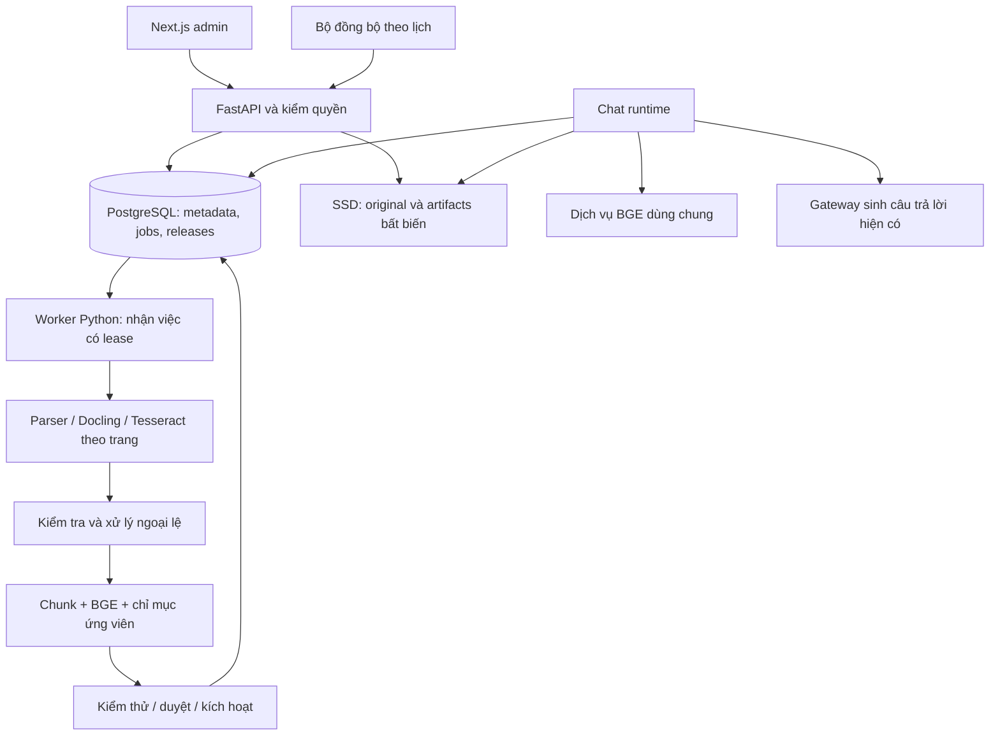

# Campus 24/7 — Spec nền tảng quản trị tri thức RAG

Ngày chốt: 23/10/2026. Trạng thái: thiết kế để triển khai, chưa phải tính năng đã hoàn thành.

Kế hoạch thực thi: [KNOWLEDGE_PLATFORM_IMPLEMENTATION_PLAN_20261023.md](KNOWLEDGE_PLATFORM_IMPLEMENTATION_PLAN_20261023.md).

## 1. Mục tiêu và cách thực hiện

Admin nạp tài liệu hoặc đăng ký nguồn qua giao diện; hệ thống tự xử lý, chỉ đưa ngoại lệ cần quyết định cho admin, xuất bản và xác nhận chatbot đã sử dụng đúng phiên bản. Không cần chạy script theo từng đợt tài liệu.

Thiết kế giữ BGE, phù hợp máy i7-10850H 6 nhân/12 luồng, RAM 16 GB, Quadro P620. RAM trống khoảng 5,4 GB là quan sát tại thời điểm kiểm tra, không phải ngân sách cố định. SSD được người dùng xác nhận có thể bố trí đủ. Chưa có benchmark các công cụ mới trên máy.

Người thực hiện được tự chọn chi tiết kỹ thuật, điều chỉnh thứ tự, gộp bước, sửa lỗi và thay adapter để đạt mục tiêu nhanh, hiệu quả, chính xác. Không tạo vòng duyệt tài liệu, gói công việc hoặc phê duyệt kỹ thuật lặp lại. Ghi ngắn quyết định đáng kể cùng kết quả kiểm chứng vào báo cáo triển khai.

Quyền linh hoạt không thay đổi cơ chế bảo vệ dữ liệu, xác thực, phân quyền, xác nhận xuất bản hoặc giới hạn chi phí hiện có. Khi gặp thao tác phá hủy, ảnh hưởng production, gửi dữ liệu nhạy cảm sang bên ngoài hoặc phát sinh dịch vụ trả phí chưa được cấp quyền, giữ nguyên phần đó và báo đúng rủi ro; tiếp tục phần độc lập. Không tự sửa hay vô hiệu hóa quy tắc an toàn để triển khai thuận tiện hơn.

## 2. Phạm vi và kết quả cần đạt

### Trong phạm vi đầu tiên

- Upload nhiều PDF/DOCX/TXT; nhập URL trang chính thức và tệp được liên kết.
- Thư viện nguồn thật thống nhất với kho chatbot, có phiên bản và xuất xứ.
- Xử lý nền có tiến độ, checkpoint, retry, chống trùng và phục hồi sau restart.
- Trích xuất có cấu trúc, OCR theo trang, đối chiếu ngoại lệ, chia đoạn và embedding BGE.
- Hybrid retrieval PostgreSQL full-text + pgvector, hợp nhất và BGE rerank.
- Kiểm thử bản ứng viên, duyệt theo chính sách hiện hành, kích hoạt và xác nhận runtime.
- Thu hồi, quay về bản phát hành trước, kiểm tra hiệu lực/quyền tại lúc sử dụng.
- Nhập kho HUCE hiện tại bằng cách bổ sung, giữ nguyên file, chỉ mục và lịch sử cũ.
- Đồng bộ định kỳ, báo thay đổi và hàng chờ cần xử lý; không thông báo lặp khi không đổi.

### Để sau khi luồng chính đã chạy

- Worker GPU riêng cho trang khó; mặc định chưa tải PaddleOCR-VL/MinerU lên máy local.
- Temporal, RAGFlow toàn bộ, tìm kiếm ảnh đa phương thức và model Qwen.
- Fine-tune, tự suy diễn hiệu lực pháp lý, tự sinh đồ thị thành nguồn chuẩn.
- Chạy nhiều người dùng quy mô lớn hoặc cam kết SLA production.

## 3. Hiện trạng được đối chiếu từ mã nguồn

| Thành phần hiện có | Ý nghĩa đối với triển khai |
|---|---|
| `data/huce-public-20261013/`, `data/huce-faq-20261013/` | Tài liệu gốc, bản trích xuất, bản reviewed/corrections và FAQ cần giữ |
| `data/huce-document-pipeline/`, `data/huce-discovery-20261020/` | Hồ sơ nguồn, xử lý và đối chiếu; có thể tái sử dụng bằng chứng hợp lệ |
| `scripts/public_rag_retrieval.py`, `scripts/run_advanced_rag.py` | BGE wiring và chỉ mục JSON hiện tại; cần chuyển theo bản phát hành |
| `infrastructure/retrieval/public_knowledge.py`, `public_hybrid.py` | Loader đang đọc kho file; không được coi catalog admin là kho này |
| `application/knowledge/operations.py`, `bootstrap/service_demo.py` | Quản trị nguồn `.txt` demo, build `demo-lexical-v1`; chưa phải xuất bản RAG thật |
| `presentation/knowledge.py` | Catalog nhận store truyền vào, không mặc nhiên phản ánh corpus đang phục vụ |
| `apps/web/src/features/knowledge/SourceOperations.tsx` | Có giao diện phiên bản/review/preview; tận dụng trải nghiệm, thay bằng backend thật |
| `services/worker/src/campus247_worker/ingestion/` | Có parse/chunk/index; cần adapter tài liệu và vòng xử lý nền thật |
| `services/worker/src/campus247_worker/main.py` | Khung worker hiện chỉ khởi động trạng thái; chưa có vòng nhận việc bền vững |
| Migration `0011`–`0013`, `domain/embedding_index.py`, adapter PostgreSQL | Có manifest/profile/pointer và vector BGE 1024; mở rộng thay vì lập schema song song vô ích |
| `scripts/run_ingestion.py` | Đang chủ động từ chối chạy; không bật lại bằng cách bỏ kiểm tra adapter/manifest |

Các đường dẫn module rút gọn trong tài liệu nằm dưới `services/api/src/campus247/`. Hiện trạng này là điểm bắt đầu, người thực hiện kiểm tra lại trước khi sửa vì workspace đang có nhiều thay đổi sẵn.

## 4. Kiến trúc đích

- File gốc là bằng chứng; PostgreSQL là nguồn quyết định trạng thái, quyền và release.
- Vector/chỉ mục là sản phẩm dẫn xuất, có thể dựng lại. Runtime không nạp toàn corpus/vector JSON vào RAM khi đã chuyển sang adapter PostgreSQL.
- API trả job ID ngay sau khi tiếp nhận hợp lệ; OCR/embedding không chạy trong request upload.
- Worker không nhúng model vào từng API process. Embedding/reranker dùng endpoint dùng chung, giới hạn số yêu cầu đồng thời.
- Adapter `DocumentConverter`, `OCRReader`, `SourceFetcher`, `KnowledgeStorage`, `JobRepository`, `ReleaseRepository` tách khỏi nghiệp vụ. Tên cụ thể có thể theo convention hiện tại.
- Trước mắt PostgreSQL kiêm hàng đợi; không thêm Redis/Celery/Temporal chỉ để có job queue. Các dịch vụ khác của dự án đang cần Redis không bị thay đổi.

## 5. Công nghệ và giới hạn tài nguyên

| Công đoạn | Lựa chọn mặc định | Cách dùng |
|---|---|---|
| API/UI | FastAPI/Next.js hiện tại | Bản build khi demo; không để build và OCR chạy đồng thời |
| PDF có chữ | pypdf/pdfplumber | Trích xuất trực tiếp, kiểm tra vùng/bảng và ký tự |
| Cấu trúc phức tạp | Docling | Adapter riêng, chạy CPU trong tiến trình con |
| Scan | Tesseract + `vie`/`eng` | OCR đúng trang/vùng cần thiết, lưu ảnh và vị trí |
| Website | HTTP parser trước, Crawl4AI khi cần trình duyệt | Một browser context, ít trang song song |
| Embedding | `BAAI/bge-m3` | 1024 chiều; giữ profile/revision đã kiểm chứng |
| Reranker | `BAAI/bge-reranker-v2-m3` | Batch nhỏ, top candidates giới hạn |
| Tìm kiếm | PostgreSQL FTS + pgvector | RRF/rerank; không gọi FTS là BM25 nếu chưa dùng BM25 |
| Đánh giá | Test hiện có + tập HUCE + Ragas chọn lọc | Judge qua gateway chỉ trong phạm vi dữ liệu/ngân sách cho phép |

Revision embedding đang có: `5617a9f61b028005a4858fdac845db406aefb181`; reranker: `953dc6f6f85a1b2dbfca4c34a2796e7dde08d41e`. Khi nhập lại vector phải khớp cả revision, normalization, dimension và input hash. Không thay model hoặc bịa vector để vượt kiểm tra.

Thiết lập khởi đầu, được điều chỉnh sau đo:

- `heavy_job_concurrency=1`, `ocr_page_batch=1`, `embedding_batch=1`, một browser session.
- Một truy vấn chat model-heavy tại một thời điểm; UI báo đang chờ nếu có tranh chấp.
- Embedding tài liệu nhường truy vấn chat giữa các batch, không ngắt ngang tác vụ đang ghi.
- API/DB/model services thường trực được đo riêng; tiến trình parser/OCR chỉ tồn tại khi cần. Một heavy job không có nghĩa các model thường trực không chiếm RAM.
- Worker tạm ngừng nhận batch mới khi RAM trống thấp hơn khoảng 2 GB trong vài lần lấy mẫu; đây là giá trị khởi đầu, không phải bảo đảm chống OOM. Dùng tổng working set của cây tiến trình do tác vụ sở hữu, timeout và trang/batch giới hạn.
- Giới hạn số trang, pixel khi render và dung lượng artifact; đọc stream và ghi theo trang. Giới hạn upload khởi đầu 50 MB/file, 500 trang/file, 10 file/batch; file lớn hơn vào chế độ chia lô/kiểm tra, không tự cắt nội dung âm thầm.
- Nếu model + DB/API đã khiến máy thiếu RAM khi không có job, giảm dịch vụ thường trực, tối ưu runtime hoặc tách model worker; không dựa vào pagefile để hứa tốc độ.
- Không tự dừng process không thuộc tác vụ, dọn dữ liệu hoặc tải model lớn hàng loạt. Không đổi driver, bảo mật hay quyền hệ thống để cố dùng P620.

## 6. Mô hình dữ liệu logic

Tên dưới đây là thực thể logic. Đối chiếu schema hiện tại rồi tái sử dụng/mở rộng bằng migration bổ sung; không bắt buộc tạo đủ bảng mới với đúng tên này.

| Thực thể | Trường/quan hệ cần có |
|---|---|
| `knowledge_source` | tenant/campus, tên, URL gốc, đơn vị ban hành, loại nguồn, mức thẩm quyền, phạm vi quyền, cấu hình đồng bộ |
| `document_version` | source, revision, original artifact/hash, MIME, tác giả tiếp nhận, hiệu lực, quan hệ thay thế, trạng thái review/publication |
| `knowledge_artifact` | key nội bộ, SHA256, size, loại original/render/extraction, processor profile, quan hệ cha |
| `document_page/block` | số trang, bbox/hệ tọa độ, thứ tự đọc, loại text/table, nội dung chuẩn hóa, cảnh báo |
| `knowledge_chunk` | version, page/block locators, ordinal, section, content/hash, index text/hash, language, lexical fields |
| `embedding_profile/index_manifest` | model/revision/dimension/normalization, parser/chunker profile, corpus fingerprint, build/validation status |
| `release` / `release_member` | tập version/chunk membership bất biến, index/profile, manifest checksum, predecessor, kết quả kiểm thử |
| `active_release` | scope, desired release, generation, actor/time; đổi bằng compare-and-swap |
| `runtime_ack` | instance, boot ID, serving release, generation, last heartbeat, load error |
| `ingestion_job` | source/version/stage, trạng thái, input fingerprint, progress, attempts, next_attempt_at, lease/fencing token |
| `job_step/checkpoint` | input/output hashes, config, artifact refs, timings, error code |
| `knowledge_review` / `audit_event` | actor, verdict, hash nội dung đã duyệt, phiên bản chính sách, thay đổi và lý do |
| `source_sync` / `outbox_event` | schedule, ETag/Last-Modified, content fingerprint, run result; sự kiện cùng transaction với thay đổi |

Phạm vi tenant/campus có mặt ở truy vấn và unique keys phù hợp. Dedup nội dung không được làm lộ file hoặc quyền của tenant khác.

Nội dung trích xuất để làm evidence tách khỏi tiêu đề bổ sung, alias câu hỏi hoặc tóm tắt do AI sinh. Mọi sửa OCR tạo rendition mới với mapping và hash mới; không sửa bản gốc hoặc rendition đã duyệt.

## 7. Trạng thái và hợp đồng xử lý nền

Không gộp tiếp nhận, chất lượng, phê duyệt và phục vụ vào một cột status.

- Job: `QUEUED → RUNNING → SUCCEEDED`; nhánh `RETRY_WAIT`, `FAILED`, `CANCELLED`. Chờ người duyệt là trạng thái nghiệp vụ `NEEDS_REVIEW`, không giữ lease/transaction mở.
- Version: `DRAFT`, `NEEDS_REVIEW`, `APPROVED`, `REJECTED`; publication được ghi riêng (`UNPUBLISHED`, `PUBLISHED`, `WITHDRAWN`).
- Build/release: `BUILDING → VALIDATING → READY`, sau đó `ACTIVE/RETIRED`; lỗi thành `FAILED`. Tái dùng enum/manifest hiện có khi phù hợp.
- Serving là phép chiếu từ desired pointer + ack còn sống, không suy ra từ `PUBLISHED`.

Nhận việc bằng transaction ngắn và `FOR UPDATE SKIP LOCKED`. Worker ghi owner, lease expiry và tăng fencing token; chỉ token còn hiệu lực được cập nhật checkpoint/kết quả. Không giữ DB lock trong lúc OCR, HTTP hay chờ admin. Worker crash thì việc hết lease được nhận lại; process cũ không được ghi đè kết quả của chủ mới.

Khóa idempotency gắn tenant, version, stage, input hash và processor profile. Từng bước có thể chạy nhiều lần nhưng kết quả đã commit không bị nhân đôi. Retry tạm thời dùng backoff có giới hạn (khởi đầu tối đa 3 lần); lỗi file, quyền hoặc nội dung không tự retry vô hạn.

Ghi artifact vào key mới theo lần chạy; chỉ gắn artifact đã hoàn chỉnh vào metadata bằng transaction. File tồn tại nhưng transaction thất bại được đánh dấu để kiểm tra, không tự xóa. Upload cùng request key trả cùng kết quả; cùng file khác nguồn không tự hợp nhất nghiệp vụ.

## 8. Luồng nạp, OCR và kiểm tra

1. Kiểm quyền, quota/định dạng, tên file hiển thị tách key lưu trữ; stream file và tính checksum. MIME thực tế phải phù hợp extension. URL chưa được tải trước khi kiểm tra đích.
2. Tạo original artifact + version + job. Cùng dữ liệu không tạo embedding lặp nếu profile và context đầu vào không đổi.
3. Phân loại từng trang: có chữ, scan, nhiều cột, bảng. Không ép OCR toàn bộ chỉ vì một trang scan.
4. Trích xuất trực tiếp hoặc chuyển Docling/Tesseract. Lưu trang/bbox, thứ tự đọc, ảnh đối chiếu khi cần, lỗi/ký tự không nhận diện. DOCX không có pagination ổn định thì dẫn paragraph/table/cell; không bịa số trang.
5. Kiểm tra trang bị thiếu, text rỗng/trùng bất thường, dấu tiếng Việt, mất cột, hàng/ô lệch, số/ngày/đơn vị và chú thích. Độ tự tin OCR chỉ là tín hiệu; không phải xác nhận đúng.
6. Đưa vùng bất thường vào hàng chờ để admin xem ảnh và text cạnh nhau. Nếu có bộ đọc thứ hai, bất đồng được ghi thành issue; đồng ý giữa hai model không thay thế kiểm chứng nguồn.
7. Chia đoạn theo chương/điều/khoản hoặc tiêu đề; bảng giữ header, quan hệ hàng/cột và chú thích. Bảng dài được chia có lặp header và locator chính xác. Không cắt mất ngoại lệ/điều kiện liên quan.
8. Tạo index text riêng, embedding BGE theo batch, cache theo toàn input hash + model profile. Giữ evidence text nguyên nghĩa.
9. Tạo bản ứng viên, chạy kiểm thử và chuẩn bị preview với danh sách nguồn/phiên bản sẽ được phục vụ.

Metadata hiệu lực/thẩm quyền chưa rõ thì ghi `UNKNOWN`, không tự suy diễn ngày hiệu lực từ ngày crawl. Xác nhận một tài liệu thay thế tài liệu khác phải có bằng chứng hoặc quyết định có quyền. HTTP 404 hoặc lỗi đồng bộ không tự thu hồi nguồn đã xuất bản.

## 9. Retrieval và câu trả lời

- Resolve actor/scope và release snapshot một lần cho lượt hỏi. Cả lexical/vector chỉ tìm trong membership của release đó, version được phép và hiệu lực phù hợp. Query lịch sử phải xác định thời điểm, không tự áp quy định cũ cho hiện tại.
- Nhánh từ khóa giữ mã học phần/số quyết định, có dạng giữ dấu và chuẩn hóa tìm kiếm; không làm thay đổi evidence. Đo riêng tiếng Việt và câu không dấu.
- Khởi đầu lấy khoảng 20 kết quả mỗi nhánh, hợp nhất theo chunk ID, RRF rồi rerank 6–10 ứng viên; các số này được hiệu chỉnh bằng đo CPU/RAM/Recall@k.
- Approximate vector search có filter phải được kiểm tra recall: tăng phạm vi quét hoặc dùng exact search khi phù hợp; không giải quyết thiếu recall bằng bỏ filter quyền.
- Lấy thêm parent/đoạn liền kề có giới hạn để đủ điều kiện/ngoại lệ. Bất kỳ đoạn bổ sung nào cũng chịu cùng kiểm quyền/hiệu lực.
- Citations trả source/version/chunk/page hoặc block locator, evidence hash và release ID. Endpoint xem nguồn kiểm quyền hiện tại, không lộ object key hoặc token.
- Trước khi gửi câu trả lời, kiểm tra lại revocation/quyền của bằng chứng đã dùng. Nếu thay đổi thì loại bằng chứng và compose lại hoặc dừng có thông báo; nếu đang stream, kiểm tra trước khi stream nội dung factual và dừng phần còn lại khi nhận revocation. Phần đã gửi không thể thu hồi, ghi nhận giới hạn này.
- Kiểm tra từng kết luận quan trọng, đặc biệt số tiền/ngày/điều kiện. Khi thiếu/mâu thuẫn, nêu giới hạn, yêu cầu thông tin cần thiết hoặc dẫn nguồn; không tạo đáp án chắc chắn chỉ từ điểm reranker.
- Cache theo scope + release generation + policy generation + query, và kiểm quyền khi trả. Không dùng cache chung bỏ qua quyền.

## 10. Xuất bản, kích hoạt và thu hồi

Review gắn với hash rendition, metadata hiệu lực và phạm vi quyền cụ thể. Thay đổi những phần đó làm review trước không còn hợp lệ. Giữ tách người tạo/người duyệt và preview/confirmation đang có; không nới quyền chỉ để luồng chạy nhanh.

Một release chứa tập membership cố định của các nguồn được phục vụ, gồm cả nguồn không đổi. Build chỉ phần mới và tái sử dụng vector đã xác minh; không tạo release thiếu nguồn cũ do chỉ lấy batch mới. Nội dung, profile và tập membership sau `READY` không được thay âm thầm.

Kích hoạt theo hai giai đoạn:

1. Validate ứng viên, runtime chuẩn bị adapter/snapshot mà không đưa vào serving.
2. Transaction đổi desired pointer bằng expected generation, ghi audit + outbox. Runtime kiểm tra lại generation, chuyển snapshot tại ranh giới request và ghi ack sau khi sẵn sàng tìm kiếm/citation.

Nếu nạp thất bại: runtime giữ release trước, UI báo `ACTIVATION_FAILED` hoặc `PENDING`, không báo đã phục vụ. Instance đang khởi động/chưa ack không nhận traffic mới. Local dùng một instance; nhiều instance sau này cần route chỉ tới instance đủ generation hoặc báo trạng thái triển khai một phần.

Rollback là một lần kích hoạt lại release đã kiểm chứng, không xóa release mới, không downgrade schema. Release cũ vẫn bị áp quyền và danh sách thu hồi hiện tại. Khi cần gỡ tài liệu khẩn, revocation có hiệu lực độc lập với việc build release mới; sau đó tạo release loại tài liệu đó.

Tự xuất bản chỉ qua chính sách ứng dụng đã được cấu hình hợp lệ cho nhóm ít rủi ro, service identity có quyền và audit rõ. Luồng đầu giữ người duyệt; không tự bật auto-publish để bỏ cơ chế review hiện có. Không phát sinh vòng xin duyệt kỹ thuật ngoài luồng sản phẩm này.

## 11. API và giao diện

Prefix đích đề xuất `/v1/knowledge`; tái dùng route hiện có hoặc adapter tương thích để tránh hai catalog. Danh sách dưới là hợp đồng dự kiến, không phải endpoint hiện đã hoạt động.

| API | Hành vi |
|---|---|
| `POST /sources`, `GET /sources` | Tạo nguồn/danh sách có cursor, bộ lọc quyền, trạng thái và tìm tên |
| `POST /sources/{id}/versions` | Multipart stream upload, metadata, idempotency key; trả 202 + version/job |
| `GET /versions/{id}` / `/artifacts/{id}` | Chi tiết và xem/tải nguồn có kiểm quyền |
| `GET /jobs`, `GET /jobs/{id}` | Tiến độ thật theo công đoạn, lỗi và bước cần xử lý |
| `POST /jobs/{id}/retry` / `/cancel` | Thử lại công đoạn hợp lệ hoặc dừng tại checkpoint |
| `GET /versions/{id}/comparison` | So metadata, text và vùng nguồn với predecessor |
| `POST /versions/{id}/review` | Verdict + rendition checksum + expected revision |
| `POST /releases`, `GET /releases/{id}` | Build ứng viên + kết quả kiểm thử/membership |
| `POST /releases/{id}/preview` / `/confirm` | Preview và xác nhận activate/rollback theo expected generation |
| `POST /versions/{id}/withdraw/preview` / `/confirm` | Thu hồi có lý do, audit và hiệu lực runtime |
| `POST /sources/{id}/sync`, `PATCH /sources/{id}/sync-config` | Đồng bộ thủ công/lịch theo chính sách |
| `POST /search-preview`, `GET /runtime-status` | Hỏi thử release có quyền; desired/serving/ack và lỗi |

Mutation kiểm quyền server-side, optimistic concurrency và idempotency; preview/token không ghi vào log. Lỗi trả mã ổn định như `SOURCE_INVALID`, `EXTRACTION_FAILED`, `REVIEW_REQUIRED`, `RESOURCE_WAIT`, `STALE_REVISION`, `ACTIVATION_FAILED`; kèm hướng xử lý bằng tiếng Việt. Không hứa phần trăm tổng khi chỉ biết tiến độ một công đoạn.

Năm khu vực UI: Thư viện; Nạp & đồng bộ; Tiến độ xử lý; Duyệt thay đổi; Chất lượng & phát hành. Tận dụng `/knowledge`, `/knowledge/sources`, không dựng màn hình demo độc lập. Hiển thị riêng đã nhận, xử lý, duyệt, xuất bản và chatbot đang dùng. Poll có backoff đủ cho bản đầu, chưa cần WebSocket/SSE mới.

## 12. Đồng bộ và bảo vệ đầu vào

- Scheduler nhẹ trong worker tạo job đến hạn, khóa tránh trùng. Dùng conditional HTTP nếu có, nhưng so nội dung/checksum mới là căn cứ tạo version.
- Chỉ domain/URL do admin có quyền cấu hình; kiểm tra DNS/IP và từng redirect để chặn localhost, private/link-local, metadata endpoints; giới hạn thời gian, bytes, độ sâu và số URL. Không bypass đăng nhập hoặc lấy credential trình duyệt cá nhân.
- Nội dung tải về là dữ liệu, không phải lệnh cho agent. Parser không thực thi macro, embedded executable hoặc code trong tài liệu. Chạy process giới hạn tài nguyên.
- Model/source licenses, version và artifact hash ghi trong dependency manifest của triển khai; không dùng `latest` làm cấu hình tái lập.
- File được lưu trong storage root cấu hình hợp lệ, key do server tạo; kiểm tra canonical path/reparse point, không nhận đường dẫn máy từ client để ghi.
- Nội dung nhạy cảm không tự gửi cho OCR/judge bên ngoài. Bản đầu ưu tiên nguồn HUCE công khai và dữ liệu kiểm thử đã được phép.

## 13. Nhập dữ liệu hiện có và vận hành

Lập inventory đọc-only cho file nguồn, reviewed releases, `.ready`/`.withdrawn`, FAQ, index profiles và runtime thực tế. Import vào namespace mới và lập bảng ánh xạ ID; nhãn reviewed trong file không tự chuyển thành phê duyệt của con người.

Vector chỉ được tái dùng khi chứng minh cùng input text/context, profile và checksum. Nếu không đủ thì build lại trong namespace mới. Catalog bản đầu lấy từ chính release được adapter mới phục vụ. UI demo và DB SQLite lịch sử được giữ, phân biệt rõ với nguồn thật.

Cutover qua cấu hình explicit, sau kiểm tra đối chứng; không gộp điểm từ hai kho khác version trong một câu trả lời. Khi lỗi quay adapter/release cũ nếu vẫn đáp ứng quyền và thu hồi; không tự thay bằng fake.

Quan sát: queue age, stage time, page/chunk counts, retries, peak process-tree RAM, model residency, retrieval latency, desired/serving generation, source freshness, citation errors. Log ID/hash/trạng thái; tránh raw nội dung riêng tư. Không phát log chain-of-thought.

Backup metadata và storage cùng manifest có thể khôi phục; không tự xóa backup/cache/artifact cũ. Cần dọn dung lượng thì báo danh sách thay vì cleanup ngầm. Kiểm thử khôi phục trong đích mới, không overwrite môi trường đang hoạt động.

## 14. Tiêu chí nghiệm thu

| ID | Kết quả và cách chứng minh |
|---|---|
| AC-01 | Admin upload PDF/TXT qua UI; xem original, version, job và tiến độ thật; không chạy script thủ công |
| AC-02 | Restart worker giữa bước; tiếp tục từ checkpoint, không nhân đôi version/chunk/job result |
| AC-03 | Lease hết hạn/process cũ trả muộn; fencing chặn commit kết quả cũ |
| AC-04 | PDF có chữ, scan tiếng Việt, bảng và DOCX đều được xử lý hoặc báo ngoại lệ đúng vị trí; không báo thành công khi thiếu trang |
| AC-05 | Người không có quyền không xem/tìm/cite được nguồn; kiểm cả hai nhánh search, parent expansion và cache |
| AC-06 | Review gắn đúng hash; người tạo không tự duyệt qua luồng yêu cầu reviewer độc lập; sửa sau review buộc duyệt lại |
| AC-07 | Build lỗi không đổi serving; activation chỉ hiện thành công sau ack còn sống đúng generation |
| AC-08 | Thu hồi chặn chat/citation mới; rollback không khôi phục quyền hoặc tài liệu đã thu hồi |
| AC-09 | Bộ câu hỏi HUCE có đáp án/locator kiểm chứng đo recall, correctness, citation support và abstention; báo lỗi nghiêm trọng theo nhóm, không chỉ điểm trung bình |
| AC-10 | Thử nạp trong lúc chat trên máy 16 GB; không OOM, không mất job; công bố peak RAM và p50/p95 thực đo, không tự hạ chuẩn để báo đạt |
| AC-11 | Import bảo toàn dữ liệu cũ và đối chiếu nguồn/chunk/hash; nguồn thay đổi, thiếu hoặc lỗi đều có báo cáo |
| AC-12 | Sync không đổi không tạo version/vector lặp; website lỗi không tự thu hồi; URL nguy hiểm bị chặn |
| AC-13 | Admin tạo, duyệt, phát hành, hỏi thử và thu hồi được từ UI; nguồn trong thư viện khớp release chatbot đang phục vụ |

Không hứa chính xác 100%. Trước cutover, mọi case quyền/thu hồi/integrity được chọn phải đạt; lỗi nghiêm trọng về số liệu/hiệu lực còn tồn tại phải được xử lý hoặc chặn phạm vi tương ứng. Ngưỡng hiệu năng/chất lượng được đặt trước khi so ứng viên trên tập holdout, dựa baseline và nhu cầu thực tế; không dùng LLM judge làm trọng tài duy nhất.

## 15. Nguồn kỹ thuật tham khảo

- [Docling và cấu trúc tài liệu](https://docling-project.github.io/docling/concepts/docling_document/).
- [Tesseract](https://github.com/tesseract-ocr/tesseract), [bộ ngôn ngữ](https://github.com/tesseract-ocr/tessdata).
- [Crawl4AI](https://github.com/unclecode/crawl4ai).
- [BGE-M3](https://huggingface.co/BAAI/bge-m3), [BGE reranker](https://huggingface.co/BAAI/bge-reranker-v2-m3).
- [pgvector](https://github.com/pgvector/pgvector), [PostgreSQL full-text search](https://www.postgresql.org/docs/current/textsearch.html).
- [Ragas](https://github.com/vibrantlabsai/ragas), [RAGChecker](https://github.com/amazon-science/RAGChecker).

Các liên kết là tài liệu tham khảo; khi cài đặt phải chọn version phù hợp với môi trường thực tế. Không cần thay dependency hiện có chỉ để đồng bộ phiên bản mới nhất.
