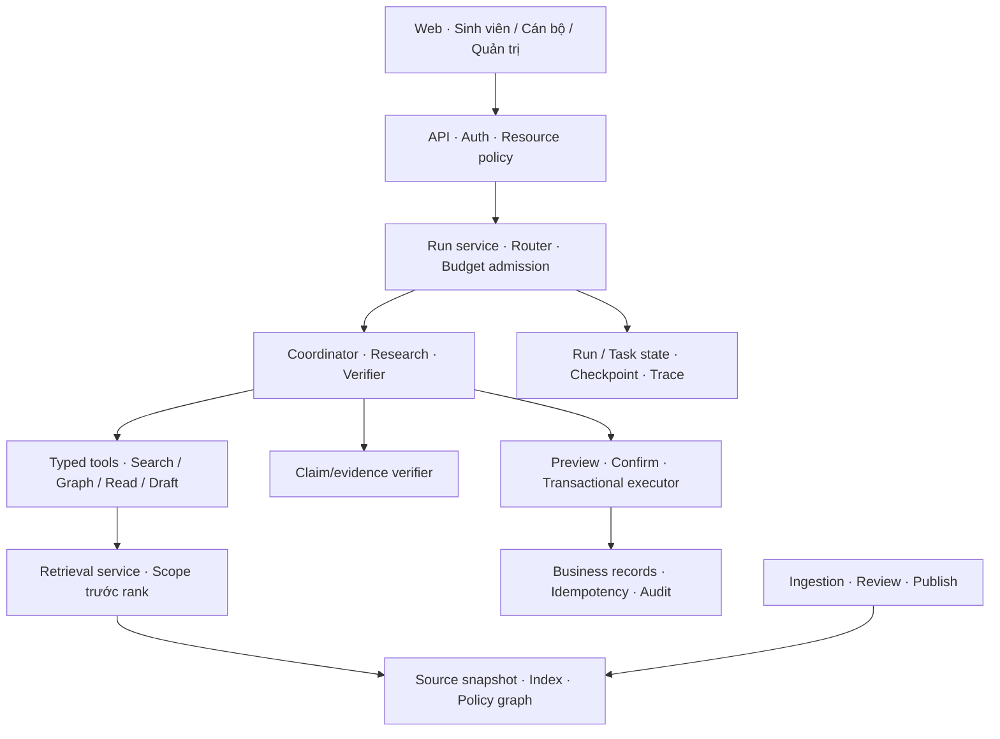

# Kiến trúc và hợp đồng chung cho các chặng 2–7

Ngày: 13/10/2026. Trạng thái: thiết kế đề xuất. [Điều hướng và thời gian](README.md).

Phạm vi hiện hành: [chặng 2–3–4 gộp, multi-agent tích hợp](02_MULTI_AGENT_INTEGRATED.md). Single-agent không còn là chặng/đường xử lý phải xây riêng; scope và acceptance so sánh trong tài liệu cũ đã được thay bằng kiểm chứng hệ thống được chọn.

## 1. Kiến trúc mặc định

Tiếp tục dùng web Next.js, API FastAPI, backend chia module, PostgreSQL/pgvector và worker nhập tài liệu. LangGraph phục vụ điều phối và trạng thái; Redis chỉ dùng khi cần cache/admission control. Có thể tái thiết kế implementation nếu cách khác đạt mục tiêu tốt hơn, với chuyển tiếp và dữ liệu được bảo toàn.

Model chỉ sinh đề xuất/đầu ra có cấu trúc. Application kiểm tra schema, quyền, điều kiện, ngân sách và thực thi. Không biến model output, memory hoặc phản hồi của tác tử khác thành trusted context.

## 2. Quan sát code hiện có

- `services/api/src/campus247/agent/graph.py`: graph hiện có nhánh retrieval, write preview/confirmation và handover; kiểm tra wiring thực khi triển khai.
- `services/api/src/campus247/agent/state.py`: có `AgentState`, `DraftResponse`, `ConfirmationContext`, `ExecutionContext` và terminal classes để tham khảo hoặc adapter.
- `services/api/src/campus247/application/retrieval/canonical.py`: canonical retrieval có typed context, runtime binding và bounded candidates.
- `services/api/src/campus247/ports/retrieval.py`: một port đơn giản hiện chỉ nhận text/top-k; không đủ để tự chứng minh giữ scope và provenance ở hệ thống mới.
- `docs/HUCE_PUBLIC_HYBRID_ACTIVATION_20261013.md`: bằng chứng local lịch sử, không thay phép đo của implementation mới.

Đường public và canonical hiện có thể khác nhau. Trước khi hợp nhất, đo cả hai và xác định đường thực sự đang phục vụ. Dùng adapter qua service chung hoặc implementation mới có version; không suy ra thống nhất từ tên class.

[Kiểm kê chặng 1](../CERTIFICATE_STAGE1_INVENTORY_20261013.md) đang định hướng hồ sơ local qua SQLite transaction port, với runtime hồ sơ tách gateway paid. Đối chiếu implementation mới trước khi chọn persistence của các chặng sau. SQLite là phương án hợp lệ cho demo nếu đạt transaction, isolation, resume và benchmark mục tiêu; PostgreSQL/pgvector vẫn là hướng nền tảng khi môi trường phù hợp. Không chuyển database chỉ để đồng nhất tên stack hoặc làm mất dữ liệu hồ sơ/lịch sử đang có.

## 3. Ngữ cảnh đáng tin cậy và hợp đồng

### 3.1. RunContext — do server tạo

| Nhóm trường | Nội dung |
|---|---|
| Identity | Actor/session, role và resource policy reference |
| Scope | Campus, audience và phạm vi tri thức được phép |
| Snapshot | Corpus/index/model/config version, thời điểm xét hiệu lực |
| Resources | Deadline, token/call/cost ceilings và ledger reference |
| Correlation | Run ID, conversation ID, request ID và trace ID |

LLM không ghi các trường này. Không lưu token/secret trong checkpoint. Mỗi tool call và resume phải kiểm tra quyền hiện tại; snapshot quyền lúc bắt đầu không cấp quyền vĩnh viễn.

### 3.2. EvidenceRecord — bằng chứng kiểm tra được

Trường tối thiểu: evidence ID, source/document-version ID, chunk/parent ID, excerpt gốc, locator, checksum, hiệu lực, đối tượng áp dụng, trạng thái publication và lý do đủ điều kiện truy cập.

Metadata sinh thêm để tìm kiếm được tách khỏi excerpt. Graph edge hoặc contextual summary phải dẫn về source record; nội dung đó không tự trở thành bằng chứng.

### 3.3. ClaimRecord và CoverageItem

- Claim: phát biểu đề xuất, evidence IDs, điều kiện/phạm vi, verdict và reason code.
- Coverage: câu hỏi con, thông tin bắt buộc, bằng chứng đã có, phần thiếu, trạng thái `supported / missing_user_fact / missing_source / conflicting / out_of_scope`.
- Evidence đầy đủ cho một phần không chứng minh toàn bộ câu hỏi đã được giải quyết.
- Điểm tự đánh giá của model là tín hiệu cần kiểm tra, không phải xác suất đúng đã được hiệu chuẩn.

### 3.4. ToolResult và ActionProposal

Tool result có status, data đã validate, source refs, error code và usage. Cho phép `partial`, `denied`, `unavailable`, `invalid_output`; không dùng chuỗi tự do để suy ra đã thành công.

Action proposal có loại nghiệp vụ, payload chuẩn hóa, trường thiếu và preview reference. Actor/scope, confirmation binding, payload hash và idempotency do server xác lập.

### 3.5. Terminal result

Map kết quả mới về hợp đồng UI/SSE đang phục vụ: grounded answer, clarification, safe refusal, handover notice, action preview/result hoặc system error. Version hóa nếu phải mở rộng; có adapter và contract tests để không làm UI hiểu lỗi thành thành công.

## 4. Dữ liệu và trạng thái đề xuất

| Nhóm record | Trách nhiệm |
|---|---|
| AgentRun | Mục tiêu, cấu hình, status, budget usage, timestamps |
| AgentTask | Phụ thuộc, lease/version, attempt, trạng thái và output reference |
| Evidence/Claim/Coverage | Bằng chứng và kết quả kiểm chứng theo run/snapshot |
| Checkpoint | Trạng thái đủ để tiếp tục, schema version, node cursor |
| SourceVersion/IndexManifest | Nguồn, checksum, hiệu lực và fingerprint lập chỉ mục |
| PolicyNode/PolicyEdge | Quan hệ tri thức có bằng chứng và review state |
| BusinessPreview/Request | Bản nháp, xác nhận, hồ sơ và lịch sử |

Tên bảng là đề xuất, tái sử dụng schema hiện có nếu phù hợp. Không bắt buộc tạo bảng cho từng type nếu một cấu trúc đơn giản vẫn kiểm chứng được. Tránh ghi raw transcript vào trace; tách dữ liệu nghiệp vụ theo quyền.

State machine run: `created → running → waiting_user/waiting_staff → running → completed/partial/failed/cancelled`. Cancellation kết thúc việc điều phối; không xóa hồ sơ hay đảo một thao tác đã commit.

## 5. Persistence và resume

Chọn persistent checkpointer tương thích LangGraph hoặc orchestration store có giao diện tương đương đã kiểm chứng. Custom class có hàm save/load không tự chứng minh tương thích checkpoint protocol. Kiểm tra thread/run isolation, serialization, crash recovery và schema evolution.

LangGraph phân biệt checkpointer theo thread với store dùng dữ liệu dài hạn. Thiết kế này giữ memory hội thoại, tri thức và dữ liệu nghiệp vụ tách trách nhiệm. [Persistence](https://docs.langchain.com/oss/python/langgraph/persistence).

Khi dùng interrupt, node có thể chạy lại phần trước điểm interrupt lúc resume. Đặt side effect trong executor có idempotency; kiểm tra lại actor, payload và hiệu lực xác nhận. [Interrupts](https://docs.langchain.com/oss/python/langgraph/interrupts).

## 6. API/UI và observability

Mở rộng API hiện có trước khi tạo endpoint mới. Nếu cần, nhóm run API hỗ trợ bắt đầu, xem trạng thái, tiếp tục, hủy và stream events; không hard-code prefix khi chưa đối chiếu bootstrap/OpenAPI.

Events đề xuất: run started, task status, evidence coverage, clarification required, action preview, terminal result. Dùng allowlist payload, sequence ID và terminal persistence; reconnect không tạo lượt nghiệp vụ mới. UI hiển thị kế hoạch/task/tool result có cấu trúc, không hiển thị chain-of-thought.

Trace liên kết run/task/tool, duration, queue time, input/output tokens, candidate/source IDs, verdict và outcome. Ghi model/prompt/corpus/config fingerprints. Cost từ usage/ledger thật; thiếu usage ghi `unknown`, không mặc định bằng 0.

## 7. Quy trình thay thế implementation

1. Ghi baseline code/runtime đang dùng, các path dirty và dữ liệu đang phục vụ.
2. Chọn refactor tại chỗ bằng patch hoặc xây service/namespace mới; giữ scope disjoint với công việc khác.
3. Tạo migration additive hoặc adapter cho schema/checkpoint đang tồn tại.
4. Chạy contract, quyền, provenance và kiểm chứng chức năng/chất lượng trong môi trường được xác minh.
5. Chuyển cấu hình/active pointer ở môi trường local thuộc phạm vi đã cho phép, có previous pointer và receipt.
6. Giữ implementation, dữ liệu và evidence cũ; việc xóa/quarantine thêm chỉ làm khi đúng thẩm quyền và target protocol.

Không giữ bug chỉ vì code cũ đã có, cũng không dùng viết lại làm lý do mất lịch sử. Khi phương pháp mới chưa đủ bằng chứng, tiếp tục phục vụ đường đã kiểm chứng hoặc trả trạng thái hạn chế rõ ràng.

## 8. Tiêu chí xuyên suốt

Zero observed unauthorized access/side effect trong các kiểm thử đã chạy; mọi hành động cần xác nhận; provenance và source hash khớp; scope được áp lại trên retry/subquery/cache/resume; false success bị chặn; giới hạn tài nguyên không bị model vượt qua. Báo cáo phạm vi kiểm thử thay vì tuyên bố bảo đảm tuyệt đối từ mẫu hữu hạn.
