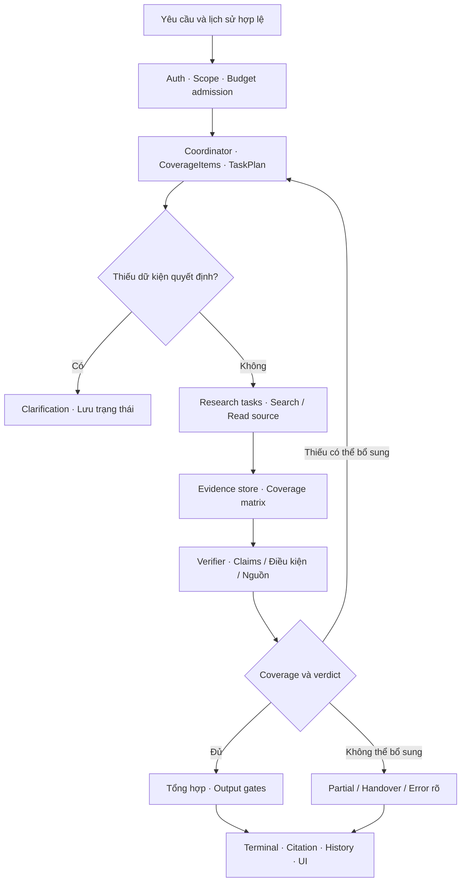

# Chặng 2–3–4 gộp — Multi-agent tích hợp

Ngày: 13/10/2026. Trạng thái: thiết kế để triển khai, chưa phải nghiệm thu. [Điều hướng](README.md). [Prompt tiếp tục chat](PROMPT_MULTI_AGENT_INTEGRATED_20261013.md).

## 1. Phạm vi đã đổi

Người dùng trực tiếp yêu cầu dùng multi-agent ngay, bỏ so sánh và gộp chặng 2–3–4. Chặng gộp triển khai Coordinator/Research/Verifier cùng coverage, corrective retrieval, DAG, persistence/resume, admission control, cache và observability. Các chặng 5–7 giữ số tham chiếu hiện có.

Không có đầu ra single-agent riêng, router chọn Advanced/single/multi, benchmark so sánh hoặc ablation bắt buộc. Nền Advanced RAG, corpus/index và evidence đã có tiếp tục được tái sử dụng. Đánh giá chất lượng, nguồn, quyền, lỗi, độ trễ và usage của hệ thống đang phục vụ vẫn cần thực hiện.

Multi-agent ở đây là kiến trúc của ứng dụng Campus 24/7. Điều này không tự cấp quyền tạo Codex subagent hoặc chat mới. Tái sử dụng code đang viết dở trong chat chặng 2 bằng patch có thể review; bảo toàn dữ liệu và mọi thay đổi có sẵn.

## 2. Luồng và vai trò

| Vai trò | Trách nhiệm | Ranh giới |
|---|---|---|
| Coordinator | Hiểu yêu cầu, tạo coverage/task DAG, phân công, chọn tìm tiếp/hỏi rõ/tổng hợp/dừng | Đề xuất kế hoạch typed; application validate trước dispatch |
| Research | Lập truy vấn theo mục tiêu con, search/read, giữ provenance, tìm bổ sung khi có khoảng trống cụ thể | Scope/publication/as-of/bounds áp lại ở mỗi tool |
| Verifier | Đối chiếu claims với nguồn gốc, điều kiện, số/đơn vị/phủ định, phát hiện mâu thuẫn và phần thiếu | Mở source refs thật; verdict có schema; không duyệt hồ sơ nghiệp vụ |
| Service adapter | Chuẩn bị draft/preview của luồng giấy xác nhận đã có khi người dùng yêu cầu | Giữ auth, confirmation, idempotency và audit; mở rộng nghiệp vụ ở chặng 6 |

Các vai trò có thể dùng chung model nền nhưng có context, prompt, hợp đồng đầu ra và tool allowlist riêng. Kế hoạch và vòng tìm bổ sung thay đổi theo yêu cầu/evidence thực tế. Không chứng minh multi-agent chỉ bằng tên node hoặc một chuỗi prompt cố định. Câu đơn giản có thể chỉ cần một Research task và Verifier; không fan-out vô ích. Câu nhiều vấn đề được chia task độc lập khi tài nguyên cho phép. Điều hướng hệ thống và xử lý hồ sơ vẫn qua các service xác định hiện có.

## 3. Hợp đồng và bằng chứng

Tái sử dụng [kiến trúc chung](00_SHARED_ARCHITECTURE.md) với RunContext do server tạo, EvidenceRecord, ClaimRecord, CoverageItem, ToolResult và ActionProposal. Coverage phân biệt supported, missing_user_fact, missing_source, conflicting và out_of_scope. Điểm rank hoặc lời agent khác không tự chứng minh một claim đúng.

Logical tools: search_knowledge, read_source, inspect_evidence và prepare_service_draft nếu service được cấp quyền. Không mở network/browser/code execution tùy ý cho model. Evidence giữ source/version/chunk/parent/locator/hash, excerpt gốc, publication, đối tượng và hiệu lực. Metadata/FAQ/contextual summary chỉ là tín hiệu tìm kiếm.

Question understanding giữ điều kiện, phủ định, thời điểm và tham chiếu hội thoại. Assistant history không là nguồn quy định hoặc quyền. Topic switch không mang nguồn chủ đề cũ sang kết luận mới. Đọc đầy đủ parent khi child chỉ có một phần của tập điều kiện; không diễn đạt điều kiện cần thành điều kiện đủ.

## 4. DAG, controller và tài nguyên

TaskPlan có task ID, goal, role, dependency IDs, allowlisted tools, evidence refs, status, attempt, lease/version và deadline. Validator chặn cycle, dependency không có, task trùng/vượt cap, tool ngoài quyền và output sai schema.

Điều phối thích ứng diễn ra trong multi-agent: chọn số Research task, fan-out hay tuần tự, parent cần đọc, lượt tìm bổ sung và thời điểm dừng. Query/evidence fingerprints phát hiện lặp; thiếu progress dừng sau bound đã chọn trên dev. Task partial/failed không bị tổng hợp thành thành công đầy đủ.

Admission và reservation dùng budget chung cho toàn run, gồm Coordinator, Research, Verifier, synthesis và retry. Không nhân ceilings theo số agent. Kiểm tra call/token/cost/native/concurrency/deadline headroom trước dispatch; reconcile usage thật và giữ uncertain reservations theo ledger hiện hành. Thiếu telemetry ghi unknown. Cache gắn scope, source/index/model/config/version/as-of và kiểm lại quyền/publication trước hit.

## 5. Persistence, tích hợp và chuyển tiếp

Lưu run/task state, coverage/evidence refs, claims/verdict, cursor và usage reservations. Checkpoint không chứa secret hoặc raw prompts. Lease/CAS giữ một worker nhận task tại một thời điểm. Resume revalidate actor/session/scope/source state và phân biệt task chưa chạy, đang chạy hoặc đã có kết quả. Cancellation dừng điều phối, không xóa hồ sơ hoặc đảo business effect đã commit.

Giữ API/SSE/citation/history compatibility qua adapter. Stream trạng thái/task/source/coverage cần thiết bằng payload allowlist; không hiển thị chain-of-thought. Terminal được lưu để reload/reconnect không tạo run hoặc hồ sơ mới ngoài ý muốn. Domain rules ở application/domain, không đặt trong route hoặc UI.

Code đang viết dở ở application/single_agent và sqlite_agent_runs.py được kiểm tra trước khi tái sử dụng làm hợp đồng chung hoặc worker. Tên cũ không ép xây single-agent riêng. Không xóa/di chuyển hàng loạt code đang có để đổi tên; có thể dùng module mới và adapter. Chuyển cấu hình local có previous pointer/receipt và phương án phục hồi; giữ implementation, database, guard và evidence cũ.

## 6. Work packages và thời gian

| Gói | Công việc | Giờ Codex dự kiến |
|---|---|---:|
| M234-01 | Kiểm kê code dở, wiring, runtime/ledger, scope và hợp đồng | 4–8 |
| M234-02 | Coverage, typed tools, source readback và Research tìm bổ sung | 6–12 |
| M234-03 | Coordinator, task DAG, workers, Verifier và synthesis | 8–16 |
| M234-04 | Admission, reservation, deadline/no-progress/cancel và cache | 6–12 |
| M234-05 | Persistence/lease/retry/resume, API/SSE/history/UI | 5–10 |
| M234-06 | Kiểm chức năng/nguồn/lỗi, build, runbook và bàn giao | 7–12 |

Tổng envelope **36–70 giờ Codex hoạt động**, giữ tổng ước lượng cũ trước hiệu chỉnh. Đây không phải thời gian đã làm hoặc SLA. Kiểm kê phần đã viết và phần so sánh đã bỏ để cập nhật estimate còn lại; ghi active/external wait/calendar riêng theo README.

## 7. Acceptance

1. Đường hỏi đáp quy định thực sự sử dụng Coordinator/Research/Verifier với hợp đồng riêng; trace cho thấy phân công và quyết định phụ thuộc yêu cầu/evidence, không chỉ tên node.
2. Câu đơn nguồn, nhiều nguồn và follow-up giữ điều kiện/scope/topic. Có ca lượt đầu thiếu nguồn rồi tìm bổ sung có ích; trace chứng minh search/read tool thật được gọi và source hash đọc lại đúng.
3. Câu nhiều vấn đề tạo DAG hợp lệ; task độc lập chạy song song khi resource profile đủ. Task có dependency đợi đúng kết quả; output/tool/DAG giả bị chặn trước effect.
4. Verifier đối chiếu nguồn gốc; hai agent đồng ý với diễn giải sai không làm claim vượt evidence gate. Thiếu user facts sinh clarification; thiếu nguồn/mâu thuẫn khác với timeout/provider/tool failure.
5. Loop/no-progress, call/token/cost/native/deadline exhaustion và cancel kết thúc đúng; reservations đồng thời không vượt cap, kể cả retry và synthesis.
6. Crash/restart/reload/reconnect giữ terminal/task/evidence và không lặp business effect. Resume/cache/retry áp quyền và source eligibility hiện tại, không dựa vào role cũ trong checkpoint.
7. UI mở citation đúng nguồn/locator/hash, hiển thị tiến độ/clarification/partial/error hữu ích; luồng giấy xác nhận chặng 1 và confirmation/history không bị hồi quy. Giữ yêu cầu bỏ nhãn demo/mô phỏng khỏi giao diện và bản giấy xác nhận.
8. Ghi kết quả từng ca, failed/skipped/not_verified, fingerprint, cost/latency thật hoặc unknown, thời gian Codex và phạm vi kiểm chứng. Không cần kết quả so sánh hoặc ablation để nghiệm thu chặng này.

Doubles kiểm schema/control flow/concurrency/fault; source checks dùng tài liệu thật; live generation chỉ trong ngân sách đã xác minh. Không gọi replay/cache/double là fresh live multi-agent. Nếu thiếu tài nguyên cho acceptance live, triển khai và kiểm phần độc lập trước, giữ runner sẵn và báo rõ phần chưa đo/nguồn lực cần bổ sung; không tự tăng cap hoặc tuyên bố completed khi còn tiêu chí chưa qua.

## 8. Bàn giao

Implementation local chạy được; runtime receipt/config và phương án phục hồi; runbook; trace/source/usage evidence mới; báo cáo đạt/chưa đạt theo acceptance. Bộ schema/tools/evidence/task/resume này là đầu vào chặng 5 và 6. Chặng 7 đánh giá chất lượng cuối và vận hành của hệ thống đã chọn, không yêu cầu xây lại các kiến trúc để so sánh.
