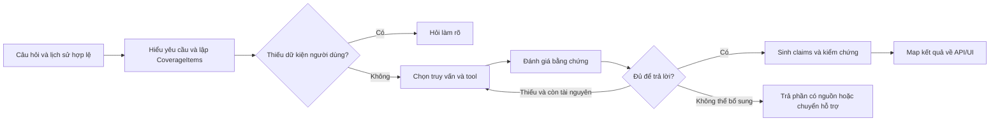

# Chặng 2 — Single-agent RAG với ma trận bằng chứng

> **Tham khảo thiết kế cũ:** Theo yêu cầu trực tiếp ngày 13/10/2026, chặng 2–3–4 đã gộp thành [Multi-agent tích hợp](02_MULTI_AGENT_INTEGRATED.md). Các kỹ thuật coverage/tìm lại/verification ở đây có thể tái sử dụng trong Research/Verifier. Không còn yêu cầu xây single-agent riêng hoặc thực hiện các mục so sánh trong tài liệu này.

Ngày: 13/10/2026. Trạng thái: thiết kế. Ước lượng: **12–24 giờ Codex hoạt động**, trước dự phòng. [Kiến trúc chung](00_SHARED_ARCHITECTURE.md).

## 1. Mục tiêu và đầu vào

Một agent có thể phân tích câu hỏi, chọn công cụ truy hồi, đánh giá phần còn thiếu, tìm bổ sung và trả lời với nguồn. Vòng lặp có quyết định dựa trên kết quả thực tế; không chỉ nối một chuỗi prompt cố định.

Đầu vào cần có: corpus/index được xác minh, retriever giữ scope, source readback, gateway có usage/deadline, history có ownership và dataset phát triển ban đầu. Nếu một phần chặng 1 còn thiếu, sửa phần nền liên quan trước; việc này được tính riêng.

## 2. Luồng đề xuất

## 3. Thiết kế chi tiết

### 3.1. Hiểu câu hỏi và hội thoại

Tạo goal và câu hỏi con; giữ thời điểm, đối tượng, điều kiện và phủ định. Rewrite câu nối tiếp dựa trên thông tin user đã cung cấp. Topic switch không kéo nguồn của chủ đề trước. Assistant history chỉ giúp hiểu hội thoại, không là nguồn quy định hoặc quyền truy cập.

Trường hợp hỏi giới thiệu hoặc điều hướng dùng nội dung hệ thống. Câu hỏi quy định cần source evidence. Nếu thiếu loại học bổng, khóa học hoặc thời điểm áp dụng mà kết luận phụ thuộc dữ kiện đó, hỏi rõ trước.

### 3.2. Toolset

| Công cụ | Mục đích | Kiểm tra tại server |
|---|---|---|
| search_knowledge | Tìm đoạn được phép | Scope, hiệu lực, publication, bounds |
| read_source | Mở parent/điều khoản gốc | Source ownership, version và hash |
| inspect_evidence | Kiểm coverage/claim | Input schema, evidence refs và limits |
| prepare_service_draft | Đề xuất bản nháp nếu chặng 1 hỗ trợ | Chỉ dùng service đã cấp quyền; chưa gửi hồ sơ |

Tên là logical tool ID, không bắt buộc endpoint. Không mở browser/network/code execution tùy ý cho model. Search adapter cung cấp evidence typed; rank score không được xem là mức đúng của phát biểu.

### 3.3. Evidence coverage và finding bổ sung

Lập matrix theo câu hỏi con. Chọn tìm tiếp nếu có phần thiếu cụ thể và một truy vấn có khả năng bổ sung; đọc đầy đủ parent nếu child chỉ nêu một điều kiện trong danh sách. Một điều kiện thuộc tập điều kiện cần không được diễn đạt thành đủ.

Giữ provenance qua truy vấn mới, merge và deduplicate. Metadata contextual/FAQ chỉ là tín hiệu tìm. Nếu nguồn mâu thuẫn, ưu tiên xác định phạm vi/hiệu lực; không tự chọn nguồn có score lớn nhất để kết luận.

### 3.4. Loop controller

Agent đề xuất `search / read / clarify / answer / handover`; controller validate quyết định. Có cap vòng lặp, candidate, context, model calls và deadline trong budget profile hiện hành. Nếu profile chưa đủ cho một kế hoạch, thu hẹp tác vụ hoặc trả trạng thái rõ; không tự nâng ceilings.

Fingerprint truy vấn và evidence set giúp phát hiện lặp. Nếu bước mới không bổ sung nguồn/điều kiện sau giới hạn đã chọn trên dev, dừng. Tái tạo câu trả lời chỉ dùng phần ngân sách còn lại và cùng evidence scope.

### 3.5. Generation và verification

Sinh các claims có evidence refs và điều kiện. Kiểm xác định cho numeric/unit/comparator/negation khi có thể; kiểm semantic có schema và failure rõ. Với phần chưa được hỗ trợ, sửa claim, tìm bổ sung hoặc loại khỏi câu trả lời. Model verifier không là sole gate cho quyền hay thực thi nghiệp vụ.

## 4. Tích hợp và code dự kiến

- Application conversation: understanding, coverage planning và topic/reference handling.
- Application retrieval: typed search result, source readback và material/semantic support.
- Agent layer: loop/subgraph và terminal adapter.
- Presentation: stream trạng thái và clarification theo hợp đồng hiện tại.
- Infrastructure: checkpoint/trace/usage adapter nếu cần.

Có thể tạo module mới thay graph hiện tại nếu giảm coupling, nhưng giữ API/history/citation compatibility bằng adapter. Không biến routes/UI thành nơi xử lý domain rules.

## 5. Work packages và thời gian

| Gói | Công việc | Giờ Codex |
|---|---|---:|
| S2-01 | Kiểm wiring, hợp đồng và baseline cần dùng | 2–4 |
| S2-02 | CoverageItems, query planning và đọc nguồn | 3–6 |
| S2-03 | Agent loop, verifier, budget/stop handling | 4–8 |
| S2-04 | UI/API integration và kiểm chứng phát triển | 3–6 |

Các khoảng cộng thành 12–24 giờ, chưa tính chờ bên ngoài hoặc phần nền chặng 1.

## 6. Acceptance và kiểm chứng

- Câu đơn nguồn, nhiều nguồn và câu nối tiếp giữ đúng điều kiện.
- Trong ít nhất một kịch bản, lượt tìm đầu thiếu bằng chứng và agent chọn được lượt bổ sung có ích; trace cho thấy tool thật được gọi.
- Câu thiếu dữ kiện sinh clarification; câu không có source không tạo quy định giả.
- Phân biệt sự thiếu nguồn với timeout/model failure.
- Query lặp/no-progress, budget hết và hủy run kết thúc đúng.
- Source readback/hash và quyền vẫn đúng sau retry.
- History/terminal result phục hồi sau reload; resume không dựa vào role từ checkpoint cũ.
- So sánh với Advanced RAG cùng corpus/model/dev questions; báo cost/latency và cả kết quả không cải thiện.

Doubles kiểm schema/control flow; retrieval/source checks dùng nguồn thực; live generation chỉ dùng phạm vi/ngân sách đã xác minh. Evidence có config fingerprint, từng câu và verdict, không chỉ tổng pass.

## 7. Chuyển tiếp và rủi ro

Đường agent là cấu hình riêng ban đầu, giữ đường Advanced đã kiểm chứng. Nếu agent loop không tạo lợi ích, sửa cách lựa chọn hành động hoặc phục vụ câu đơn giản bằng đường ngắn. Không thay gold hoặc ngưỡng để quảng bá cải thiện.

Thiết kế lấy cảm hứng từ adaptive retrieval; không tuyên bố tái hiện classifier huấn luyện trong Adaptive-RAG chỉ vì có router. [Adaptive-RAG](https://aclanthology.org/2024.naacl-long.389/).

Đầu ra cho chặng 3: evidence/coverage/tool schemas, reusable search tools, single-agent run có trace, baseline và những failure cần phối hợp nhiều tác tử để giải quyết.
