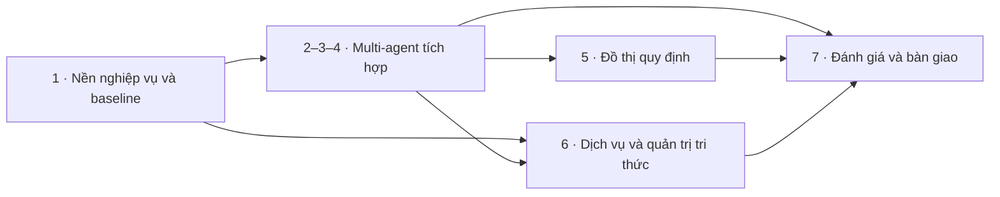

# Thiết kế và thực hiện các chặng tiếp theo — Campus 24/7

Ngày: 13/10/2026. Trạng thái: thiết kế để triển khai; chưa phải báo cáo nghiệm thu.

## 1. Mục tiêu đã chốt và chỉ dẫn mới

Kế hoạch gốc: [GRADUATION_PROJECT_PLAN_20261013.md](../GRADUATION_PROJECT_PLAN_20261013.md).

Giữ mục tiêu: nền tảng dịch vụ đại học cho một trường, ba nhóm người dùng, hai nghiệp vụ xin giấy xác nhận/phúc khảo và hỗ trợ chung; kết hợp Advanced RAG, agent, multi-agent, đồ thị quy định có bằng chứng và đánh giá độc lập. Dùng tài liệu công khai cùng dữ liệu cá nhân/vận hành mô phỏng trong phạm vi hiện tại.

Cập nhật trực tiếp ngày 13/10/2026: “tôi muốn dùng multi agent luôn, ko cần so sánh nữa, gộp chặng 2-3-4 lại và viết prompt để chạy lại đoạn chat đang làm chặng 2”. Phạm vi hiện hành là [chặng multi-agent tích hợp](02_MULTI_AGENT_INTEGRATED.md). Không xây single-agent thành một sản phẩm/chặng riêng hoặc yêu cầu benchmark so sánh/ablation. Giữ kiểm chứng chất lượng, nguồn, quyền, lỗi và tài nguyên. [Prompt tiếp tục chat hiện có](PROMPT_MULTI_AGENT_INTEGRATED_20261013.md).

Chỉ dẫn trực tiếp của người dùng khi yêu cầu bộ thiết kế này:

> “viết tài liệu thiết kế các chặng tiếp theo; thời gian làm tính bằng thời gian codex làm; thực hiện theo kế hoạch đã chốt, có thể đập đi xây lại miễn là đáp ứng mục tiêu, cho phép bạn có quyền linh hoạt làm”

Codex được chủ động chọn phương pháp, refactor, thiết kế lại module hoặc xây implementation thay thế khi cần để đạt mục tiêu. Không bắt buộc giữ một cấu trúc code kém phù hợp. Các lựa chọn dưới đây là mặc định kỹ thuật có thể điều chỉnh với bằng chứng; không tạo vòng phê duyệt tài liệu/task mới.

Quyền linh hoạt về kỹ thuật giữ nguyên ranh giới bảo toàn dữ liệu và bảo mật. Việc thay thế code được thực hiện bằng patch có thể review, implementation/namespace mới và chuyển tiếp có thể phục hồi. Yêu cầu này không xác nhận danh sách đích phá hủy mới, không cho phép reset, xóa dữ liệu, bỏ thay đổi có sẵn, giảm cơ chế bảo vệ hoặc tự tăng quyền paid/production. Sáu file kế hoạch đã lưu trữ vẫn được giữ nguyên.

## 2. Cách đọc và thực hiện

| Tài liệu | Vai trò |
|---|---|
| [00_SHARED_ARCHITECTURE.md](00_SHARED_ARCHITECTURE.md) | Kiến trúc chung, dữ liệu, hợp đồng, chuyển tiếp và observability |
| [02_MULTI_AGENT_INTEGRATED.md](02_MULTI_AGENT_INTEGRATED.md) | Chặng 2–3–4 gộp: Coordinator/Research/Verifier, coverage, DAG, phục hồi và điều phối tài nguyên |
| [PROMPT_MULTI_AGENT_INTEGRATED_20261013.md](PROMPT_MULTI_AGENT_INTEGRATED_20261013.md) | Prompt để tiếp tục chat chặng 2 theo phạm vi mới |
| [02_SINGLE_AGENT_RAG.md](02_SINGLE_AGENT_RAG.md) | Tham khảo kỹ thuật cũ về coverage và tìm lại; không còn chặng single-agent riêng |
| [03_MULTI_AGENT_SYSTEM.md](03_MULTI_AGENT_SYSTEM.md) | Tham khảo kỹ thuật cũ về DAG/roles/resume; scope và acceptance theo chặng gộp |
| [04_ADAPTIVE_ORCHESTRATION.md](04_ADAPTIVE_ORCHESTRATION.md) | Tham khảo kỹ thuật cũ về admission/cache/usage; không còn router so sánh các kiến trúc |
| [05_POLICY_GRAPH_RAG.md](05_POLICY_GRAPH_RAG.md) | Đồ thị quy định theo quan hệ, điều kiện, hiệu lực và nguồn |
| [06_SERVICE_AND_KNOWLEDGE_OPERATIONS.md](06_SERVICE_AND_KNOWLEDGE_OPERATIONS.md) | Service Agent, phúc khảo, hỗ trợ chung và quản trị tri thức |
| [07_EVALUATION_AND_DELIVERY.md](07_EVALUATION_AND_DELIVERY.md) | Đánh giá độc lập, thực nghiệm, kiểm tải, báo cáo và bàn giao |

Chặng 1 đã có [báo cáo bàn giao](../CERTIFICATE_STAGE1_DELIVERY_20261013.md) cho luồng xin giấy xác nhận end-to-end và baseline phát triển trong phạm vi local/synthetic. Khi bắt đầu chặng sau, đối chiếu trạng thái thực tế và sửa phần nền liên quan nếu thiếu; không suy ra production readiness hoặc chất lượng phổ quát từ báo cáo này.

Dùng [bản kiểm kê chặng 1](../CERTIFICATE_STAGE1_INVENTORY_20261013.md), runbook và delivery để đối chiếu contract, SQLite transaction port, identity và UI thực tế. Chat chặng 2 đã có code đang viết dở; kiểm tra và tái sử dụng phần phù hợp, giữ mọi thay đổi/evidence có sẵn.

## 3. Đơn vị thời gian Codex

**Giờ Codex hoạt động** là khoảng thời gian thực tế Codex đang thực hiện công việc: đọc và phân tích, sửa code, chạy công cụ, build/test, kiểm UI, review và sửa lỗi. Thời gian công cụ chạy phục vụ công việc, kể cả model inference và benchmark, thuộc giờ này khi Codex đang theo dõi thực hiện.

Tách riêng:

- `active_elapsed_minutes`: hợp của các khoảng làm việc của Codex chính; không cộng lặp hai tool chạy song song.
- `external_wait_minutes`: chờ trả lời của người dùng, reviewer, quyền truy cập, ngân sách mới hoặc nguồn lực chưa có; không quy đổi thành giờ triển khai.
- `calendar_elapsed_minutes`: thời gian lịch từ lúc bắt đầu đến kết thúc, bao gồm các khoảng chờ.
- `agent_effort_minutes`: tổng khoảng làm việc của từng agent nếu sau này có phân công được cho phép; không dùng số này như thời gian hoàn thành theo đồng hồ.

Mặc định ước lượng cho một Codex làm tuần tự. Không quy đổi tháng công của người sang giờ Codex theo một hệ số giả định. Các khoảng dưới đây là ước lượng kỹ thuật ban đầu, độ tin cậy thấp, chưa được hiệu chỉnh bằng các chặng đã hoàn thành của dự án. Chúng không phải SLA hoặc cam kết chất lượng trong một thời hạn cố định.

## 4. Ước lượng và thứ tự phụ thuộc

| Chặng | Đầu ra chính | Giờ Codex dự kiến | Điều kiện kỹ thuật đầu vào |
|---|---|---:|---|
| 1, phần nền nếu còn thiếu | Xin xác nhận end-to-end, persistence, baseline 40–60 câu | 12–24 | Kiểm kê và xác minh môi trường |
| 2–3–4, gộp | Multi-agent có coverage/tìm lại, DAG/verifier/resume, admission/cache/observability | 36–70 | Retrieval/citation/history, quyền và tài nguyên được xác minh |
| 5 | Graph-assisted RAG cho nhóm quy định đã chọn | 12–24 | Metadata nguồn/hiệu lực và retrieval interface ổn định |
| 6 | Service Agent, phúc khảo, hỗ trợ và tri thức quản trị | 16–30 | Nền nghiệp vụ chặng 1 và điều phối/công cụ đủ điều kiện |
| 7 | Đánh giá chất lượng cuối và bản bàn giao tái lập | 16–32 | Cấu hình multi-agent đóng băng và dataset được kiểm tra |

Tổng các chặng 2–7: **80–156 giờ Codex hoạt động**, trước dự phòng. Với dự phòng 25% cho sửa lỗi và tích hợp: **100–195 giờ**. Nếu chặng 1 còn toàn bộ phần nền: tổng 1–7 khoảng **92–180 giờ**, hoặc **115–225 giờ** gồm dự phòng 25%. Thời gian chờ reviewer/nguồn lực bên ngoài được báo riêng, không ẩn trong các tổng này.

Giữ envelope 36–70 giờ từ tổng ba chặng cũ, chưa hiệu chỉnh cho phần đã làm và các phép so sánh đã bỏ. Khi bắt đầu lại chat, đo phần còn lại rồi cập nhật ước lượng. Giữ số 5–7 cho các chặng sau.

Ước lượng giả định stack hiện có sử dụng được, corpus/model artifact được bảo toàn, không mua hạ tầng mới, không huấn luyện mô hình lớn và đồ thị chỉ bao phủ nhóm thủ tục chọn lọc. Nếu phải tái thiết kế nhiều phần nền, OCR lại nguồn hoặc khôi phục môi trường, tính thêm công việc có căn cứ thay vì giữ tổng bằng mọi giá.



Đồ thị mô tả các agent của ứng dụng Campus 24/7; không tự cấp phép tạo Codex subagent/chat song song. Với một Codex, ưu tiên hoàn thành chặng gộp đang làm; có thể đổi thứ tự 5/6 nếu đầu vào đủ và giảm thời gian chờ.

## 5. Kiểm tra đầu vào, đầu ra và linh hoạt

Mỗi chặng được bắt đầu từ một checklist ngắn: code/runtime thực tế, nguồn và dữ liệu, hợp đồng liên quan, quyền công cụ, ngân sách, tiêu chí cần chứng minh. Đây là kiểm tra kỹ thuật; không yêu cầu trạng thái `ready/accepted` trong catalog cũ.

Codex có thể:

- Gộp hoặc thay module, chọn framework/adapter phù hợp trong các ranh giới hiện có.
- Xây nhánh implementation mới nếu sửa nhánh cũ phức tạp hơn; bảo toàn code và dữ liệu cũ.
- Thay heuristic bằng classifier, đổi chunking/ranking/routing, hoặc bỏ một kỹ thuật không tạo lợi ích sau thực nghiệm.
- Cập nhật hợp đồng nội bộ có version và adapter chuyển tiếp; giữ hành vi nghiệp vụ và quyền truy cập.
- Tách việc ngoài scope thành backlog, tiếp tục phần công việc độc lập.

Các mục tiêu sản phẩm, tính đúng nghiệp vụ, trích dẫn trung thực, xác nhận thao tác và tính trung thực của đánh giá không được đổi để hợp thức hóa kết quả. Phạm vi so sánh kiến trúc đã được người dùng bỏ; giữ baseline/evidence cũ như dữ liệu lịch sử, ghi đúng cấu hình và phạm vi của các kiểm chứng mới.

## 6. Ghi nhận thời gian thực tế

Đề xuất một record cho mỗi công việc, lưu ở vị trí evidence mới trong workspace khi thực hiện:

```json
{
  "work_id": "S2-EVIDENCE-01",
  "stage": 2,
  "objective": "Ma trận bằng chứng và trạng thái thiếu nguồn",
  "status": "planned",
  "estimated_active_hours": [2, 4],
  "started_at_utc": null,
  "finished_at_utc": null,
  "active_elapsed_minutes": null,
  "external_wait_minutes": null,
  "calendar_elapsed_minutes": null,
  "measurement_basis": null,
  "verification_refs": [],
  "remaining_work": []
}
```

Các số thực tế chưa đo giữ `null`. Ghi khoảng bắt đầu/kết thúc, thời gian tạm dừng và nguồn đo; phần không có telemetry đầy đủ được đánh dấu ước lượng. Sau 2–3 công việc đầu, hiệu chỉnh phần còn lại bằng thời gian đã quan sát. Không ghi thời gian thiết kế tài liệu thành thời gian đã triển khai tính năng.

## 7. Bàn giao mỗi chặng

- Implementation có thể chạy và diff có phạm vi rõ.
- Kịch bản thành công, thiếu bằng chứng và lỗi được kiểm chứng đúng mức.
- Source/corpus/model/config fingerprint cùng kết quả từng ca liên quan.
- Thời gian Codex thực tế, phần chờ, chênh lệch ước lượng và nguyên nhân.
- Giới hạn còn lại, cấu hình dùng cho chặng tiếp theo và cách phục hồi.

Kết luận `completed` chỉ khi tiêu chí đã qua. `not_verified`, failure, skip hoặc kết quả âm được giữ trong báo cáo. Nghiệm thu dựa trên hành vi và bằng chứng, không dựa vào số lượng kỹ thuật hay số node trong graph.
